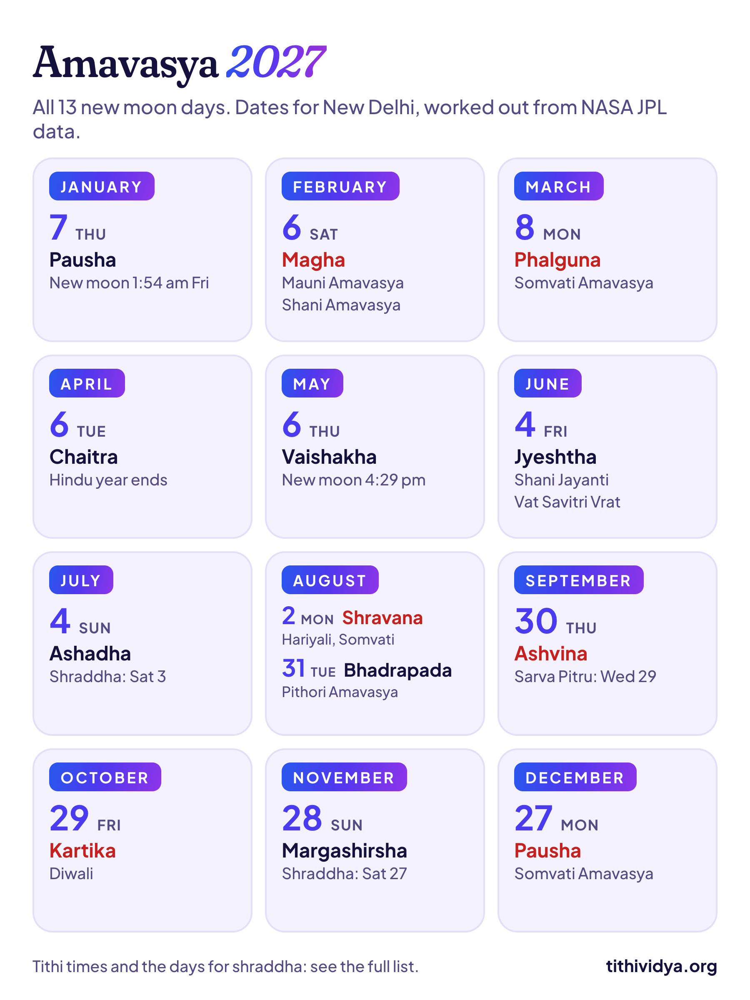
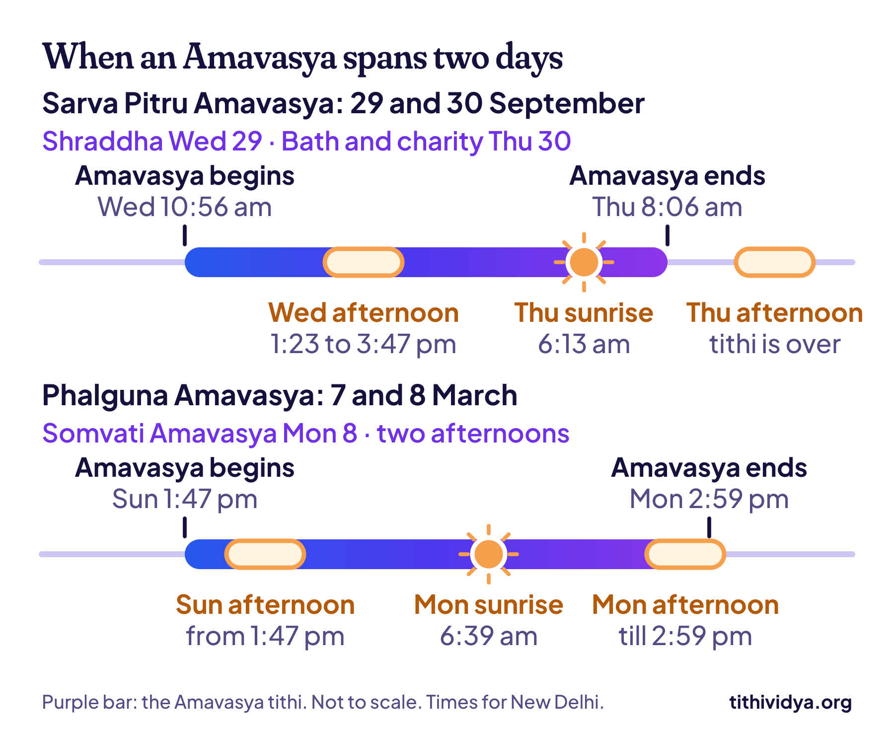

**2027 has 13 Amavasyas, one more than most years.** The first is on Thursday, 7 January, and the last on Monday, 27 December. This Amavasya 2027 list gives the date and time of each one for New Delhi.

Three of them fall on a Monday, which makes them Somvati Amavasya. One falls on a Saturday. And one arrives with a solar eclipse that India can see.

## Amavasya 2027 list: all 13 dates

| Date | Amavasya | Known for |
| --- | --- | --- |
| Thu, 7 Jan | Pausha Amavasya | First of the year |
| Sat, 6 Feb | Magha Amavasya | Mauni Amavasya, Shani Amavasya |
| Mon, 8 Mar | Phalguna Amavasya | Somvati Amavasya |
| Tue, 6 Apr | Chaitra Amavasya | Last day of the Hindu year, Bhaumvati Amavasya |
| Thu, 6 May | Vaishakha Amavasya | No special name |
| Fri, 4 Jun | Jyeshtha Amavasya | Shani Jayanti, Vat Savitri Vrat |
| Sun, 4 Jul | Ashadha Amavasya | Shraddha on Sat, 3 Jul |
| Mon, 2 Aug | Shravana Amavasya | Hariyali Amavasya, Somvati Amavasya |
| Tue, 31 Aug | Bhadrapada Amavasya | Pithori Amavasya, Pola, Bhaumvati Amavasya |
| Thu, 30 Sep | Ashvina Amavasya | Sarva Pitru Amavasya (shraddha on Wed, 29 Sep) |
| Fri, 29 Oct | Kartika Amavasya | Diwali, Lakshmi Puja |
| Sun, 28 Nov | Margashirsha Amavasya | Shraddha on Sat, 27 Nov |
| Mon, 27 Dec | Pausha Amavasya | Somvati Amavasya |

Each date is the day that has Amavasya at sunrise, which is what most calendars print. The month names are the North Indian ones. In the amanta calendar of Maharashtra, Gujarat and the south, each Amavasya belongs to the month before: the Diwali Amavasya is in Ashvina there, not Kartika. The day is the same.

Amavasya is the 30th and last [tithi, or lunar day](/blog/what-is-tithi), of the moon's cycle, when the moon sits between us and the sun and can't be seen.

Why 13? Twelve moon cycles take only about 354 days. The first Amavasya of 2027 comes early, on 7 January, so a thirteenth fits in before the year is out. August gets two: the 2nd and the 31st.

## Amavasya 2027 date and time

An Amavasya is a tithi, not a calendar day, so it begins and ends at odd hours. These times are in IST and hold for all of India.

| Amavasya | Tithi begins | Tithi ends (exact new moon) |
| --- | --- | --- |
| Pausha | Wed 6 Jan, 11:15 pm | Fri 8 Jan, 1:54 am |
| Magha | Fri 5 Feb, 7:06 pm | Sat 6 Feb, 9:26 pm |
| Phalguna | Sun 7 Mar, 1:47 pm | Mon 8 Mar, 2:59 pm |
| Chaitra | Tue 6 Apr, 5:41 am | Wed 7 Apr, 5:21 am |
| Vaishakha | Wed 5 May, 6:17 pm | Thu 6 May, 4:29 pm |
| Jyeshtha | Fri 4 Jun, 4:06 am | Sat 5 Jun, 1:10 am |
| Ashadha | Sat 3 Jul, 12:06 pm | Sun 4 Jul, 8:32 am |
| Shravana | Sun 1 Aug, 7:21 pm | Mon 2 Aug, 3:35 pm |
| Bhadrapada | Tue 31 Aug, 2:42 am | Tue 31 Aug, 11:11 pm |
| Ashvina | Wed 29 Sep, 10:56 am | Thu 30 Sep, 8:06 am |
| Kartika | Thu 28 Oct, 8:49 pm | Fri 29 Oct, 7:07 pm |
| Margashirsha | Sat 27 Nov, 9:08 am | Sun 28 Nov, 8:54 am |
| Pausha | Mon 27 Dec, 12:23 am | Tue 28 Dec, 1:42 am |

**The moment an Amavasya tithi ends is the exact new moon.** The tithi covers the last 12° of the moon's approach to the sun, and it ends when the two line up.

The lengths vary a lot. January's Amavasya runs 26 hours 39 minutes. The one on 1 and 2 August lasts just 20 hours 15 minutes, the shortest tithi of any kind in 2027.

## Somvati, Shani and Mauni Amavasya in 2027

Some Amavasyas carry a special name, from the weekday or the month they fall in.

| Name | What makes it special | 2027 dates |
| --- | --- | --- |
| Somvati Amavasya | Falls on a Monday | 8 March, 2 August, 27 December |
| Shani Amavasya | Falls on a Saturday | 6 February |
| Bhaumvati Amavasya | Falls on a Tuesday | 6 April, 31 August |
| Mauni Amavasya | The Amavasya of Magha | 6 February |
| Sarva Pitru Amavasya | The last day of Pitru Paksha | 29 September |

**Somvati Amavasya** is the one people ask about most, and 2027 has three. Many married women fast that day and walk around a peepal tree 108 times, praying for their husbands' long lives. A year can have none at all, so three is a good count.

**Mauni Amavasya** is the new moon of silence (maun). Many people keep quiet through the morning and bathe in a holy river. It's the biggest bathing day of the Magh Mela at Prayagraj. In 2027 it's also the year's only Shani Amavasya, a day for visiting Shani temples with mustard oil and black sesame.

A note on Saturdays. On 3 July and 27 November the tithi begins on a Saturday morning and covers that afternoon and night, though sunrise falls on Sunday. So some calendars mark those as Shani Amavasya too.

> **Tip:** Not sure which tithi you, or someone you remember, belongs to? [Find my tithi](/find) works it out from a date, time and place. It also lists the date that tithi returns every year.

## Which day for shraddha and tarpan?

Amavasya is the day for remembering ancestors: shraddha, tarpan (offering water) and feeding others in their name. Those rites are done in the afternoon. So the rule changes: what counts is having Amavasya in the afternoon, not at sunrise.

On nine of the 13 Amavasyas, both land on the same date. These four are different:

| Amavasya | Sunrise date (bath, charity) | Afternoon in Amavasya (shraddha, tarpan) |
| --- | --- | --- |
| Phalguna | Mon, 8 Mar | Sun, 7 Mar and Mon, 8 Mar |
| Ashadha | Sun, 4 Jul | Sat, 3 Jul |
| Ashvina (Sarva Pitru) | Thu, 30 Sep | Wed, 29 Sep |
| Margashirsha | Sun, 28 Nov | Sat, 27 Nov |

Take **Sarva Pitru Amavasya**, the most important shraddha day of the year. The tithi begins at 10:56 am on Wednesday, 29 September, and ends at 8:06 am on Thursday. Wednesday's afternoon lies inside it. Thursday's doesn't. So the shraddha is on Wednesday, even though many calendars print Thursday as the Amavasya.

March is the odd one: both afternoons have some Amavasya in them. Sunday's has more. Monday is the sunrise date and the Somvati day. Your family priest will know which your tradition takes.

The afternoon window moves a little with your city's sunrise and sunset. It's the fourth of five equal parts of the daylight hours, so it starts about an hour and a half after local midday.

## What people do on Amavasya

Customs differ from home to home. These are the common ones:

- **A bath at dawn,** in a river if there's one nearby, or at home.
- **Tarpan and shraddha** for parents and grandparents who have passed, in the afternoon.
- **Food for others:** a meal for a priest, the poor, cows or crows, in the ancestors' name.
- **A lamp in the evening,** often under a peepal tree.
- **A fast,** kept by many on Somvati Amavasya. If you're pregnant, diabetic or on medicine, talk to your doctor before a fast.

## Amavasya 2027, month by month

### January to March

**Pausha Amavasya, 7 January.** The year's first, with the longest Amavasya tithi of 2027.

**Magha Amavasya, 6 February.** Mauni Amavasya and Shani Amavasya on one day. There's a solar eclipse too, but not for India (see below).

**Phalguna Amavasya, 8 March.** The first Somvati Amavasya of the year, two days after Maha Shivratri.

### April to June

**Chaitra Amavasya, 6 April.** The last day of the Hindu year. Vikram Samvat 2084 begins the next morning with Chaitra Navratri, Ugadi and Gudi Padwa.

**Vaishakha Amavasya, 6 May.** A quiet one, with no big festival attached.

**Jyeshtha Amavasya, 4 June.** Shani Jayanti, and Vat Savitri Vrat in North India, when married women fast and tie threads around a banyan tree. Maharashtra and Gujarat keep the same vrat on the full moon two weeks later.

### July to September

**Ashadha Amavasya, 4 July.** The tithi runs from 12:06 pm on Saturday to 8:32 am on Sunday, so the afternoon rites are on Saturday.

**Shravana Amavasya, 2 August.** Hariyali Amavasya, the green new moon of the monsoon, when people plant trees and fairs fill parts of Rajasthan and Uttar Pradesh. It's a Somvati Amavasya, and it comes with the year's big solar eclipse.

**Bhadrapada Amavasya, 31 August.** Pithori Amavasya, when mothers pray for their children. In Maharashtra and Chhattisgarh it's Pola, the day farmers thank their bullocks.

**Ashvina Amavasya, 29 and 30 September.** Sarva Pitru Amavasya, also called Mahalaya. It's the shraddha for every ancestor, and for anyone whose tithi of passing isn't known. Navratri begins the next morning.

### October to December

**Kartika Amavasya, 29 October.** Diwali. Amavasya covers the whole evening of Friday, when Lakshmi Puja is done. The darkest night of the month is the night of lamps.

**Margashirsha Amavasya, 28 November.** Afternoon rites on Saturday the 27th.

**Pausha Amavasya, 27 December.** The third Somvati Amavasya, and the second Pausha Amavasya of the calendar year.

> **Read next:** [Purnima 2027 list: all 12 dates, times and fast days](/blog/purnima-list). The other end of the moon's month, with moonrise times.

## Solar eclipses on Amavasya in 2027

A solar eclipse can only happen on an Amavasya, when the moon passes in front of the sun. Two Amavasyas of 2027 have one.

| Amavasya | Eclipse | Seen from India? |
| --- | --- | --- |
| Magha, 6 February | Annular (a ring of sun) | No. It peaks around 9:30 pm IST, when it's night here |
| Shravana, 2 August | Total | As a partial eclipse, in the late afternoon |

The August eclipse is one of the longest total eclipses of the century along its path, from Spain across North Africa to Arabia. From much of India the moon will cover part of the sun before sunset. Never look at it without proper eclipse glasses.

Our calculator doesn't work out eclipses, so this comes from [NASA's table of 2027 eclipses](https://eclipse.gsfc.nasa.gov/OH/OH2027.html). [Wikipedia's page on the 2 August eclipse](https://en.wikipedia.org/wiki/Solar_eclipse_of_August_2,_2027) has the map. For sutak times, check a panchang set to your city.

## Amavasai in South India

In Tamil Nadu the day is Amavasai, and three of them matter most for remembering ancestors. They go by the Tamil solar month:

| Amavasai | 2027 date |
| --- | --- |
| Thai Amavasai | Saturday, 6 February |
| Aadi Amavasai | Monday, 2 August |
| Mahalaya Amavasai | Wednesday, 29 September |

In Kerala, Karkidaka Vavu, the day of Vavu Bali, is also Monday, 2 August.

## Where these dates come from

I worked out every tithi time with Tithi Vidya, which reads the positions of the sun and moon from NASA JPL's [DE440 data](https://ssd.jpl.nasa.gov/doc/de440_de441.html). I've tested it against 92,839 tithi start times from Swiss Ephemeris, and half of them agree within 1.7 seconds. [How it works](/how-it-works) has the method and the code.

The afternoon windows use New Delhi's sunrise and sunset. I checked all 13 dates against a published panchang for New Delhi, and they match. For the customs of each day, [Wikipedia's page on Amavasya](https://en.wikipedia.org/wiki/Amavasya) is a good start.

## Common questions

### How many Amavasyas are there in 2027?

13. Most years have 12, but the first one of 2027 comes early, on 7 January, so a thirteenth fits in on 27 December.

### Amavasya kab hai? When is the next one?

If you're reading this in late 2026, the next Amavasya is on Tuesday, 8 December 2026. After that it's Thursday, 7 January 2027.

### How many Somvati Amavasyas are there in 2027?

Three: Monday, 8 March, Monday, 2 August, and Monday, 27 December.

### When is Mauni Amavasya in 2027?

On Saturday, 6 February 2027. The Amavasya tithi runs from 7:06 pm on Friday to 9:26 pm on Saturday (IST).

### Is Diwali always on Amavasya?

Yes. Diwali's Lakshmi Puja is done on the evening of Kartika Amavasya. In 2027 that's Friday, 29 October.

### Is Amavasya a bad day to start something?

Many families avoid starting new work or holding weddings on Amavasya, and keep the day for prayer and for their ancestors. It's a custom, not a law of nature. India's most joyful night, Diwali, falls on one.

## Keep reading

- [Purnima 2027 list: all 12 dates, times and fast days](/blog/purnima-list): the full moons, with moonrise for four cities.
- [Ekadashi 2027 list: all 25 dates with parana times](/blog/ekadashi-list): every fast day, and when to break each fast.
- [Hindu calendar 2027: all festival dates with tithi](/blog/hindu-calendar): Diwali, Navratri and the rest of the year.
