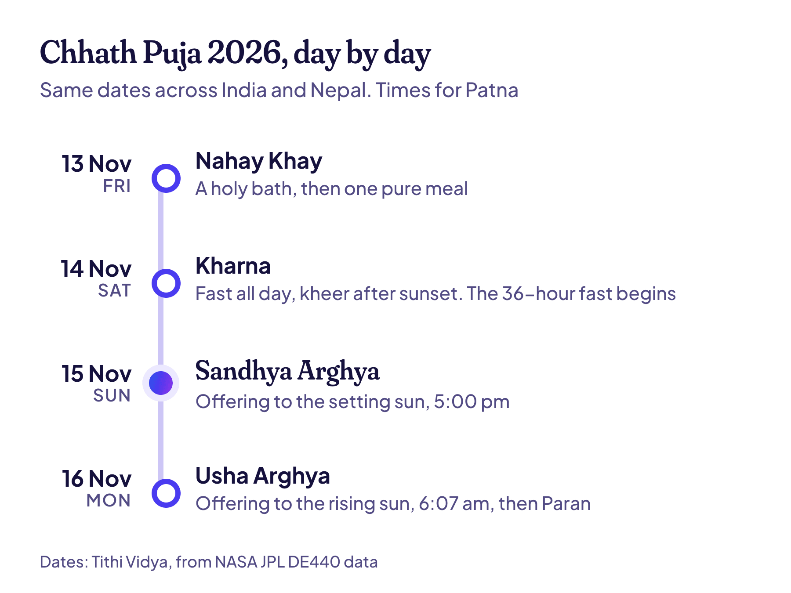

**Chhath Puja 2026 is from Friday, 13 November, to Monday, 16 November.** The main evening arghya is at sunset on Sunday, 15 November: 5:00 pm in Patna. The fast ends with the morning arghya at sunrise on Monday, 16 November, at 6:07 am in Patna.

Notice the order. Most prayers to the sun greet it as it rises. Chhath's biggest moment is an offering to the setting sun, and the sunrise comes the next morning. Times for your city are below.

## Chhath Puja 2026 dates: all four days

| Day | Date | What happens |
| --- | --- | --- |
| 1. Nahay Khay | Friday, 13 November | A holy bath and one pure meal |
| 2. Kharna | Saturday, 14 November | A fast all day, then kheer after sunset |
| 3. Sandhya Arghya | Sunday, 15 November | The offering to the setting sun |
| 4. Usha Arghya | Monday, 16 November | The offering to the rising sun, then the fast ends |

These dates hold across India and Nepal. Each day follows a tithi, or lunar day, and this year no tithi changes anywhere near sunrise, so no region ends up a day apart. If tithis are new to you, [here's what a tithi is, with a picture](/blog/tithi-birthday).

## Chhath arghya time 2026 in your city

Both arghyas are timed by the sun itself: the evening one as it sets on 15 November, and the morning one as it rises on 16 November.

| City | Sunset, Sun 15 Nov | Sunrise, Mon 16 Nov |
| --- | --- | --- |
| Patna | 5:00 pm | 6:07 am |
| Ranchi | 5:03 pm | 6:03 am |
| Varanasi | 5:10 pm | 6:15 am |
| Kolkata | 4:52 pm | 5:49 am |
| Lucknow | 5:15 pm | 6:26 am |
| New Delhi | 5:27 pm | 6:44 am |
| Mumbai | 6:00 pm | 6:46 am |
| Janakpur, Nepal | 5:10 pm | 6:21 am |

The times are in IST, except Janakpur, which is in Nepal time. Each one is the moment the top edge of the sun meets a flat horizon. I worked them out from NASA JPL's [DE440 data](https://ssd.jpl.nasa.gov/doc/de440_de441.html), the same way [Tithi Vidya works out sunrise](/how-it-works).

A real river bank isn't flat, though. Behind trees or buildings, the sun drops out of sight a few minutes before sunset and shows up a few minutes after sunrise. So reach the ghat early, on both days.

## What happens on each day of Chhath

1. **Nahay Khay, 13 November.** The person keeping the fast, called the parvaitin, takes a holy bath, often in a river, and the whole house is cleaned. Then comes one simple, pure meal, usually lauki bhaat: bottle gourd, chana dal and rice, cooked without onion or garlic.
2. **Kharna, 14 November.** A fast through the day, without even water. After sunset, the parvaitin eats kheer made with jaggery, with roti. This meal starts the hardest part: about 36 hours with no food or water.
3. **Sandhya Arghya, 15 November.** The day goes into making prasad, above all thekua, a crisp fried sweet of wheat flour, jaggery and ghee. In the evening the family walks to a river or pond. The parvaitin stands in the water and offers arghya to the setting sun, with thekua and fruit in bamboo baskets.
4. **Usha Arghya, 16 November.** Back to the water before dawn, for the arghya to the rising sun. Then the parvaitin breaks the fast with a little prasad and water. This is called Paran.

Where there's no river nearby, families use a pond, or set up a tank of water at home or on the roof.

## Which tithi is Chhath Puja?

The main day is **Kartika Shukla Shashthi**, the 6th tithi of the bright half of the month of Kartika. That's where the name comes from: chhath simply means "the sixth". The festival is also called Surya Shashthi, and its four days run from Chaturthi, the 4th tithi, to Saptami, the 7th.

This year, Shashthi begins at 11:24 pm on Saturday, 14 November, and ends at 2:01 am on Monday, 16 November (New Delhi time). It covers all of Sunday, sunset included, so there's no doubt about the evening arghya.

Because it follows the moon, Chhath moves every year. It usually comes about a week after Diwali, which is on 8 November in 2026. Kartika isn't done after Chhath, either: [Dev Uthani Ekadashi](/blog/dev-uthani-ekadashi) follows on 20 November, [Tulsi Vivah](/blog/tulsi-vivah) on the 21st and [Kartik Purnima](/blog/kartik-purnima) on the 24th.

| Year | Nahay Khay | Evening arghya | Morning arghya |
| --- | --- | --- | --- |
| 2026 | Fri, 13 Nov | Sun, 15 Nov | Mon, 16 Nov |
| 2027 | Tue, 2 Nov | Thu, 4 Nov | Fri, 5 Nov |
| 2028 | Sat, 21 Oct | Mon, 23 Oct | Tue, 24 Oct |
| 2029 | Fri, 9 Nov | Sun, 11 Nov | Mon, 12 Nov |

See the pattern? The evening arghya comes 11 days earlier in 2027, and 12 days earlier again in 2028. Then 2029 jumps back into November. A lunar year is about 11 days shorter than ours, and every few years an extra month pulls it back into line. [Why Hindu dates move like this](/blog/why-your-hindu-birthday-moves) has the full story.

> **Read next:** [Tithi birthday calculator: 5 things it must get right](/blog/tithi-birthday-calculator). Sunrise is one of them, and it's the same rule that fixes Chhath's dates.

## Why Chhath Puja is celebrated

Chhath gives thanks to **Surya**, the sun god, for life on Earth. It also honours **Chhathi Maiya**, Surya's sister, who is prayed to for the long life and good health of children. So the fast is kept for the children and the whole family. The parvaitin is usually a woman, but men keep it too.

Tradition ties Chhath to both great epics. In one telling, Sita kept the fast after she and Ram returned to Ayodhya. In the Mahabharata, Kunti and Draupadi keep it. [Wikipedia's page on Chhath](https://en.wikipedia.org/wiki/Chhath) has these stories and more.

It's biggest in Bihar, Jharkhand, eastern Uttar Pradesh and southern Nepal, where it's often called the mahaparv, the great festival. Families from there carry it everywhere they settle, so you'll see crowded ghats in Delhi, Mumbai, Kolkata and Kathmandu, and abroad too. In Mithila, another big day comes a month later: [Vivah Panchami](/blog/vivah-panchami), the wedding of Ram and Sita, on 14 December.

## Chhath fasting rules most families keep

- **Purity first.** The prasad is cooked fresh, without onion or garlic, and the arghya prasad without salt.
- **No water from Kharna to Paran.** That's about 36 hours, from the Kharna meal to the morning arghya.
- **The same offerings for everyone.** Rich or poor, families offer much the same things: thekua, sugarcane, coconut, bananas and other seasonal fruit.
- **For some, it's for life.** In some communities, once someone starts keeping Chhath, they keep it every year and pass it on. It's skipped only in a year when the family has had a death.

Every family has its own ways, so the elders' word counts for more than any list. And a 36-hour fast without water is hard on the body. If you're pregnant, diabetic or on medicine, talk to your doctor before a fast.

## Common questions

### Is Chhath Puja on 15 or 16 November 2026?

Both, in a way. The main evening arghya is on Sunday, 15 November, and the morning arghya that ends the fast is on Monday, 16 November. The festival starts two days earlier, with Nahay Khay on Friday, 13 November.

### When is Kharna in 2026?

On Saturday, 14 November. The Kharna meal of jaggery kheer and roti is eaten after sunset that evening.

### Is the Chhath arghya at sunrise or sunset?

Both. The Sandhya Arghya is at sunset on Shashthi, 15 November, and the Usha Arghya is at sunrise on Saptami, 16 November. Chhath honours the sun at both ends of its day, and the evening offering to a setting sun is what makes it stand out among Hindu festivals.

### How many days is Chhath Puja?

Four days and three nights, from Kartika Shukla Chaturthi to Saptami. In 2026, that's from Friday, 13 November, to Monday, 16 November.

### Is Chhath Puja a holiday?

Holidays are set state by state. Bihar and Jharkhand, where Chhath is biggest, usually close offices and schools for it. Check your state's 2026 holiday list for the exact days.

### When is Chhath Puja in 2027?

From Tuesday, 2 November, to Friday, 5 November 2027. The evening arghya is on Thursday, 4 November.

### When is Chaiti Chhath in 2027?

Chhath also comes in spring, in the month of Chaitra, on a smaller scale. In 2027, Chaiti Chhath's evening arghya is on Monday, 12 April, and the morning arghya on Tuesday, 13 April.

> **Tip:** Chhath always falls on the same tithi, and so does your birthday in the Hindu calendar. [Find my tithi](/find) shows yours, and the dates it comes back on for the next 100 years.

## Keep reading

- [Vivah Panchami 2026: date, story and the wedding custom](/blog/vivah-panchami): the next big festival in Mithila, and why some families skip weddings that day.
- [Why your Hindu birthday moves every year](/blog/why-your-hindu-birthday-moves): the same 11-day slide that moves Chhath.
- [Tithi birthday: what it is and how to find yours](/blog/tithi-birthday): tithis explained, with a real example.
