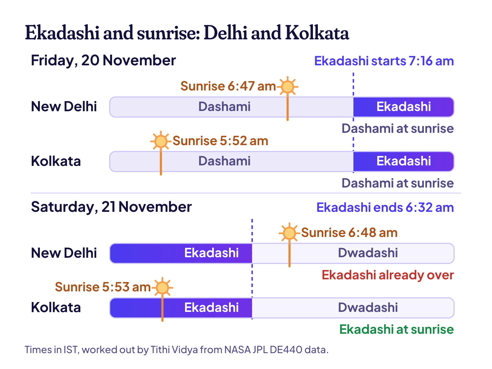

**Dev Uthani Ekadashi 2026 is on Friday, 20 November.** That's the day most families fast. Vaishnava families, including ISKCON, keep it a day later, on Saturday, 21 November. If you fast on Friday, break it on Saturday between 1:11 pm and 3:18 pm (New Delhi time).

So why two dates? This year the Ekadashi tithi slips in between two sunrises. In New Delhi it starts 29 minutes after sunrise on Friday and ends 16 minutes before sunrise on Saturday, so it never touches either one. That small gap is the whole story. Parana times for 12 cities are further down.

## Dev Uthani Ekadashi 2026 date and time

| | Date and time (IST) |
| --- | --- |
| Ekadashi begins | Friday, 20 November, 7:16 am |
| Ekadashi ends | Saturday, 21 November, 6:32 am |
| Fast for most families (Smarta) | Friday, 20 November |
| Fast for Vaishnava families and ISKCON | Saturday, 21 November |
| Parana after a Friday fast | Saturday, 21 November, 1:11 pm to 3:18 pm |
| Parana after a Saturday fast | Sunday, 22 November, 6:49 am to 8:56 am |
| Tulsi Vivah | Saturday, 21 November |

The tithi times are the same everywhere in India. The parana times are for New Delhi, because they depend on your local sunrise.

Dev Uthani Ekadashi, also called Prabodhini Ekadashi, is the Ekadashi (11th lunar day) of Shukla Paksha, the bright half of the moon month of Kartika.

## Why some calendars say 20 November and some 21

A Hindu calendar names each day after the tithi that's running at sunrise. This is called the udaya tithi rule, and it's one of the [five things a tithi calculator must get right](/blog/tithi-birthday-calculator).

But tithis don't line up neatly with days. Each one lasts somewhere between about 20 and 27 hours, depending on how fast the moon is moving. This Ekadashi lasts 23 hours and 16 minutes, so it fits between two sunrises without touching either. A tithi like that is called kshaya, a skipped tithi, and [I've explained how skipped tithis work](/blog/tithi-birthday#skipped-and-doubled-tithis) with another real example.

Look at Saturday morning in the picture. In New Delhi the sun comes up at 6:48 am, 16 minutes after Ekadashi has ended. In Kolkata it comes up at 5:53 am, with 39 minutes of Ekadashi still to run.

So the answer moves with the map. Ekadashi misses both sunrises in Delhi, Mumbai, Jaipur and Ahmedabad. But it's still running at Saturday's sunrise in Kolkata, Patna, Varanasi, Chennai, Bengaluru and Hyderabad. Lucknow is the closest call: Ekadashi ends just 2 minutes after sunrise there.

By the plain sunrise rule, then, Delhi gets no Ekadashi day at all, and Kolkata's lands on Saturday. Ekadashi fasts have rules of their own, though, and they settle it.

## Smarta or Vaishnava: which day should you fast?

**Most families (Smarta) fast on Friday, 20 November.** When an Ekadashi spreads over two days like this, the custom for families is the first day. It works out neatly, too. The fast should be broken during Dwadashi, the 12th tithi, and Dwadashi runs all through Saturday. It then ends at 4:57 am on Sunday, before sunrise.

**Vaishnava families, including ISKCON, fast on Saturday, 21 November.** Their rule is stricter about how the day begins. Ekadashi has to be running at arunodaya, the dawn hour about 96 minutes before sunrise. On Friday, dawn still belongs to Dashami, the 10th tithi, so they wait a day. On Saturday, Ekadashi is running before dawn everywhere in India.

Most years, both traditions fast on the same day. They split when Ekadashi begins just after a sunrise, as it does in 2026. If your family has always followed one panchang or one temple, go with that. Both days are right within their own tradition.

> **Read next:** [Chhath Puja 2026: dates, Kharna and arghya times](/blog/chhath-puja). The next big festival starts on 13 November, and it's timed by sunset and sunrise too.

## Dev Uthani Ekadashi parana time 2026

Parana means breaking the fast. Three rules decide when:

1. It's done the next day, during Dwadashi.
2. Not during Hari Vasara, the first quarter of Dwadashi. This year Hari Vasara ends at 12:08 pm on Saturday.
3. Morning is best, and the middle of the day is avoided. Hari Vasara runs past Saturday morning, so a Friday fast is broken in the early afternoon instead.

Here are both windows for 12 cities, worked out from each city's own sunrise and sunset:

| City | Friday fast: break it Sat, 21 Nov | Saturday fast: break it Sun, 22 Nov |
| --- | --- | --- |
| New Delhi | 1:11 pm to 3:18 pm | 6:49 am to 8:56 am |
| Mumbai | 1:31 pm to 3:45 pm | 6:50 am to 9:04 am |
| Kolkata | 12:28 pm to 2:40 pm | 5:54 am to 8:05 am |
| Chennai | 1:04 pm to 3:21 pm | 6:11 am to 8:28 am |
| Bengaluru | 1:14 pm to 3:32 pm | 6:21 am to 8:39 am |
| Hyderabad | 1:09 pm to 3:24 pm | 6:25 am to 8:40 am |
| Ahmedabad | 1:31 pm to 3:43 pm | 6:58 am to 9:09 am |
| Pune | 1:27 pm to 3:42 pm | 6:45 am to 8:59 am |
| Jaipur | 1:17 pm to 3:26 pm | 6:52 am to 9:00 am |
| Lucknow | 12:56 pm to 3:05 pm | 6:31 am to 8:39 am |
| Patna | 12:40 pm to 2:50 pm | 6:12 am to 8:21 am |
| Varanasi | 12:49 pm to 2:59 pm | 6:20 am to 8:30 am |

If you fast on Saturday, Dwadashi is already over when you wake up on Sunday. In that case the custom is to break the fast soon after sunrise, so the Sunday windows start at sunrise.

Before trusting these, I ran the same method on last year's Dev Uthani, and it matched the published parana times to within a minute. The sunrise and sunset times come from NASA JPL's [DE440 data](https://ssd.jpl.nasa.gov/doc/de440_de441.html), the same data behind [every date on Tithi Vidya](/how-it-works).

### Outside India

In the UK, the US and Canada, Ekadashi begins before sunrise on Friday. So Smarta and Vaishnava families both fast on Friday, 20 November, and break the fast on Saturday morning:

| City | Break the fast, Saturday, 21 November |
| --- | --- |
| London | 7:29 am to 9:12 am |
| New York | 6:50 am to 8:47 am |
| Toronto | 7:19 am to 9:13 am |
| San Francisco | 6:56 am to 8:56 am |

Further east, in Singapore and Australia, Ekadashi is still running at Saturday's sunrise, so ask your temple which day it keeps.

## Why Dev Uthani Ekadashi is celebrated

Hindu tradition says Vishnu sleeps for four months of the year. He falls asleep on Devshayani Ekadashi in Ashadha, which was on 25 July this year, and he wakes on this Ekadashi in Kartika. Those four months are called Chaturmas, and [Wikipedia's page on Chaturmas](https://en.wikipedia.org/wiki/Chaturmasya) covers what people give up during them.

The names all say the same thing. Dev Uthani means "the god rises", and Prabodhini means "the awakening". You'll also hear Devutthana Ekadashi, Hari Prabodhini and Dev Uthani Gyaras (gyaras is the everyday Hindi word for the 11th). In Maharashtra it's Kartiki Ekadashi, and in Nepal it's Thulo Ekadashi.

Weddings are the other reason the day matters so much. Many families don't hold weddings during Chaturmas, so Dev Uthani reopens the wedding season. In Rajasthan, so many weddings fall on this day that it once moved an election. In 2023, more than 50,000 weddings were planned for Dev Uthani on 23 November. So the Election Commission moved the state's assembly vote to the 25th ([ETV Bharat reported it](https://etvbharat.com/english/state/rajasthan/with-more-than-50k-marriages-in-rajasthan-on-november-23-eci-delays-assembly-polls-to-accommodate-dev-uthani-ekadashi-festivities/na20231012194849152152511)).

The day after Dev Uthani, many homes hold [Tulsi Vivah](/blog/tulsi-vivah), the wedding of the tulsi plant to Vishnu. And a month later, Mithila celebrates the most famous wedding of all on [Vivah Panchami, 14 December](/blog/vivah-panchami).

## How people keep Dev Uthani Ekadashi

- **The fast.** No rice or other grains. Some keep a nirjala fast, without even water. Most eat fruit, milk and fasting foods like sabudana or singhara (water chestnut) flour. If you're pregnant, diabetic or on medicine, talk to your doctor before a fast.
- **Waking the gods.** In many homes in Uttar Pradesh and Bihar, the evening puja ends with a folk song that asks the gods to wake up. Someone beats a soop, a bamboo winnowing basket, like a drum. Some families also draw the god's footprints in rice paste.
- **Sugarcane.** This is when the sugarcane harvest starts. Sugarcane, water chestnuts, sweet potatoes and ber go into the puja, and many families in Uttar Pradesh eat their first sugarcane of the season only after this day.
- **Pandharpur and Pushkar.** In Maharashtra, Varkari pilgrims crowd the Vithoba temple at Pandharpur. In Rajasthan, the holy days of the Pushkar fair run from this Ekadashi to [Kartik Purnima](/blog/kartik-purnima).

[Wikipedia's page on Prabodhini Ekadashi](https://en.wikipedia.org/wiki/Prabodhini_Ekadashi) has more on these regional customs.

## Common questions

### Dev Uthani Ekadashi kab hai: 20 or 21 November 2026?

Both dates are in use. Most families fast on Friday, 20 November 2026. Vaishnava families, including ISKCON, fast on Saturday, 21 November. Go by the panchang or temple your family usually follows.

### Is Prabodhini Ekadashi the same as Dev Uthani Ekadashi?

Yes. They're two names for the same day, the Ekadashi of the bright half of Kartika. Devutthana Ekadashi and Dev Uthani Gyaras are the same day too.

### Can you get married on Dev Uthani Ekadashi?

Yes. It ends the four months when many families avoid weddings. Many families, especially in Rajasthan, also treat the day itself as an abujh muhurat: a day so good that no wedding time needs fixing. For other dates in the season, ask your family priest. Tithi Vidya doesn't work out muhurats.

### What can I eat on Dev Uthani Ekadashi?

Skip rice, wheat, dal and other grains. Fruit, milk, curd, nuts, sabudana, kuttu (buckwheat) and singhara flour, potatoes and sweet potatoes are what most families eat. Whether tea and water are fine depends on how strict your fast is: a nirjala fast skips even water.

### When does Chaturmas end in 2026?

On Dev Uthani Ekadashi: 20 November for most families, and 21 November for Vaishnavas. It began on Devshayani Ekadashi, 25 July 2026.

### When is Dev Uthani Ekadashi in 2027?

On Wednesday, 10 November 2027. That year Ekadashi is running at sunrise and before dawn, so Smarta and Vaishnava families fast on the same day.

> **Tip:** Ekadashi comes twice a month, but your own birth tithi comes back once a year. [Find my tithi](/find) shows yours, and your tithi birthday for the next 100 years.

## Keep reading

- [Chhath Puja 2026: dates, Kharna and arghya times](/blog/chhath-puja): all four days from 13 November, with sunset and sunrise for 8 cities.
- [Tithi birthday calculator: 5 things it must get right](/blog/tithi-birthday-calculator): the sunrise rule from this post, and four more.
- [Vivah Panchami 2026](/blog/vivah-panchami): the wedding of Ram and Sita, and why some families avoid weddings that day.
