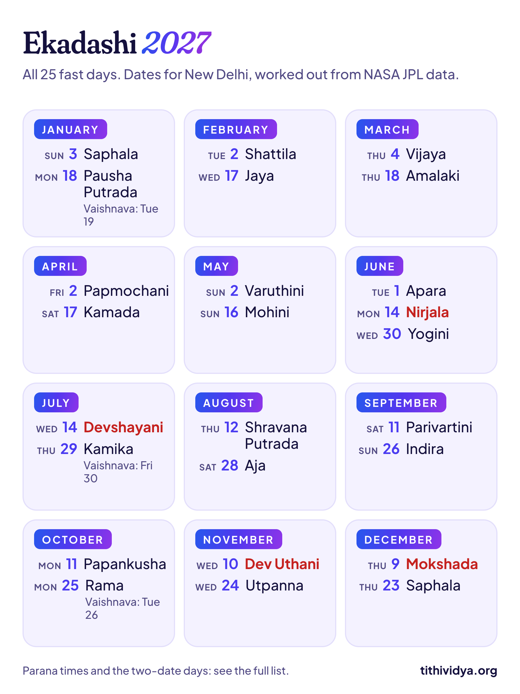
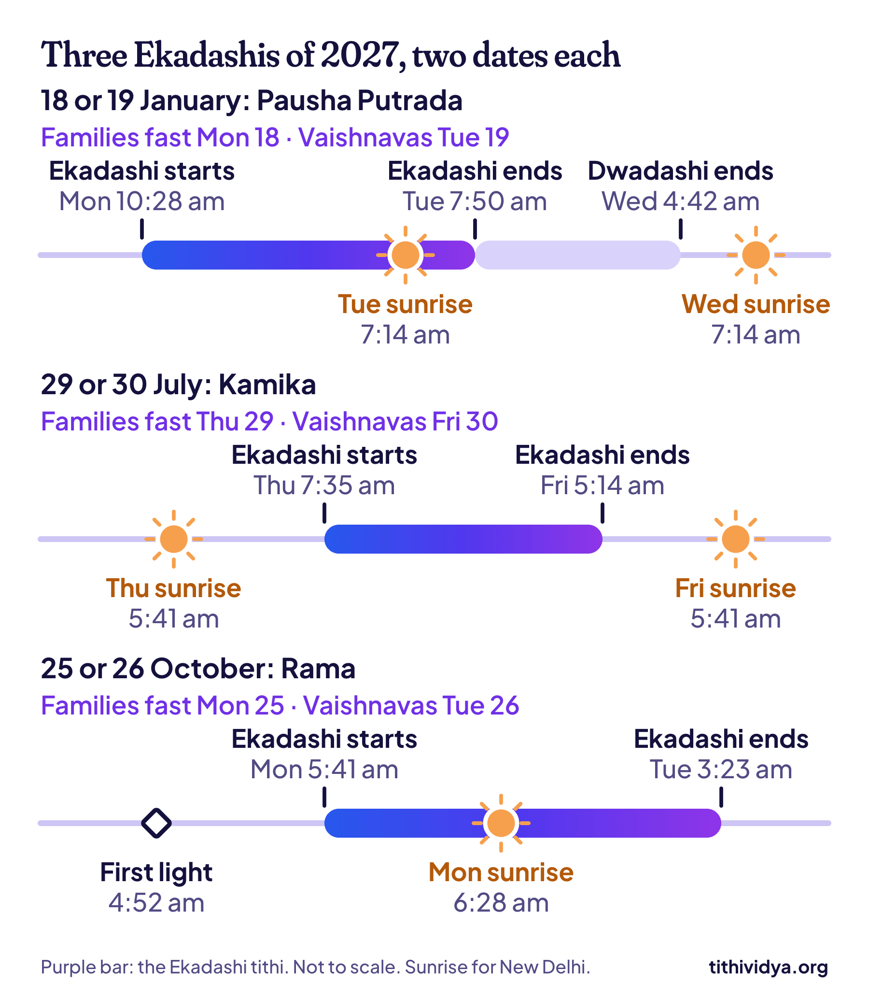

**2027 has 25 Ekadashi fasts, not the usual 24.** The first is Saphala Ekadashi on Sunday, 3 January, and the last is Saphala Ekadashi again, on Thursday, 23 December. This Ekadashi 2027 list has every date, with tithi and parana times for New Delhi.

Three of the 25 come with two dates: one for most families, and one a day later for Vaishnava temples. Both are right, and the reason each time is a matter of minutes around sunrise. I've marked those three with a star.

## Ekadashi 2027 list: all 25 dates

| Date | Ekadashi | Month and half |
| --- | --- | --- |
| Sun, 3 Jan | Saphala Ekadashi | Pausha, Krishna |
| Mon, 18 Jan \* | Pausha Putrada Ekadashi | Pausha, Shukla |
| Tue, 2 Feb | Shattila Ekadashi | Magha, Krishna |
| Wed, 17 Feb | Jaya Ekadashi | Magha, Shukla |
| Thu, 4 Mar | Vijaya Ekadashi | Phalguna, Krishna |
| Thu, 18 Mar | Amalaki Ekadashi | Phalguna, Shukla |
| Fri, 2 Apr | Papmochani Ekadashi | Chaitra, Krishna |
| Sat, 17 Apr | Kamada Ekadashi | Chaitra, Shukla |
| Sun, 2 May | Varuthini Ekadashi | Vaishakha, Krishna |
| Sun, 16 May | Mohini Ekadashi | Vaishakha, Shukla |
| Tue, 1 Jun | Apara Ekadashi | Jyeshtha, Krishna |
| Mon, 14 Jun | Nirjala Ekadashi | Jyeshtha, Shukla |
| Wed, 30 Jun | Yogini Ekadashi | Ashadha, Krishna |
| Wed, 14 Jul | Devshayani Ekadashi | Ashadha, Shukla |
| Thu, 29 Jul \* | Kamika Ekadashi | Shravana, Krishna |
| Thu, 12 Aug | Shravana Putrada Ekadashi | Shravana, Shukla |
| Sat, 28 Aug | Aja Ekadashi | Bhadrapada, Krishna |
| Sat, 11 Sep | Parivartini Ekadashi | Bhadrapada, Shukla |
| Sun, 26 Sep | Indira Ekadashi | Ashvina, Krishna |
| Mon, 11 Oct | Papankusha Ekadashi | Ashvina, Shukla |
| Mon, 25 Oct \* | Rama Ekadashi | Kartika, Krishna |
| Wed, 10 Nov | Dev Uthani Ekadashi | Kartika, Shukla |
| Wed, 24 Nov | Utpanna Ekadashi | Margashirsha, Krishna |
| Thu, 9 Dec | Mokshada Ekadashi | Margashirsha, Shukla |
| Thu, 23 Dec | Saphala Ekadashi | Pausha, Krishna |

\* Vaishnava families and temples, ISKCON included, fast a day later: on 19 January, 30 July and 26 October. [The reason for each](#the-3-ekadashis-with-two-dates) is further down.

Ekadashi (Gyaras in everyday Hindi) is the 11th tithi, or lunar day. It comes twice in every moon cycle: once while the moon grows, and once while it shrinks. If the word tithi is new to you, [this short explainer with a picture](/blog/tithi-birthday) covers it.

## How to read this list

- **The date is the fast day** most households keep. In a panchang it's called the Smarta date.
- **The month names are North Indian** (purnimanta). In the amanta calendar of Maharashtra, Gujarat and the south, the Krishna Paksha Ekadashis carry the month before. Saphala falls in Margashirsha there, not Pausha. The day is the same.
- **Krishna and Shukla** are the two halves of the lunar month. Shukla Paksha is the bright half, when the moon grows. Krishna Paksha is the dark half.
- **Every time is for New Delhi, in IST.** The tithi times hold for all of India. Parana windows move with your own sunrise, by up to about half an hour.

And why 25? A normal year has 24 Ekadashis, and a year with an extra month (adhik maas) has 26. But twelve moon months are about 11 days shorter than a calendar year. So Saphala Ekadashi fits into 2027 twice, on 3 January and 23 December. June gets three Ekadashis for the same reason: the 1st, the 14th and the 30th.

> **Tip:** About 1 person in 15 is born on an Ekadashi. Were you? [Find my tithi](/find) shows the tithi you were born on, and the date it comes back every year.

## Ekadashi 2027 dates and parana times

Parana is the breaking of the fast, done the next morning. Each month below gives the fast day, the hours the Ekadashi tithi runs, and the parana window for New Delhi.

### January 2027

| Fast day | Ekadashi tithi (IST) | Break the fast, New Delhi |
| --- | --- | --- |
| **Sun, 3 Jan:** Saphala Ekadashi | 2:25 pm Sat 2 Jan to 4:09 pm Sun 3 Jan | Mon, 4 Jan, 7:15 am to 9:19 am |
| **Mon, 18 Jan:** Pausha Putrada Ekadashi (Vaishnava: Tue, 19 Jan) | 10:28 am Mon 18 Jan to 7:50 am Tue 19 Jan | Tue, 19 Jan, 1:35 pm to 3:42 pm (Vaishnava: Wed, 20 Jan, 7:14 am to 9:21 am) |

The year opens with Saphala Ekadashi; saphala means fruitful. Pausha Putrada Ekadashi, kept by couples praying for a child, is the first of the year's three splits. Notice the Monday fast ends on Tuesday afternoon, not Tuesday morning. I'll explain that in a minute.

### February 2027

| Fast day | Ekadashi tithi (IST) | Break the fast, New Delhi |
| --- | --- | --- |
| **Tue, 2 Feb:** Shattila Ekadashi | 8:42 am Mon 1 Feb to 11:11 am Tue 2 Feb | Wed, 3 Feb, 7:08 am to 9:19 am |
| **Wed, 17 Feb:** Jaya Ekadashi | 8:20 pm Tue 16 Feb to 5:32 pm Wed 17 Feb | Thu, 18 Feb, 6:57 am to 9:12 am |

Shattila is named for sesame: shat means six, and til is sesame. The seeds are used six ways that day, from the bath to the food given away. Jaya Ekadashi has the shortest Ekadashi tithi of 2027, at 21 hours 12 minutes.

### March 2027

| Fast day | Ekadashi tithi (IST) | Break the fast, New Delhi |
| --- | --- | --- |
| **Thu, 4 Mar:** Vijaya Ekadashi | 4:45 am Wed 3 Mar to 7:25 am Thu 4 Mar | Fri, 5 Mar, 6:43 am to 9:03 am |
| **Thu, 18 Mar:** Amalaki Ekadashi | 4:22 am Thu 18 Mar to 1:52 am Fri 19 Mar | Fri, 19 Mar, 7:13 am to 8:52 am |

Vijaya Ekadashi is the odd one. Its tithi lasts 26 hours 40 minutes, the longest of the year, and it's running at sunrise on both 3 and 4 March. When that happens the fast goes on the second day, so it's Thursday the 4th, two days before Maha Shivratri. Some calendars print the 3rd.

Amalaki Ekadashi, when the amla tree is worshipped, comes four days before Holi. In Varanasi it's Rangbhari Ekadashi, the day the Holi season opens there.

### April 2027

| Fast day | Ekadashi tithi (IST) | Break the fast, New Delhi |
| --- | --- | --- |
| **Fri, 2 Apr:** Papmochani Ekadashi | 12:46 am Fri 2 Apr to 2:52 am Sat 3 Apr | Sat, 3 Apr, 1:40 pm to 4:10 pm |
| **Sat, 17 Apr:** Kamada Ekadashi | 11:22 am Fri 16 Apr to 9:28 am Sat 17 Apr | Sun, 18 Apr, 5:53 am to 7:43 am |

Papmochani is the last Ekadashi of the Hindu year. The new year, Vikram Samvat 2084, starts on 7 April, so Kamada Ekadashi is the first of the new one. It comes two days after Ram Navami.

### May 2027

| Fast day | Ekadashi tithi (IST) | Break the fast, New Delhi |
| --- | --- | --- |
| **Sun, 2 May:** Varuthini Ekadashi | 6:54 pm Sat 1 May to 7:52 pm Sun 2 May | Mon, 3 May, 5:39 am to 8:19 am |
| **Sun, 16 May:** Mohini Ekadashi | 6:18 pm Sat 15 May to 5:14 pm Sun 16 May | Mon, 17 May, 5:30 am to 8:13 am |

Both of May's Ekadashis fall on a Sunday. Mohini Ekadashi is named after Mohini, the form Vishnu took to keep the nectar of immortality from the demons.

### June 2027

| Fast day | Ekadashi tithi (IST) | Break the fast, New Delhi |
| --- | --- | --- |
| **Tue, 1 Jun:** Apara Ekadashi | 10:03 am Mon 31 May to 9:40 am Tue 1 Jun | Wed, 2 Jun, 5:24 am to 8:10 am |
| **Mon, 14 Jun:** Nirjala Ekadashi | 2:13 am Mon 14 Jun to 2:08 am Tue 15 Jun | Tue, 15 Jun, 1:45 pm to 4:33 pm |
| **Wed, 30 Jun:** Yogini Ekadashi | 10:05 pm Tue 29 Jun to 8:31 pm Wed 30 Jun | Thu, 1 Jul, 5:27 am to 8:14 am |

June has three. The big one is **Nirjala Ekadashi on Monday, 14 June**, the strictest fast of the year: no food and no water, from sunrise to the next sunrise. Tradition says this one fast earns the merit of all the others. It's also called Bhimseni Ekadashi, after Bhima, who couldn't manage the rest.

If you're pregnant, diabetic or on medicine, talk to your doctor before a fast, and above all before a waterless one in June.

### July 2027

| Fast day | Ekadashi tithi (IST) | Break the fast, New Delhi |
| --- | --- | --- |
| **Wed, 14 Jul:** Devshayani Ekadashi | 12:09 pm Tue 13 Jul to 1:11 pm Wed 14 Jul | Thu, 15 Jul, 5:33 am to 8:19 am |
| **Thu, 29 Jul:** Kamika Ekadashi (Vaishnava: Fri, 30 Jul) | 7:35 am Thu 29 Jul to 5:14 am Fri 30 Jul | Fri, 30 Jul, 1:49 pm to 4:31 pm (Vaishnava: Sat, 31 Jul, 5:42 am to 8:24 am) |

Devshayani Ekadashi is the day Vishnu is said to go to sleep. It starts Chaturmas, the four months when many families hold no weddings, and it's the day of the great Ashadhi Ekadashi pilgrimage to Pandharpur. Kamika Ekadashi, in the month of Sawan, is the second split of the year.

### August 2027

| Fast day | Ekadashi tithi (IST) | Break the fast, New Delhi |
| --- | --- | --- |
| **Thu, 12 Aug:** Shravana Putrada Ekadashi | 12:59 am Thu 12 Aug to 3:00 am Fri 13 Aug | Fri, 13 Aug, 1:45 pm to 4:24 pm |
| **Sat, 28 Aug:** Aja Ekadashi | 3:26 pm Fri 27 Aug to 12:43 pm Sat 28 Aug | Sun, 29 Aug, 5:57 am to 8:31 am |

Shravana Putrada is the year's second Putrada Ekadashi; the first was in January. Aja Ekadashi is tied to King Harishchandra, who is said to have won back his family and kingdom by keeping it.

### September 2027

| Fast day | Ekadashi tithi (IST) | Break the fast, New Delhi |
| --- | --- | --- |
| **Sat, 11 Sep:** Parivartini Ekadashi | 5:01 pm Fri 10 Sep to 7:37 pm Sat 11 Sep | Sun, 12 Sep, 6:04 am to 8:34 am |
| **Sun, 26 Sep:** Indira Ekadashi | 10:31 pm Sat 25 Sep to 7:50 pm Sun 26 Sep | Mon, 27 Sep, 6:12 am to 8:36 am |

On Parivartini Ekadashi, Vishnu is said to turn over in his sleep, halfway through Chaturmas. You'll also see it called Parsva Ekadashi, and Jal Jhulni Ekadashi in Rajasthan and Madhya Pradesh. Indira Ekadashi falls inside Pitru Paksha (15 to 29 September), and many families keep it for their ancestors.

### October 2027

| Fast day | Ekadashi tithi (IST) | Break the fast, New Delhi |
| --- | --- | --- |
| **Mon, 11 Oct:** Papankusha Ekadashi | 11:41 am Sun 10 Oct to 2:09 pm Mon 11 Oct | Tue, 12 Oct, 6:20 am to 8:39 am |
| **Mon, 25 Oct:** Rama Ekadashi (Vaishnava: Tue, 26 Oct) | 5:41 am Mon 25 Oct to 3:23 am Tue 26 Oct | Tue, 26 Oct, 1:12 pm to 3:27 pm (Vaishnava: Wed, 27 Oct, 6:29 am to 8:44 am) |

Papankusha Ekadashi comes two days after Dussehra. Rama Ekadashi, named after Rama, a name of Lakshmi, is four days before Diwali, and it's the year's third split.

### November 2027

| Fast day | Ekadashi tithi (IST) | Break the fast, New Delhi |
| --- | --- | --- |
| **Wed, 10 Nov:** Dev Uthani Ekadashi | 7:35 am Tue 9 Nov to 9:12 am Wed 10 Nov | Thu, 11 Nov, 6:40 am to 8:50 am |
| **Wed, 24 Nov:** Utpanna Ekadashi | 1:45 pm Tue 23 Nov to 12:12 pm Wed 24 Nov | Thu, 25 Nov, 6:51 am to 8:58 am |

Dev Uthani Ekadashi is when Vishnu wakes, Chaturmas ends and the wedding season reopens. Tulsi Vivah follows the next evening, on 11 November. In 2027 everyone fasts on the same Wednesday, unlike [Dev Uthani Ekadashi 2026](/blog/dev-uthani-ekadashi), which split in two. Utpanna Ekadashi marks the birth of Ekadashi herself, and it's the traditional one to [start keeping Ekadashi fasts](/blog/utpanna-ekadashi).

### December 2027

| Fast day | Ekadashi tithi (IST) | Break the fast, New Delhi |
| --- | --- | --- |
| **Thu, 9 Dec:** Mokshada Ekadashi | 2:59 am Thu 9 Dec to 3:20 am Fri 10 Dec | Fri, 10 Dec, 1:16 pm to 3:20 pm |
| **Thu, 23 Dec:** Saphala Ekadashi | 11:41 pm Wed 22 Dec to 11:12 pm Thu 23 Dec | Fri, 24 Dec, 7:11 am to 9:15 am |

Mokshada Ekadashi is also Gita Jayanti, the day Krishna is said to have spoken the Bhagavad Gita. Then Saphala Ekadashi returns for the second time, and the year ends where it began.

> **Read next:** [Hindu calendar 2027: all festival dates with tithi](/blog/hindu-calendar). Every other big date of the year, from Holi to Diwali, on one page.

## The 3 Ekadashis with two dates

Most days in the Hindu calendar are named after the tithi running at sunrise. Ekadashi fasts add two more conditions, and that's where the second date comes from. Here are the three splits of 2027, with what the clock shows.

### Pausha Putrada Ekadashi: 18 or 19 January

Ekadashi ends at 7:50 am on Tuesday, 36 minutes after sunrise. So Tuesday looks like the day.

But the fast must be broken during Dwadashi, the next tithi, and Dwadashi is over by 4:42 am on Wednesday, before the sun is up. A Tuesday fast would have no Dwadashi morning to end in. So families fast on Monday. Vaishnavas keep Tuesday, the day with Ekadashi at sunrise.

### Kamika Ekadashi: 29 or 30 July

Ekadashi starts at 7:35 am on Thursday, after sunrise, and ends at 5:14 am on Friday, before sunrise. It touches no sunrise at all.

Families fast on Thursday, the day it fills. Vaishnavas don't fast on a day that began with Dashami, the 10th tithi, so they keep Friday.

### Rama Ekadashi: 25 or 26 October

Ekadashi starts at 5:41 am on Monday, just 47 minutes before sunrise. It's running at sunrise, so families fast on Monday.

The Vaishnava rule is stricter. Ekadashi must already be running 96 minutes before sunrise, at the first light of dawn. It isn't, so their fast moves to Tuesday.

### Which date should you keep?

- **Your family has a custom:** follow it.
- **You go to an ISKCON or other Vaishnava temple:** take the later date.
- **No custom at all:** the first date is what most households keep.

One more note for ISKCON families. ISKCON follows its own rulebook, which can move a fast to the next day, called a Mahadwadashi. In 2027 that may apply to Nirjala Ekadashi (15 June) and Parivartini Ekadashi (12 September).

Temples publish their own list by city, like this [ISKCON Bangalore Ekadashi calendar](https://www.iskconbangalore.org/ekadashi-calendar/), so follow your temple's.

## Why some parana times are after midday

The rule for breaking the fast has three parts:

1. **Break it the next day, after sunrise,** while Dwadashi is still running.
2. **Wait out Hari Vasara,** the first quarter of Dwadashi.
3. **Use the early morning** if you can, and avoid the middle of the day. If Hari Vasara runs past the early morning, the window moves to the afternoon.

On seven Ekadashis of 2027, that third part pushes parana past midday:

| Fast | Hari Vasara ends | Parana window, New Delhi |
| --- | --- | --- |
| Pausha Putrada, 18 Jan | 1:03 pm, Tue 19 Jan | 1:35 pm to 3:42 pm |
| Papmochani, 2 Apr | 9:16 am, Sat 3 Apr | 1:40 pm to 4:10 pm |
| Nirjala, 14 Jun | 8:14 am, Tue 15 Jun | 1:45 pm to 4:33 pm |
| Kamika, 29 Jul | 10:30 am, Fri 30 Jul | 1:49 pm to 4:31 pm |
| Shravana Putrada, 12 Aug | 9:35 am, Fri 13 Aug | 1:45 pm to 4:24 pm |
| Rama, 25 Oct | 8:48 am, Tue 26 Oct | 1:12 pm to 3:27 pm |
| Mokshada, 9 Dec | 9:14 am, Fri 10 Dec | 1:16 pm to 3:20 pm |

Look at Nirjala. Hari Vasara ends at 8:14 am, only four minutes after the early-morning window closes. Printed panchangs will show the afternoon window. Many families simply break the fast once Hari Vasara is over, and after a waterless day, that's the kinder choice. Ask your elders or your priest which they follow.

Not in Delhi? When the window starts at sunrise, start from your own sunrise instead; the window lasts a fifth of your daylight. Mumbai's sunrise is up to 40 minutes later than Delhi's, and Kolkata's is half an hour to an hour earlier.

## Where these dates come from

I worked out every tithi time here with Tithi Vidya, which reads the positions of the sun and moon from NASA JPL's [DE440 data](https://ssd.jpl.nasa.gov/doc/de440_de441.html). I've tested it against 92,839 tithi start times from Swiss Ephemeris, and half of them agree within 1.7 seconds. The method and the tests are on [How it works](/how-it-works).

Then I applied the Ekadashi rules for New Delhi: sunrise, the 96 minutes before it, and the state of Dwadashi. Last, I checked the result against two published 2027 panchang lists for New Delhi. All 25 fast days agreed, and so did the three Vaishnava dates.

For the stories behind each fast, [Wikipedia's Ekadashi page](https://en.wikipedia.org/wiki/Ekadashi) lists all 24 names with their legends.

## Common questions

### How many Ekadashis are there in 2027?

25: 13 in Krishna Paksha and 12 in Shukla Paksha. A year usually has 24, but Saphala Ekadashi falls in both January and December 2027.

### Ekadashi kab hai? When is the next one?

If you're reading this in late 2026, the next ones are Dev Uthani Ekadashi on 20 November, Utpanna Ekadashi on 4 December and Mokshada Ekadashi on 20 December. The first Ekadashi of 2027 is Saphala, on Sunday, 3 January.

### When is Nirjala Ekadashi in 2027?

On Monday, 14 June 2027. The tithi runs from 2:13 am that day to 2:08 am on Tuesday (IST).

### When is Vaikuntha Ekadashi in 2027?

There isn't one. Vaikuntha Ekadashi is the Shukla Paksha Ekadashi that falls while the sun is in Dhanu (Sagittarius), from mid-December to mid-January. One falls on 20 December 2026, and the next on 8 January 2028, so 2027 is skipped. Temples like Srirangam and Tirumala announce their own dates. [Wikipedia's page on Vaikuntha Ekadashi](https://en.wikipedia.org/wiki/Vaikuntha_Ekadashi) explains the festival.

### Is there an Ekadashi 2027 list as a PDF or calendar?

Not a PDF, but the one-page picture near the top does the same job. Save it to your phone or share it on WhatsApp. I'll correct this page if any date needs it.

### Are Ekadashi dates the same outside India?

Not always. A tithi starts at the same moment everywhere, but sunrise doesn't. In the US, Canada and the UK, some fasts fall a day earlier than in India. Check a panchang set to your city.

## Keep reading

- [Utpanna Ekadashi 2026: date, parana time and how to start](/blog/utpanna-ekadashi): the best first fast, with simple steps for beginners.
- [Dev Uthani Ekadashi 2026: 20 or 21 November?](/blog/dev-uthani-ekadashi): a split like the three above, explained with pictures.
- [Hindu calendar 2027: all festival dates with tithi](/blog/hindu-calendar): the rest of the year in one list.
