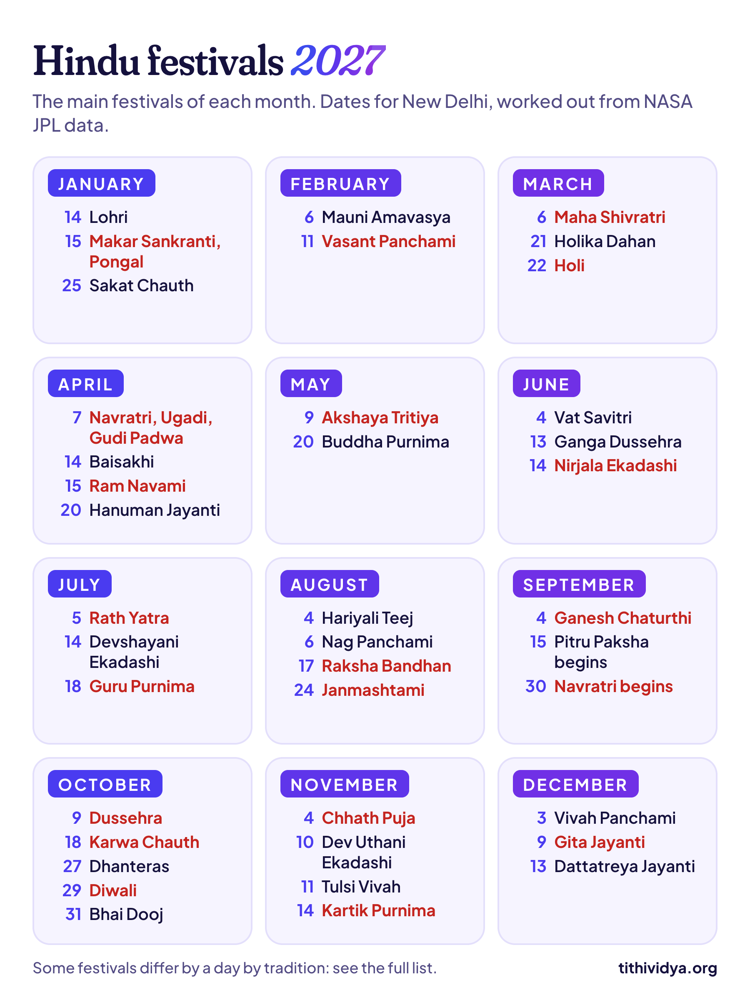

**Here's every major Hindu festival of 2027, month by month, with its date, day and tithi.** Holi is on Monday, 22 March, Raksha Bandhan on Tuesday, 17 August, and Diwali on Friday, 29 October. All 51 dates are worked out for New Delhi.

A date isn't always as simple as it looks, though. Some festivals are fixed by midnight, the evening, midday or moonrise, not by sunrise. In 2027 that moves a few of them, like Maha Shivratri and Karwa Chauth, a day earlier than a plain calendar shows. I've flagged each one.

## How to read this calendar

Each table gives the date, the festival and its tithi, the lunar day it's tied to. A Hindu calendar names each day after the tithi that's running at sunrise. That's the rule for most festivals here. [Getting that sunrise right](/blog/tithi-birthday-calculator) is one of the trickiest parts of any panchang.

When a festival goes by another time of day, the tithi column says so:

- **At midnight:** Maha Shivratri and Janmashtami.
- **In the evening:** Holika Dahan, Ahoi Ashtami, Dhanteras, Diwali and Kaal Bhairav Jayanti.
- **At midday:** Ram Navami and Ganesh Chaturthi.
- **In the afternoon:** Dussehra and the shraddha of Mahalaya Amavasya.
- **At moonrise:** Karwa Chauth and Sakat Chauth.
- **By the sun:** Makar Sankranti and Baisakhi follow the sun's move into a new zodiac sign, not the moon.

Two more things. Month names are the North Indian (purnimanta) ones. In the amanta calendar of the south and west, festivals in the dark half of the month fall in the month before. And 2027 has no adhik maas, the extra month that some years get, so every festival stays close to where it was in 2026.

## January 2027 festivals

| Date | Festival | Tithi |
| --- | --- | --- |
| Thu, 14 Jan | Lohri | The eve of Makar Sankranti |
| Fri, 15 Jan | Makar Sankranti, Pongal, Uttarayan | Sun enters Capricorn |
| Fri, 22 Jan | Paush Purnima | Pausha Purnima |
| Mon, 25 Jan | Sakat Chauth | Magha Krishna Chaturthi, at moonrise |

The sun moves into Capricorn (Makar) at 9:10 pm on Thursday, 14 January. That's after sunset, so the holy hours of Makar Sankranti fall on Friday, 15 January, along with Thai Pongal. Some calendars still print the 14th. Paush Purnima opens the month-long Magh Mela bathing season at Prayagraj.

## February 2027 festivals

| Date | Festival | Tithi |
| --- | --- | --- |
| Sat, 6 Feb | Mauni Amavasya | Magha Amavasya |
| Thu, 11 Feb | Vasant Panchami, Saraswati Puja | Magha Shukla Panchami |

Mauni Amavasya, the new moon of silence, is the biggest bathing day of the Magh Mela. Vasant Panchami's Panchami runs from 3:05 am on 11 February to 3:18 am on the 12th, so the whole morning puja falls inside it.

## March 2027 festivals

| Date | Festival | Tithi |
| --- | --- | --- |
| Sat, 6 Mar | Maha Shivratri | Phalguna Krishna Chaturdashi, at midnight |
| Sun, 21 Mar | Holika Dahan | Phalguna Purnima, in the evening |
| Mon, 22 Mar | Holi | The day after Holika Dahan |

Maha Shivratri is a good example of the midnight rule. Chaturdashi begins at 12:04 pm on Saturday, 6 March, and is running through Saturday midnight. Sunday's sunrise falls in it too, but the night that counts is Saturday's. Purnima starts at 6:22 pm on Sunday, 21 March, just before sunset, so the Holika bonfire is lit that night and colours fly on Monday.

## April 2027 festivals

| Date | Festival | Tithi |
| --- | --- | --- |
| Wed, 7 Apr | Chaitra Navratri begins, Ugadi, Gudi Padwa | Chaitra Shukla Pratipada |
| Wed, 14 Apr | Baisakhi, Tamil New Year | Sun enters Aries |
| Thu, 15 Apr | Ram Navami | Chaitra Shukla Navami, at midday |
| Tue, 20 Apr | Hanuman Jayanti | Chaitra Purnima |

Ugadi and Gudi Padwa start the Hindu new year: Vikram Samvat 2084 and Shaka Samvat 1949. The sun enters Aries (Mesha) at 3:28 pm on 14 April, which starts the solar new year. Kerala's Vishu and Bengal's Pohela Boishakh fall on 14 or 15 April, depending on the regional rule.

Hanuman Jayanti here is the North Indian date; Tamil Nadu, Andhra Pradesh and Telangana keep it at other times of the year.

## May 2027 festivals

| Date | Festival | Tithi |
| --- | --- | --- |
| Sun, 9 May | Akshaya Tritiya | Vaishakha Shukla Tritiya, in the forenoon |
| Thu, 20 May | Buddha Purnima | Vaishakha Purnima |

Tritiya begins at 11:43 am on Saturday, 8 May, and ends at 9:03 am on Sunday. Sunday holds it for over three hours after sunrise, which is why Akshaya Tritiya is on the 9th in India.

## June 2027 festivals

| Date | Festival | Tithi |
| --- | --- | --- |
| Fri, 4 Jun | Vat Savitri Vrat, Shani Jayanti | Jyeshtha Amavasya |
| Sun, 13 Jun | Ganga Dussehra | Jyeshtha Shukla Dashami |
| Mon, 14 Jun | Nirjala Ekadashi | Jyeshtha Shukla Ekadashi |

Nirjala Ekadashi, the strictest fast of the year, is the same day for families and Vaishnavas in 2027. If you're pregnant, diabetic or on medicine, talk to your doctor before a fast, and above all before a waterless one.

## July 2027 festivals

| Date | Festival | Tithi |
| --- | --- | --- |
| Mon, 5 Jul | Jagannath Rath Yatra | Ashadha Shukla Dwitiya |
| Wed, 14 Jul | Devshayani Ekadashi | Ashadha Shukla Ekadashi |
| Sun, 18 Jul | Guru Purnima | Ashadha Purnima |

Devshayani Ekadashi starts Chaturmas, the four months when Vishnu is said to sleep. In North India, Sawan begins the day after Guru Purnima.

## August 2027 festivals

| Date | Festival | Tithi |
| --- | --- | --- |
| Wed, 4 Aug | Hariyali Teej | Shravana Shukla Tritiya |
| Fri, 6 Aug | Nag Panchami | Shravana Shukla Panchami |
| Tue, 17 Aug | Raksha Bandhan | Shravana Purnima, after Bhadra |
| Tue, 24 Aug | Krishna Janmashtami | Bhadrapada Krishna Ashtami, at midnight |

Raksha Bandhan's Purnima begins at 10:29 am on Monday, 16 August, but its first half, called Bhadra, isn't used for tying rakhi. Bhadra lasts until late Monday night, so rakhi is tied on Tuesday morning, before Purnima ends at 12:58 pm. For Janmashtami, Ashtami is running at midnight on Tuesday, 24 August. ISKCON and many Vaishnava temples celebrate on Wednesday, 25 August.

## September 2027 festivals

| Date | Festival | Tithi |
| --- | --- | --- |
| Fri, 3 Sep | Hartalika Teej | Bhadrapada Shukla Tritiya |
| Sat, 4 Sep | Ganesh Chaturthi | Bhadrapada Shukla Chaturthi, at midday |
| Tue, 14 Sep | Anant Chaturdashi, Ganesh Visarjan | Bhadrapada Shukla Chaturdashi |
| Wed, 15 Sep | Pitru Paksha begins | Bhadrapada Purnima |
| Wed, 29 Sep | Sarva Pitru Amavasya, Mahalaya | Ashvina Amavasya, in the afternoon |
| Thu, 30 Sep | Sharad Navratri begins | Ashvina Shukla Pratipada |

Pitru Paksha runs from 15 to 29 September. Its last day, Sarva Pitru Amavasya, is set by the afternoon, when shraddha is done: Amavasya covers Wednesday afternoon but ends at 8:06 am on Thursday.

> **Read next:** [Why your Hindu birthday moves every year](/blog/why-your-hindu-birthday-moves). Festivals slide about 11 days a year, then jump back, for the same reason.

## October 2027 festivals

| Date | Festival | Tithi |
| --- | --- | --- |
| Thu, 7 Oct | Durga Ashtami | Ashvina Shukla Ashtami |
| Fri, 8 Oct | Maha Navami | Ashvina Shukla Navami |
| Sat, 9 Oct | Dussehra, Vijayadashami | Ashvina Shukla Dashami, in the afternoon |
| Thu, 14 Oct | Sharad Purnima, Kojagari | Ashvina Purnima, at night |
| Mon, 18 Oct | Karwa Chauth | Kartika Krishna Chaturthi, at moonrise |
| Fri, 22 Oct | Ahoi Ashtami | Kartika Krishna Ashtami, in the evening |
| Wed, 27 Oct | Dhanteras | Kartika Krishna Trayodashi, in the evening |
| Thu, 28 Oct | Choti Diwali, Narak Chaturdashi | Kartika Krishna Chaturdashi |
| Fri, 29 Oct | Diwali, Lakshmi Puja | Kartika Amavasya, in the evening |
| Sat, 30 Oct | Govardhan Puja | Kartika Shukla Pratipada |
| Sun, 31 Oct | Bhai Dooj | Kartika Shukla Dwitiya |

October is the busiest month of the year, and Karwa Chauth is the one to watch. Chaturthi begins at 5:52 pm on Monday, 18 October, and is still running when the moon rises at 7:31 pm in Delhi. By Tuesday's moonrise it has ended, so the fast is on Monday, even though some calendars print the 19th.

Diwali is simpler: Amavasya covers the evening Lakshmi Puja on Friday, 29 October, and not on Thursday.

## November 2027 festivals

| Date | Festival | Tithi |
| --- | --- | --- |
| Tue, 2 Nov to Fri, 5 Nov | [Chhath Puja](/blog/chhath-puja) (evening arghya Thu, 4 Nov) | Kartika Shukla Shashthi |
| Wed, 10 Nov | [Dev Uthani Ekadashi](/blog/dev-uthani-ekadashi) | Kartika Shukla Ekadashi |
| Thu, 11 Nov | [Tulsi Vivah](/blog/tulsi-vivah) | Kartika Shukla Dwadashi |
| Sun, 14 Nov | [Kartik Purnima](/blog/kartik-purnima) | Kartika Purnima |
| Sat, 20 Nov | [Kaal Bhairav Jayanti](/blog/kaal-bhairav-jayanti) | Margashirsha Krishna Ashtami, at night |
| Wed, 24 Nov | [Utpanna Ekadashi](/blog/utpanna-ekadashi) | Margashirsha Krishna Ekadashi |

Kartik Purnima is a two-day story in 2027. Purnima runs from 9:55 am on Saturday, 13 November, to 8:55 am on Sunday. The holy dip goes by Sunday's sunrise. But Dev Deepawali's evening lamps in Varanasi will most likely be lit on Saturday night, the only evening with Purnima in it. Each linked festival has its own guide with the full story.

## December 2027 festivals

| Date | Festival | Tithi |
| --- | --- | --- |
| Fri, 3 Dec | [Vivah Panchami](/blog/vivah-panchami) | Margashirsha Shukla Panchami |
| Thu, 9 Dec | Gita Jayanti, Mokshada Ekadashi | Margashirsha Shukla Ekadashi |
| Mon, 13 Dec | Dattatreya Jayanti | Margashirsha Purnima |

> **Tip:** Festivals follow the moon, and so does your birthday in the Hindu calendar. [Find my tithi](/find) shows the tithi you were born on and your tithi birthday for the next 100 years.

## The Hindu months of 2027

The tables above use month names, so here's when each month runs. North India ends each month on the full moon (purnimanta); the south and west end it on the new moon (amanta). So the same name covers two different stretches of days, about two weeks apart.

| Month | North India (purnimanta) | South and west (amanta) |
| --- | --- | --- |
| Pausha | 24 Dec 2026 to 22 Jan | 8 Jan to 6 Feb |
| Magha | 23 Jan to 20 Feb | 7 Feb to 8 Mar |
| Phalguna | 21 Feb to 22 Mar | 9 Mar to 6 Apr |
| Chaitra | 23 Mar to 20 Apr | 7 Apr to 6 May |
| Vaishakha | 21 Apr to 20 May | 7 May to 4 Jun |
| Jyeshtha | 21 May to 19 Jun | 5 Jun to 4 Jul |
| Ashadha | 20 Jun to 18 Jul | 5 Jul to 2 Aug |
| Shravana (Sawan) | 19 Jul to 17 Aug | 3 Aug to 31 Aug |
| Bhadrapada | 18 Aug to 15 Sep | 1 Sep to 30 Sep |
| Ashvina | 16 Sep to 15 Oct | 1 Oct to 29 Oct |
| Kartika | 16 Oct to 14 Nov | 30 Oct to 28 Nov |
| Margashirsha | 15 Nov to 13 Dec | 29 Nov to 27 Dec |

Each month's bright half (Shukla Paksha) is the same in both systems. That's why festivals in it, like Ram Navami or Govardhan Puja, carry the same month name everywhere. The year itself starts on Chaitra Shukla Pratipada, 7 April, in both.

## Festivals where calendars disagree in 2027

A few dates differ from one calendar to another. That's usually not a mistake: the calendars follow different rules or traditions. These are the ones to check with your family or temple:

- **Makar Sankranti, 14 or 15 January.** The sun enters Capricorn after sunset on the 14th. Panchangs that follow the punya kaal rule move the festival to the 15th, while many calendars and holiday lists keep the 14th.
- **Janmashtami, 24 or 25 August.** Families who go by the midnight tithi celebrate on the 24th; ISKCON and many Vaishnava temples on the 25th.
- **Karwa Chauth, 18 or 19 October.** Chaturthi is running at moonrise only on the 18th, but calendars that use the sunrise tithi print the 19th.
- **Sharad Purnima, 14 or 15 October.** Purnima covers the whole night of the 14th, which is when the kheer is left out in the moonlight.
- **Vishu and Pohela Boishakh, 14 or 15 April,** depending on each region's rule for the solar new year.
- **Ekadashi fasts.** When Ekadashi starts just after a sunrise, families fast on the first day and Vaishnavas on the second. In 2027, Nirjala, Devshayani, Dev Uthani and Mokshada Ekadashi fall on the same day for both.

If you follow a South Indian, Bengali or Odia calendar, some dates will follow your region's own panchang. And festivals set by the stars (nakshatras), like Onam, aren't in this list.

## Where these dates come from

Every tithi time here comes from Tithi Vidya, which works out where the sun and moon are from NASA JPL's [DE440 data](https://ssd.jpl.nasa.gov/doc/de440_de441.html), the data used to fly spacecraft. I tested it against 92,839 tithi start times worked out separately with Swiss Ephemeris, and half of them agreed within 1.7 seconds. The method, the code and every test are on [How it works](/how-it-works).

On top of the tithis, I applied each festival's rule for New Delhi: sunrise, midday, afternoon, evening, midnight or moonrise. Then I checked the big festivals against published panchangs. [Wikipedia's page on the Hindu calendar](https://en.wikipedia.org/wiki/Hindu_calendar) covers how the months and years work, if you're curious.

## Common questions

### When is Diwali in 2027?

On Friday, 29 October 2027. Dhanteras is on Wednesday, 27 October, and Bhai Dooj on Sunday, 31 October.

### When is Holi in 2027?

Holi is on Monday, 22 March 2027, with Holika Dahan the night before, on Sunday, 21 March.

### Is there an adhik maas in 2027?

No. 2026 had one (Adhika Jyeshtha), and the next one comes in 2029, when Chaitra repeats. So 2027 has the usual twelve months.

### When does the Hindu new year 2027 start?

On Wednesday, 7 April 2027, with Chaitra Navratri, Ugadi and Gudi Padwa. Vikram Samvat 2084 begins that day.

### Is there a Hindu calendar 2027 PDF?

Not as a PDF, but the year-at-a-glance picture above works the same way: save it on your phone or share it on WhatsApp. This page will stay up to date if any date needs a correction.

## Keep reading

- [Why your Hindu birthday moves every year](/blog/why-your-hindu-birthday-moves): the 11-day slide behind every date on this page.
- [Dev Uthani Ekadashi 2026: 20 or 21 November?](/blog/dev-uthani-ekadashi): a real case of two traditions picking two days.
- [Tithi birthday calculator: 5 things it must get right](/blog/tithi-birthday-calculator): the rules that turn a tithi into a date.
