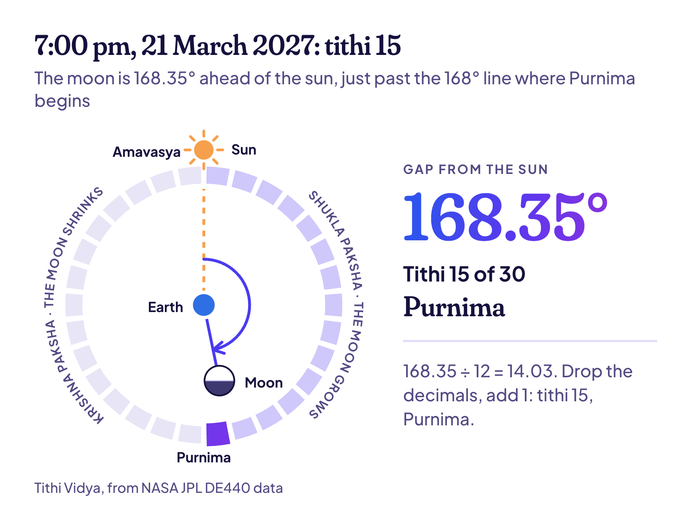

**A tithi is calculated from one number: how far the moon is ahead of the sun, in degrees, as seen from the Earth.** Divide that gap by 12, drop the decimals and add 1. The answer, from 1 to 30, is the tithi.

That's the whole formula, and it fits on a sticky note. The hard part is getting the two positions exactly right, and then finding the exact second the tithi changes. Below I'll do all of it with real numbers for Holi 2027, the same way [Tithi Vidya](/find) does it.

## How tithi is calculated, in three steps

1. **Find where the sun and the moon are.** Each gets a longitude: its position around the sky, from 0° to 360°.
2. **Take the gap.** Subtract the sun's longitude from the moon's. If the answer is negative, add 360°.
3. **Divide by 12.** Drop the decimals and add 1. That's the tithi number.

Tithis 1 to 15 are the bright half of the month, Shukla Paksha, ending with Purnima (15). Tithis 16 to 30 are the dark half, Krishna Paksha, ending with Amavasya (30). If you want the picture first, [what a tithi is](/blog/what-is-tithi) shows the 30 slices around the Earth.

> **For the curious:** In one line, tithi = floor((moon − sun) ÷ 12°) + 1, with the gap taken between 0° and 360°. Astronomers call the gap the moon's [elongation](https://en.wikipedia.org/wiki/Elongation_%28astronomy%29).

## Step 1: where the sun and moon are

Picture the sky as a giant clock face around the Earth. The sun creeps around it once a year. The moon goes around about once a month. A longitude is just the position on that dial, counted in degrees from a fixed starting point.

The starting point is the spot where the sun sits at the March equinox. So at the moment of the equinox, the sun's longitude is 0°. Three months later it's about 90°, and so on.

Where do the numbers come from? Tithi Vidya reads them from NASA JPL's [DE440 data](https://ssd.jpl.nasa.gov/doc/de440_de441.html), which gives the positions of the sun, the moon and the planets for centuries. It's the same kind of data used to fly spacecraft. We read it with Skyfield, a free Python library, and take each position as it appears from the centre of the Earth.

Why "as it appears"? Light takes about 8 minutes to reach us from the sun, and the Earth is moving while it travels. So we see the sun slightly behind where it really is. A panchang is about what we see, so these small corrections stay in. I'll show what they're worth further down.

## Step 2: the gap between them

Now subtract. The gap is the moon's longitude minus the sun's. It's 0° at the new moon, when the two line up. It's 180° at the full moon, when they sit on opposite sides of the Earth.

The gap grows because the moon is the faster runner. It gains between about 10.8° and 14.2° a day on the sun (those are the extremes for 2027), and 12.2° on average. That's why a tithi lasts close to a day, but never exactly one.

When the moon laps the sun, the gap goes past 360° and starts again from 0°. That's the next new moon, and the next lunar month.

## Step 3: divide by 12

There are 30 tithis in a lap, so each one is 360 ÷ 30 = 12° of gap. Dividing the gap by 12 tells you how many whole tithis have passed. Add 1, and you get the tithi you're in now.

| Gap from the sun | Tithi number | Name |
| --- | --- | --- |
| 0° to 12° | 1 | Shukla Pratipada |
| 120° to 132° | 11 | Shukla Ekadashi |
| 168° to 180° | 15 | Purnima |
| 180° to 192° | 16 | Krishna Pratipada |
| 300° to 312° | 26 | Krishna Ekadashi |
| 348° to 360° | 30 | Amavasya |

Notice something in that table. Purnima ends at 180°, which is the exact moment of the full moon. So the full moon is the last minute of Purnima, not the start of it. Many people expect the opposite.

> **Read next:** [Why your Hindu birthday moves every year](/blog/why-your-hindu-birthday-moves). The same 12° steps explain why a tithi lands on a different date each year.

## A worked example: Holi 2027

Let's take a real moment: 7:00 pm IST on Sunday, 21 March 2027, the evening of Holika Dahan. These numbers come straight from the DE440 data.

1. **The sun's longitude is 0.71°.** It crossed 0°, the March equinox, at 1:54 am that morning.
2. **The moon's longitude is 169.06°.**
3. **The gap is 169.06 − 0.71 = 168.35°.**
4. **168.35 ÷ 12 = 14.03.** Drop the decimals: 14. Add 1: **tithi 15, Purnima.**



See how close that is to the line? Purnima starts at 168°, and the gap is only 0.35° past it. So Purnima began not long before 7 pm, and before that it was still Chaturdashi. That raises the real question: when exactly did it change?

## How the exact start of a tithi is found

The formula tells you which tithi is running. It doesn't tell you when it began. For that you search.

**First, a rough guess.** At noon that day the gap was 164.48°. It needs 3.52° more to reach 168°. Right then the moon was gaining 0.55° an hour on the sun. So 3.52 ÷ 0.55 is about 6.4 hours, and Purnima should start around 6:24 pm.

**Then, narrow it down.** Take a window you know contains the change: at noon it's tithi 14, and at midnight it's tithi 15. Check the middle. Keep whichever half still contains the change, and repeat.

| Time checked (IST) | Gap | Tithi |
| --- | --- | --- |
| 6:00:00 pm | 167.80° | 14 |
| 9:00:00 pm | 169.45° | 15 |
| 7:30:00 pm | 168.63° | 15 |
| 6:45:00 pm | 168.21° | 15 |
| 6:22:30 pm | 168.004° | 15 |
| 6:11:15 pm | 167.90° | 14 |
| 6:16:52 pm | 167.95° | 14 |

Each check halves the window. Twelve hours become six, then three, then 90 minutes. After 16 halvings the window is under a second wide, and the answer is **6:22:01 pm IST**. That's the time Tithi Vidya shows, and the same Purnima ends at the full moon, 4:13:48 pm on Monday.

It's the same moment everywhere on Earth. In London it's 12:52 pm, and in New York 8:52 am. Only the clock reading changes.

> **For the curious:** Our script does this for every tithi from 1899 to 2150, once. It steps forward 12 hours at a time, which can't skip a tithi, since the shortest is about 20 hours. Wherever the tithi number changes, it halves down to the second. That gives 92,839 start times in a 367 KB table, which your phone reads. [How it works](/how-it-works) has the full method and the real code.

Want to check any moment yourself? [Find my tithi](/find) shows the tithi at any date and time from 1900 to 2149, with when it began and ends.

## Why the ayanamsa doesn't change the tithi

Indian calendars measure longitude from the stars, not from the equinox. This is called sidereal longitude. The two starting points drift apart by about 1° every 72 years, and the difference between them is the ayanamsa. India's official choice is the Lahiri ayanamsa, which was 24.24° on Holi 2027.

So does a panchang that uses the stars get a different tithi? No. Both the sun and the moon move by the same 24.24°, and the gap stays exactly the same:

| At 7:00 pm, 21 March 2027 | From the equinox | From the stars (Lahiri) |
| --- | --- | --- |
| Sun | 0.71° | 336.47° |
| Moon | 169.06° | 144.82° |
| Gap | 168.35° | 168.35° |

Moving the zero on a ruler doesn't change the distance between two marks. The ayanamsa does matter for other things. It decides which sign the sun is in, and so the names of the months and when an extra month (adhik maas) is added. But it never moves a tithi.

## The small corrections, and what they're worth

How careful do you need to be? I measured it on the same Purnima. Each line is how far the start time moves if you skip that step:

| If you skip... | Purnima starts | Off by |
| --- | --- | --- |
| Nothing (our method) | 6:22:01 pm | |
| Light time and aberration | 6:22:37 pm | 36 seconds |
| The moving ecliptic (use the year 2000's) | 6:22:00 pm | 1 second |

Thirty-six seconds sounds tiny, and usually it is. But a tithi that changes within a minute of sunrise can flip a whole day's name. And the moon's position is where most errors come from.

While building the calculator, I tried a short textbook formula for the moon, with six terms. Over 1900 to 2100, it named the wrong tithi at Delhi's sunrise on 429 of the 73,049 days. A good astronomy library got 20 wrong. Reading NASA's data directly fixed the rest, and that's what the site uses now.

> **For the curious:** This is the function in our open source code that turns the two positions into a tithi (Python, from `generator/ephem.py`). The longitudes are apparent, geocentric and measured along the ecliptic of date.
>
> ```python
> def tithi_index(self, t):
>     """0..29: 0 is Shukla Pratipada, 14 Purnima, 29 Amavasya."""
>     sun, moon = self.longitudes(t)
>     return (((moon - sun) % 360.0) // 12.0).astype(int)
> ```
>
> The `% 360` keeps the gap between 0° and 360°, and `// 12` divides and drops the decimals in one go. It counts from 0, so add 1 for the tithi number. The code is on [GitHub](https://github.com/vishwajeetsharma/tithi-vidya).

## Common mistakes when calculating a tithi

1. **Rounding instead of dropping the decimals.** At a gap of 179°, 179 ÷ 12 = 14.92. Round it and add 1, and you get 16, which is wrong: it's still Purnima. Drop the decimals instead: 14, plus 1, tithi 15.
2. **Thinking Purnima starts at the full moon.** It ends there. The same goes for Amavasya and the new moon.
3. **Treating a tithi time as local.** A tithi changes at one moment for the whole world. Convert that moment to your own clock, but don't recalculate it for your city.
4. **Mixing up a moment's tithi with a day's tithi.** The calendar names a day after the tithi running at sunrise, and sunrise does depend on your city. So the tithi of a moment is the same everywhere, but the tithi of a date can differ by city.
5. **Trusting a short moon formula.** The moon speeds up and slows down all the time. The six-term formula we tried put tithi changes about 7 minutes off as a rule, and sometimes 36 minutes off.

## From a tithi to a date

Everything above gives the tithi at a moment. Turning that into a calendar date needs one more rule. Most calendars give each date the tithi running at its sunrise, called the udaya tithi.

That rule causes two odd cases. A short tithi can miss every sunrise, so no date gets it: [Sakat Chauth 2027's Chaturthi](/blog/sakat-chauth) does exactly that. And a long tithi can cover two sunrises, so two dates share it. Festivals add their own rules too, like midnight for Janmashtami or the evening for Diwali, and the [Hindu calendar 2027](/blog/hindu-calendar) marks the rule for each one.

The same steps work out your tithi birthday. [A tithi birthday calculator](/blog/tithi-birthday-calculator) has to get five things right, and this calculation is the first of them.

## Common questions

### What is the formula for calculating a tithi?

Tithi = floor((moon's longitude − sun's longitude) ÷ 12°) + 1, with the gap kept between 0° and 360°. Tithis 1 to 15 are Shukla Paksha and 16 to 30 are Krishna Paksha.

### Tithi kaise nikale?

The easy way: open [Find my tithi](/find), enter the date, time and city, and it shows the tithi and when it starts and ends. By hand, you need the sun's and moon's longitudes for that moment, then the three steps above.

### How is the tithi time calculated?

By searching. You find two times on either side of the change, then halve the window again and again until it's less than a second wide. Our script does this once for every tithi from 1899 to 2150.

### Does the ayanamsa affect the tithi?

No. It shifts the sun and the moon by the same amount, so the gap between them doesn't change. It does affect the names of the months and the extra month.

### How accurate is Tithi Vidya's tithi time?

I tested all 92,839 tithi changes against Swiss Ephemeris, a separate astronomy system. Half agreed within 1.7 seconds. Every test, and where the calculator can still be wrong, is listed on the How it works page.

## Keep reading

- [What is a tithi?](/blog/what-is-tithi): the picture behind the maths, with all 30 names.
- [Tithi birthday calculator: 5 things it must get right](/blog/tithi-birthday-calculator): from a tithi to your birthday, step by step.
- [Tithi calculator by date of death](/blog/tithi-calculator-by-date-of-death): the same calculation, used to find a shraddha date.
