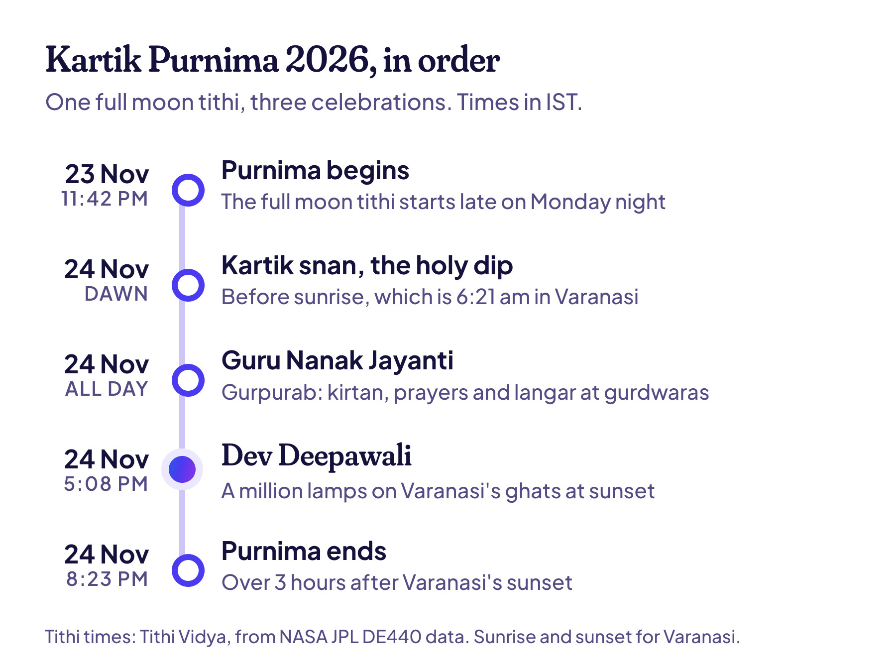

**कार्तिक पूर्णिमा 2026 मंगलवार, 24 नवंबर को है।** पूर्णिमा तिथि सोमवार, 23 नवंबर की रात 11:42 बजे शुरू होकर मंगलवार रात 8:23 बजे तक रहेगी (IST)। इसलिए इस साल भोर का स्नान, गुरु नानक जयंती और देव दीपावली के शाम के दीये, तीनों एक ही दिन पड़ रहे हैं।

ऐसा हर साल नहीं होता। अगले साल यही पूर्णिमा इन पर्वों को दो दिनों में बाँट देगी। शाम इतनी अहम क्यों है, और 6 शहरों में स्नान के लिए सूर्योदय कब है, यह नीचे है।

## कार्तिक पूर्णिमा 2026 की तारीख और समय

| | तारीख और समय (IST) |
| --- | --- |
| पूर्णिमा शुरू | सोमवार, 23 नवंबर, रात 11:42 बजे |
| पूर्णिमा समाप्त | मंगलवार, 24 नवंबर, रात 8:23 बजे |
| कार्तिक पूर्णिमा स्नान | मंगलवार, 24 नवंबर, भोर में |
| गुरु नानक जयंती (गुरुपर्व) | मंगलवार, 24 नवंबर |
| वाराणसी में देव दीपावली | मंगलवार, 24 नवंबर, सूर्यास्त (शाम 5:08 बजे) से |

कार्तिक पूर्णिमा कार्तिक महीने की पूर्णिमा है, जो कई हिंदुओं के लिए साल का सबसे पवित्र महीना है। इसे त्रिपुरी पूर्णिमा भी कहते हैं, और बंगाल में रास पूर्णिमा।

## 24 नवंबर की शाम क्यों मायने रखती है

हिंदू पंचांग में हर दिन का नाम उस तिथि पर पड़ता है जो सूर्योदय के समय चल रही हो। पूर्णिमा सोमवार देर रात शुरू होती है, इसलिए मंगलवार का सूर्योदय उसी में पड़ता है, और मंगलवार ही कार्तिक पूर्णिमा है। यह वही सूर्योदय वाला नियम है जिसने इस साल [देवउठनी एकादशी को इतना उलझा दिया](/blog/dev-uthani-ekadashi) (अंग्रेज़ी में)।

शाम के अनुष्ठानों के लिए एक बात और चाहिए: सूर्यास्त के बाद भी पूर्णिमा चल रही हो। सोमवार की शाम तक वह शुरू ही नहीं हुई होती। मंगलवार को वह रात 8:23 बजे तक है, यानी वाराणसी के शाम 5:08 बजे के सूर्यास्त के 3 घंटे से भी ज़्यादा बाद तक। इसलिए देव दीपावली के दीये और दीपदान (नदी में प्रवाहित किए जाने वाले दीये) पूर्णिमा तिथि के रहते ही होते हैं।

2027 में ऐसा सीधा मेल नहीं बैठेगा। उस साल पूर्णिमा शनिवार, 13 नवंबर की सुबह 9:55 बजे से रविवार सुबह 8:55 बजे तक है। रविवार के सूर्योदय के हिसाब से रविवार, 14 नवंबर को कार्तिक पूर्णिमा और स्नान का दिन होगा। पर पूर्णिमा में केवल शनिवार की शाम पड़ती है, इसलिए देव दीपावली के दीये संभवतः शनिवार की रात जलेंगे।

> **आगे पढ़ें:** [तुलसी विवाह 2026: तारीख, कथा और आसान पूजा विधि](/hi/blog/tulsi-vivah)। कार्तिक पूर्णिमा तुलसी विवाह का आख़िरी दिन भी है।

## कार्तिक पूर्णिमा स्नान: सूर्योदय का समय

स्नान भोर में किया जाता है, हो सके तो सूर्योदय से पहले। मंगलवार की पूरी सुबह पूर्णिमा है, इसलिए भोर का कोई भी समय ठीक है। जो लोग 26 अक्टूबर की शरद पूर्णिमा से पूरे कार्तिक महीने रोज़ भोर में स्नान करते आए हैं, उनके लिए यह आख़िरी और सबसे अहम डुबकी है।

| शहर | स्नान कहाँ होता है | सूर्योदय, मंगल 24 नवंबर |
| --- | --- | --- |
| वाराणसी | गंगा के घाट | सुबह 6:21 |
| प्रयागराज | संगम | सुबह 6:26 |
| हरिद्वार | हर की पौड़ी | सुबह 6:49 |
| पुष्कर | पुष्कर सरोवर | सुबह 6:57 |
| सोनपुर, बिहार | गंडक और गंगा का संगम | सुबह 6:13 |
| कटक | महानदी | सुबह 6:01 |

हर समय वह पल है जब सूरज का ऊपरी किनारा समतल क्षितिज से ऊपर आता है। ये समय मैंने NASA JPL के [DE440 आँकड़ों](https://ssd.jpl.nasa.gov/doc/de440_de441.html) से निकाले हैं, उसी तरह जैसे [तिथि विद्या हर सूर्योदय निकालती है](/how-it-works) (अंग्रेज़ी में)। उस पार की इमारतें और पेड़ सूरज को कुछ मिनट और छिपाए रख सकते हैं।

## वाराणसी में देव दीपावली 2026

देव दीपावली, यानी "देवताओं की दिवाली", मंगलवार, 24 नवंबर को है। शाम 5:08 बजे सूरज ढलते ही वाराणसी के घाट दस लाख से ज़्यादा मिट्टी के दीयों से जगमगा उठते हैं। दीयों की यह क़तार दक्षिण में रविदास घाट से उत्तर में राजघाट तक चलती है। फिर गंगा आरती होती है, और दीये नदी में बहाए जाते हैं।

इसके पीछे की कथा: इसी पूर्णिमा को शिव ने त्रिपुरासुर के तीन उड़ते नगरों को एक ही बाण से नष्ट किया था, इसीलिए इस दिन को त्रिपुरारी पूर्णिमा भी कहते हैं। मान्यता है कि इस जीत की ख़ुशी मनाने देवता गंगा तट पर उतरे थे, और हर साल इसी रात स्नान करने आते हैं। घाटों और अनुष्ठानों के बारे में और जानकारी [विकिपीडिया के देव दीपावली पेज](https://en.wikipedia.org/wiki/Dev_Deepavali_%28Varanasi%29) (अंग्रेज़ी में) पर है।

> **सुझाव:** अगर आप इसके लिए वाराणसी जा रहे हैं, तो सूर्यास्त से काफ़ी पहले घाट पर पहुँच जाएँ, और नाव पहले से बुक कर लें। शाम तक घाटों और नदी पर बहुत भीड़ हो जाती है।

## गुरु नानक जयंती 2026

गुरु नानक जयंती, यानी गुरुपर्व, भी मंगलवार, 24 नवंबर को है। यह सिखों के पहले गुरु, गुरु नानक देव जी का प्रकाश पर्व है। परंपरा के अनुसार उनका जन्म 1469 में कत्तक (कार्तिक) की पूर्णिमा को हुआ था, इसलिए गुरुपर्व हर साल कार्तिक पूर्णिमा को ही आता है। केंद्र सरकार की 2026 की सूची में यह राजपत्रित अवकाश है।

आयोजन काफ़ी पहले शुरू हो जाते हैं:

- **प्रभात फेरी:** पिछले कई हफ़्तों से, गुरुद्वारों से सुबह-सुबह शबद गाते हुए निकलने वाली फेरियाँ।
- **अखंड पाठ:** गुरु ग्रंथ साहिब का 48 घंटे का लगातार पाठ, जो गुरुपर्व की सुबह पूरा होता है।
- **नगर कीर्तन:** एक दिन पहले, सोमवार, 23 नवंबर को, पंज प्यारों की अगुवाई में निकलने वाला जुलूस।
- **लंगर:** गुरुपर्व के दिन गुरुद्वारों में सबके लिए मुफ़्त सामूहिक भोजन।

## कार्तिक पूर्णिमा और कैसे मनाई जाती है

- **पुष्कर, राजस्थान।** पुष्कर सरोवर में स्नान पुष्कर मेले का सबसे बड़ा दिन है। यह मेला देवउठनी एकादशी से इस पूर्णिमा तक चलता है।
- **सोनपुर, बिहार।** सोनपुर का बड़ा मेला गंडक और गंगा के संगम पर स्नान से शुरू होता है।
- **ओडिशा।** सूर्योदय से पहले परिवार दीये रखी छोटी नावें पानी में बहाते हैं। इसे बोइत बंदाण कहते हैं, और यह उन समुद्री व्यापारियों की याद में है जो कभी बाली और जावा तक जाते थे। कटक का बाली यात्रा मेला भी इसी दिन शुरू होता है।
- **बंगाल।** यहाँ यह रास पूर्णिमा है, जब कृष्ण का रास मनाया जाता है। सबसे ज़्यादा भीड़ नवद्वीप और शांतिपुर में होती है।
- **जैन** समाज बरसात के चार महीनों के बाद पालीताना के शत्रुंजय पर्वत की यात्रा फिर शुरू करता है।
- **घर पर** कई परिवार पूर्णिमा का व्रत रखते हैं और सत्यनारायण की पूजा करते हैं। अगर आप गर्भवती हैं, डायबिटीज़ है या कोई दवा चल रही है, तो व्रत से पहले अपने डॉक्टर से बात करें।

यह [तुलसी विवाह](/hi/blog/tulsi-vivah) का आख़िरी दिन भी है, जो देवउठनी एकादशी से इस पूर्णिमा तक किसी भी दिन हो सकता है। और कई लोग मानते हैं कि विष्णु का पहला अवतार, मत्स्य, कार्तिक पूर्णिमा को ही प्रकट हुआ था। ऐसी और परंपराएँ [विकिपीडिया के कार्तिक पूर्णिमा पेज](https://en.wikipedia.org/wiki/Kartik_Purnima) (अंग्रेज़ी में) पर हैं।

## आम सवाल

### कार्तिक पूर्णिमा 2026 में कब है?

मंगलवार, 24 नवंबर 2026 को। पूर्णिमा तिथि सोमवार, 23 नवंबर की रात 11:42 बजे शुरू होकर मंगलवार रात 8:23 बजे समाप्त होगी (IST)।

### कार्तिक पूर्णिमा का स्नान किस समय करें?

मंगलवार, 24 नवंबर को भोर में, हो सके तो सूर्योदय से पहले। वाराणसी में सूर्योदय सुबह 6:21 बजे और हरिद्वार में 6:49 बजे है। पूरी सुबह पूर्णिमा है, इसलिए भोर के आसपास का कोई भी समय ठीक है।

### देव दीपावली 2026 में 23 नवंबर को है या 24 को?

मंगलवार, 24 नवंबर को। दीये सूर्यास्त के बाद जलाए जाते हैं, और मंगलवार की शाम पूर्णिमा रात 8:23 बजे तक चल रही है।

### क्या 2026 में गुरु नानक जयंती की छुट्टी है?

हाँ। गुरु नानक जयंती, मंगलवार, 24 नवंबर, केंद्र सरकार की राजपत्रित छुट्टियों की सूची में है। राज्यों और बैंकों की छुट्टियाँ अलग हो सकती हैं, इसलिए अपने राज्य की सूची देख लें।

### 2027 में कार्तिक पूर्णिमा कब है?

रविवार, 14 नवंबर 2027 को, जो स्नान का दिन है। पूर्णिमा शनिवार, 13 नवंबर की सुबह 9:55 बजे शुरू होती है, इसलिए देव दीपावली के शाम के दीये संभवतः उसी शनिवार को जलेंगे।

> **सुझाव:** कार्तिक पूर्णिमा की तरह आपकी जन्म तिथि भी हर साल लौटती है। [मेरी तिथि खोजें](/find) (अंग्रेज़ी में) पर अपनी तिथि देखें, और अगले 100 साल के अपने तिथि-जन्मदिन भी।

## और पढ़ें

- [तुलसी विवाह 2026: तारीख, कथा और आसान पूजा विधि](/hi/blog/tulsi-vivah): तुलसी का विवाह, जो इस पूर्णिमा तक किसी भी दिन हो सकता है।
- [देवउठनी एकादशी 2026: 20 या 21 नवंबर?](/blog/dev-uthani-ekadashi) (अंग्रेज़ी में): तारीखें दो क्यों हैं, 12 शहरों के पारण समय के साथ।
- [छठ पूजा 2026](/blog/chhath-puja) (अंग्रेज़ी में): डूबते और उगते सूरज को अर्घ्य के चार दिन।
