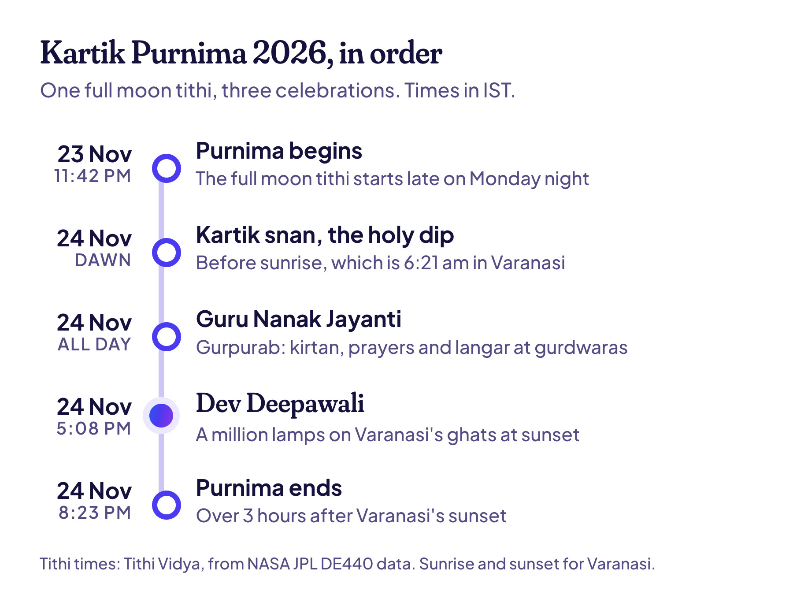

**Kartik Purnima 2026 is on Tuesday, 24 November.** The full moon tithi runs from 11:42 pm on Monday, 23 November, to 8:23 pm on Tuesday (IST). So the dawn bath, Guru Nanak Jayanti and the evening lamps of Dev Deepawali all fall on the same day this year.

That isn't a given. Next year, the same full moon splits these celebrations across two days. Why the evening matters so much, and sunrise times for the holy dip in 6 cities, are below.

## Kartik Purnima 2026 date and time

| | Date and time (IST) |
| --- | --- |
| Purnima begins | Monday, 23 November, 11:42 pm |
| Purnima ends | Tuesday, 24 November, 8:23 pm |
| Kartik Purnima snan (holy dip) | Tuesday, 24 November, at dawn |
| Guru Nanak Jayanti (Gurpurab) | Tuesday, 24 November |
| Dev Deepawali in Varanasi | Tuesday, 24 November, from sunset (5:08 pm) |

Kartik Purnima is the full moon of the month of Kartika, the holiest month of the year for many Hindus. It's also called Tripuri Purnima, and in Bengal, Rash Purnima.

## Why the evening of 24 November counts

A Hindu calendar names each day after the tithi running at sunrise. Purnima begins late on Monday night, so Tuesday's sunrise falls in it, and Tuesday is Kartik Purnima. It's the same sunrise rule that made [Dev Uthani Ekadashi so confusing](/blog/dev-uthani-ekadashi) this year.

Evening rituals need one more thing: Purnima has to be running after sunset too. On Monday evening it hasn't started yet. On Tuesday it runs until 8:23 pm, more than 3 hours after Varanasi's 5:08 pm sunset. So the lamps of Dev Deepawali and the deepdaan (lamps floated on the river) are lit while the full moon tithi is still on.

2027 won't line up so neatly. That year Purnima runs from 9:55 am on Saturday, 13 November, to 8:55 am on Sunday. Sunday's sunrise makes Sunday, 14 November, Kartik Purnima and the day of the holy dip. But only Saturday's evening falls in Purnima, so Dev Deepawali's lamps will most likely be lit on Saturday night.

> **Read next:** [Chhath Puja 2026: dates, Kharna and arghya times](/blog/chhath-puja). Another Kartika festival where the exact sunrise and sunset matter.

## Kartik Purnima snan: sunrise for the holy dip

The bath is taken at dawn, ideally before sunrise. Purnima is running all through Tuesday morning, so the whole dawn counts. For people who have bathed at dawn every day of Kartika since Sharad Purnima on 26 October, this is the last and most important dip.

| City | Where people bathe | Sunrise, Tue 24 Nov |
| --- | --- | --- |
| Varanasi | Ganga ghats | 6:21 am |
| Prayagraj | Sangam | 6:26 am |
| Haridwar | Har Ki Pauri | 6:49 am |
| Pushkar | Pushkar Lake | 6:57 am |
| Sonepur, Bihar | Where the Gandak meets the Ganga | 6:13 am |
| Cuttack | Mahanadi | 6:01 am |

Each time is when the top edge of the sun clears a flat horizon. I worked them out from NASA JPL's [DE440 data](https://ssd.jpl.nasa.gov/doc/de440_de441.html), the same way [Tithi Vidya works out every sunrise](/how-it-works). Buildings and trees on the far bank can hide the sun for a few minutes longer.

## Dev Deepawali 2026 in Varanasi

Dev Deepawali, "the Diwali of the gods", is on Tuesday, 24 November. As the sun goes down at 5:08 pm, the ghats of Varanasi light up with more than a million clay diyas. They run all the way from Ravidas Ghat in the south to Raj Ghat in the north. The Ganga aarti follows, and lamps float down the river.

The story behind it: on this full moon, Shiva destroyed Tripurasura's three flying cities with a single arrow, which is why the day is also called Tripurari Purnima. Tradition says the gods came down to the Ganga to celebrate, and they come down to bathe on this night every year. [Wikipedia's page on Dev Deepawali](https://en.wikipedia.org/wiki/Dev_Deepavali_%28Varanasi%29) has more on the ghats and the rituals.

> **Tip:** If you're going to Varanasi for it, reach the ghats well before sunset, and book any boat ahead. The ghats and the river get very crowded by evening.

## Guru Nanak Jayanti 2026

Guru Nanak Jayanti, or Gurpurab, is also on Tuesday, 24 November. It marks the birth of Guru Nanak Dev Ji, the first Sikh Guru. Tradition places his birth on the full moon of Kattak (Kartik) in 1469, so Gurpurab follows Kartik Purnima every year. It's a gazetted holiday on the central government's 2026 list.

The celebrations start well before the day:

- **Prabhat Pheris:** early-morning processions from gurdwaras, singing hymns, in the weeks before.
- **Akhand Path:** a 48-hour, non-stop reading of the Guru Granth Sahib, which ends on the morning of Gurpurab.
- **Nagar Kirtan:** a procession the day before, on Monday, 23 November, led by the Panj Pyare.
- **Langar:** a free community meal at gurdwaras on the day, open to everyone.

## How else Kartik Purnima is celebrated

- **Pushkar, Rajasthan.** The holy dip in Pushkar Lake is the high point of the Pushkar fair, which runs from Dev Uthani Ekadashi to this full moon.
- **Sonepur, Bihar.** The big Sonepur fair begins with a dip where the Gandak meets the Ganga.
- **Odisha.** Before sunrise, families float small boats carrying lamps, called Boita Bandana, to remember the sea traders who once sailed to Bali and Java. Cuttack's Bali Jatra fair starts the same day.
- **Bengal.** It's Rash Purnima, when Krishna's raas is celebrated, with the biggest crowds in Nabadwip and Shantipur.
- **Jains** begin the pilgrimage to Shatrunjaya hill at Palitana again, after the four monsoon months.
- **At home,** many families keep a Purnima fast and hold a Satyanarayan puja. If you're pregnant, diabetic or on medicine, talk to your doctor before a fast.

It's also the last day for [Tulsi Vivah](/blog/tulsi-vivah), which can be held any day from Dev Uthani Ekadashi up to this full moon. And many believe Vishnu's first avatar, Matsya the fish, appeared on Kartik Purnima. [Wikipedia's Kartik Purnima page](https://en.wikipedia.org/wiki/Kartik_Purnima) has more of these traditions.

## Common questions

### Kartik Purnima kab hai in 2026?

On Tuesday, 24 November 2026. The Purnima tithi starts at 11:42 pm on Monday, 23 November, and ends at 8:23 pm on Tuesday (IST).

### What time is the Kartik Purnima snan?

At dawn on Tuesday, 24 November, ideally before sunrise. That's 6:21 am in Varanasi and 6:49 am in Haridwar. Purnima is running all morning, so any time around dawn counts.

### Is Dev Deepawali on 23 or 24 November 2026?

On Tuesday, 24 November. The lamps are lit after sunset, and on Tuesday evening Purnima is still running until 8:23 pm.

### Is Guru Nanak Jayanti a holiday in 2026?

Yes. Guru Nanak's Birthday, on Tuesday, 24 November, is on the central government's list of gazetted holidays. State and bank holidays vary, so check your state's list.

### When is Kartik Purnima in 2027?

On Sunday, 14 November 2027, the day of the holy dip. Purnima begins at 9:55 am on Saturday, 13 November, so Dev Deepawali's evening lamps are likely to be lit that Saturday.

> **Tip:** Your birth tithi comes back every year, just like Kartik Purnima. [Find my tithi](/find) shows yours, with your tithi birthday for the next 100 years.

## Keep reading

- [Tulsi Vivah 2026: date, story and simple puja vidhi](/blog/tulsi-vivah): the wedding of the tulsi plant, which can be held up to this full moon.
- [Dev Uthani Ekadashi 2026: 20 or 21 November?](/blog/dev-uthani-ekadashi): why the dates split, with parana times for 12 cities.
- [Chhath Puja 2026](/blog/chhath-puja): four days of offerings to the setting and rising sun.
