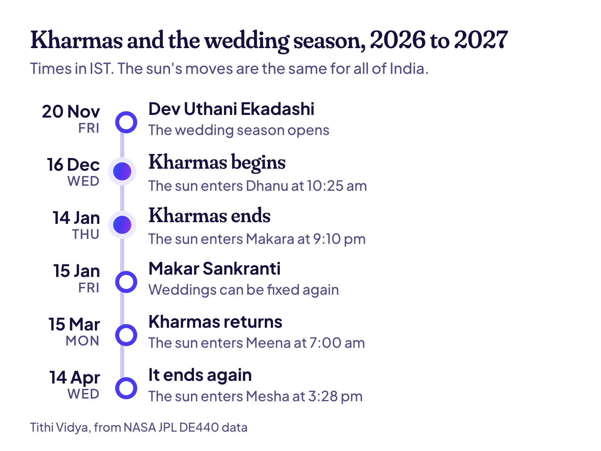

**Kharmas 2026 starts on Wednesday, 16 December, at 10:25 am and ends on Thursday, 14 January 2027, at 9:10 pm (IST).** For those 29 days, many families in North India hold no weddings, housewarmings or other big ceremonies. They begin again from Makar Sankranti, on Friday, 15 January.

Here's the odd part. Almost everything in the Hindu calendar follows the moon. Kharmas doesn't. It follows only the sun, and that's why its dates hardly move from one year to the next.

## Kharmas 2026 start and end date

Kharmas comes twice a year. These are the next three:

| Kharmas | Starts | Ends |
| --- | --- | --- |
| Winter 2026 to 2027 | Wed, 16 Dec 2026, 10:25 am | Thu, 14 Jan 2027, 9:10 pm |
| Spring 2027 | Mon, 15 Mar 2027, 7:00 am | Wed, 14 Apr 2027, 3:28 pm |
| Winter 2027 to 2028 | Thu, 16 Dec 2027, 4:39 pm | Sat, 15 Jan 2028, 3:24 am |

The times are in IST, and they're the same across India. Kharmas lands in the middle of the wedding season, which [opened on Dev Uthani Ekadashi](/blog/dev-uthani-ekadashi), 20 November.

## What is Kharmas?

Kharmas is the month the sun spends in the sign of Dhanu (Sagittarius), and later the month it spends in Meena (Pisces). It begins the moment the sun crosses into the sign and ends the moment it leaves. So it comes twice a year.

Why those two signs? In Hindu astrology [both are ruled by Jupiter](https://www.thehitavada.com/Encyc/2026/3/9/kharmaas-from-15th-auspicious-ceremonies-to-pause-for-a-month.html), Guru, the planet tied to marriage and good beginnings. Tradition holds that the sun's stay [dims Jupiter's influence](https://www.thedailyjagran.com/spiritual/kharmas-march-2025-start-and-end-date-check-significance-and-dos-and-donts-to-follow-during-malmas-10223652) for the month, so big beginnings wait.

It's [also called Malmas](https://etvbharat.com/en/!state/kharmas-ends-january-15-wedding-season-to-begin-with-75-auspicious-dates-in-2025-enn25010104772). In Tamil Nadu, the sun's month in Dhanu is [Margazhi](https://en.wikipedia.org/wiki/Dhanu_%28month%29), and weddings aren't held in it there either.

## Why the date hardly moves

Diwali can fall anywhere across four weeks, because it follows the moon. [Hindu dates slide about 11 days a year](/blog/why-your-hindu-birthday-moves) for that reason.

Kharmas ignores the moon. The sun enters Dhanu on 15 or 16 December almost every year, and Meena on 14 or 15 March. Look at the table again: 10:25 am in 2026, then 4:39 pm in 2027. It arrives about six hours later each year, until a leap day pulls it back.

> **Did you know?** I noticed this while checking the times. At both moments this winter, when Kharmas begins and when it ends, the tithi running is Shukla Saptami, the lunar day tied to the sun. It's a coincidence, but a nice one.

## What families avoid, and what carries on

By custom, these wait until Kharmas is over:

- [Weddings, engagements, griha pravesh (moving into a new home) and mundan](https://www.thehitavada.com/Encyc/2026/3/9/kharmaas-from-15th-auspicious-ceremonies-to-pause-for-a-month.html) (a child's first haircut)
- For many families, [buying a house, other property or a vehicle](https://www.thedailyjagran.com/spiritual/kharmas-march-2025-start-and-end-date-check-significance-and-dos-and-donts-to-follow-during-malmas-10223652)

Everything else carries on, and the month is thought good for prayer and giving:

- Daily puja, fasts and festivals. Mokshada Ekadashi and Gita Jayanti fall on 20 December, and [Saphala Ekadashi, the first of 2027](/blog/ekadashi-list), on 3 January.
- Charity, prayer and pilgrimages, which are thought especially worthwhile in this month.

It's a custom, not a rule for everyone. Many communities don't keep Kharmas at all, and families differ on how strictly they follow it.

## When do weddings start again?

Kharmas ends at 9:10 pm on 14 January, after sunset. So the first full day outside it is Friday, 15 January, which is Makar Sankranti.

That doesn't mean every date after it is a wedding date. A priest picks a muhurat (a good time) from the tithi, the star of the day and more, and our calculator doesn't work muhurats out. Priests usually publish the season's wedding dates well ahead, so ask yours for the first ones after Kharmas.

> **Tip:** The tithi you were married on comes back every year, just like a birthday. [Find my tithi](/find) works for any date: enter your wedding day and it lists that tithi for years ahead.

## Kharmas, Malmas and Adhik Maas

People mix these up, and the word Malmas gets used for both.

| | Kharmas | Adhik Maas |
| --- | --- | --- |
| What it is | The sun's month in Dhanu or Meena | An extra lunar month |
| Set by | The sun | The moon |
| How often | Twice every year | About once in 32 months |
| Most recent | 15 March to 14 April 2026 | 17 May to 15 June 2026 |

There's no Adhik Maas in 2027. Wikipedia has more on [how the extra month works](https://en.wikipedia.org/wiki/Adhika-masa).

I worked out these times with Tithi Vidya's data, which comes from NASA JPL's [DE440 data](https://ssd.jpl.nasa.gov/doc/de440_de441.html) for the sun's position. The tithis are from our calculator, and [How it works](/how-it-works) explains the method.

## Common questions

### Kharmas kab se kab tak hai?

From 10:25 am on 16 December 2026 to 9:10 pm on 14 January 2027. The next one runs from 15 March to 14 April 2027.

### Can weddings be held during Kharmas?

By North Indian custom, no: families wait for it to end. It isn't observed by every community, so follow your own family's practice.

### Is Kharmas the same as Malmas?

In everyday speech, often yes. But Malmas can also mean Adhik Maas, the extra lunar month, which is a different thing.

## Keep reading

- [Tulsi Vivah 2026: date, story and simple puja vidhi](/blog/tulsi-vivah): the wedding that opens the season Kharmas interrupts.
- [Vivah Panchami 2026](/blog/vivah-panchami): 14 December, two days before Kharmas begins.
- [Hindu calendar 2027: all festival dates with tithi](/blog/hindu-calendar): the year ahead, with Makar Sankranti on 15 January.
