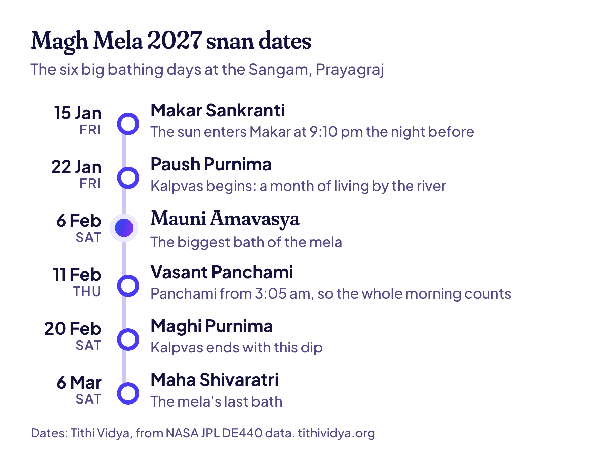

**Magh Mela 2027 runs from Friday, 15 January to Saturday, 6 March at the Sangam in Prayagraj.** It has six big bathing days, and the biggest is Mauni Amavasya on Saturday, 6 February.

There's a twist this year. The mela usually opens on Paush Purnima, the full moon of the month of Paush. In 2027 that full moon comes late, so Makar Sankranti gets there first, a week earlier. I ran six years of these dates through our engine to see why, and I'll show you below.

## Magh Mela 2027 snan dates

| Date | Snan | Tithi or sun times (IST) |
| --- | --- | --- |
| Fri, 15 Jan | Makar Sankranti | The sun enters Makar at 9:10 pm on 14 Jan |
| Fri, 22 Jan | Paush Purnima | 9:31 pm, 21 Jan to 5:47 pm, 22 Jan |
| Sat, 6 Feb | Mauni Amavasya | 7:06 pm, 5 Feb to 9:26 pm, 6 Feb |
| Thu, 11 Feb | Vasant Panchami | 3:05 am, 11 Feb to 3:19 am, 12 Feb |
| Sat, 20 Feb | Maghi Purnima | 8:00 am, 20 Feb to 4:54 am, 21 Feb |
| Sat, 6 Mar | Maha Shivaratri | 12:04 pm, 6 Mar to 1:47 pm, 7 Mar |

The dates are for Prayagraj. A tithi (a lunar day) starts and ends at the same moment everywhere, so the times hold across India. They come from Tithi Vidya, which works out the sun and moon from NASA JPL's [DE440 data](https://ssd.jpl.nasa.gov/doc/de440_de441.html) ([here's how](/how-it-works)). The span matches the government's [Incredible India page for Magh Mela 2027](https://www.incredibleindia.gov.in/en/festivals-and-events/uttar-pradesh/magh-mela-2027), which also gives 15 January to 6 March.

## Why Magh Mela 2027 starts with Sankranti

The mela runs on two clocks. Makar Sankranti follows the sun: it's the day the sun moves into Makar (Capricorn), so it stays on 14 or 15 January every year. Every other bath follows the moon, and the moon's dates [slide about 11 days a year, then jump back](/blog/why-your-hindu-birthday-moves).

So each January there's a little race. Whichever comes first, the full moon or the sun, opens the mela. Here's how it runs, worked out for Prayagraj:

| Year | Paush Purnima | Makar Sankranti | First big bath |
| --- | --- | --- | --- |
| 2025 | Mon, 13 Jan | Tue, 14 Jan | Paush Purnima |
| 2026 | Sat, 3 Jan | Wed, 14 Jan | Paush Purnima |
| **2027** | **Fri, 22 Jan** | **Fri, 15 Jan** | **Makar Sankranti** |
| 2028 | Wed, 12 Jan | Sat, 15 Jan | Paush Purnima |
| 2029 | Sun, 31 Dec 2028 | Sun, 14 Jan | Paush Purnima |
| 2030 | Sat, 19 Jan | Mon, 14 Jan | Makar Sankranti |

The first two rows are a good check on the numbers. The Maha Kumbh at Prayagraj [opened on 13 January 2025](https://en.wikipedia.org/wiki/Kumbh_Mela). Last year's Magh Mela [began on Paush Purnima, Saturday, 3 January 2026](https://www.theweek.in/wire-updates/national/2026/01/03/lakhs-bathe-in-freezing-sangam-waters-as-magh-mela-begins-in-prayagraj.amp.html). Both are the days the engine gives.

And look at 2029. Its Paush Purnima falls on 31 December 2028, so that year's mela opens before the year has even begun.

Why the 15th and not the 14th in 2027? The sun moves into Makar at 9:10 pm on Thursday, 14 January, after sunset. The holy hours of Sankranti then fall on the next morning, so the mela's first bath is on Friday.

> **Read next:** [One sun, 12 names](/blog/makar-sankranti-different-names): Makar Sankranti as Pongal, Lohri, Bihu and Uttarayan, and the 2027 split between the 14th and the 15th.

## Mauni Amavasya: the biggest bath

Mauni Amavasya is the mela's main bath. On that one day in 2026, officials counted [more than 3.15 crore people in the water by noon](https://theprint.in/india/up-3-15-crore-devotees-take-holy-dip-on-mauni-amavasya-at-sangam/2830261), with crowds reaching the ghats from midnight. In 2027 the new moon begins at 7:06 pm on Friday, 5 February and ends at 9:26 pm on Saturday. So Saturday's sunrise falls inside it, and Saturday, 6 February is the day.

It falls on a Saturday, so it's also a Shani Amavasya, the only one of 2027. There's [more on that, and on the other 12 new moons](/blog/amavasya-list), in our Amavasya list.

> **Did you know?** An annular solar eclipse happens on the same Amavasya. You won't see it from the Sangam, though: it peaks around 9:30 pm IST, after dark in India, according to [NASA's list of 2027 eclipses](https://eclipse.gsfc.nasa.gov/OH/OH2027.html).

## Kalpvas 2027: a month by the Sangam

Kalpvas is the month some pilgrims spend living by the river, in camps near the Sangam. It runs [from Paush Purnima to Maghi Purnima](https://telanganatoday.com/kalpvas-concludes-at-maha-kumbh-with-holy-dip-on-maghi-purnima). In 2027 that's from Friday, 22 January to Saturday, 20 February.

PTI's report from the first day of the 2026 mela describes the routine. Kalpvasis take a vow from their priests and stay in a township set up for them inside the mela. They bathe in the Ganga twice a day and eat one meal a day.

They break that fast after the last dip on Maghi Purnima. The numbers are big: at the 2025 Maha Kumbh, the Uttar Pradesh government put the count of kalpvasis at more than 10 lakh.

Maghi Purnima has a small puzzle of its own in 2027. At Prayagraj its tithi begins at 8:00 am on Saturday, after the 6:34 am sunrise. It ends at 4:54 am on Sunday, before the next one. It touches no sunrise at all. Saturday holds nearly all of it, so Saturday is the day.

The whole mela keeps time by the moon, just like your Hindu birthday does. Want to know yours? [Find my tithi](/find) takes a minute.

## Vasant Panchami and Maha Shivaratri

**Vasant Panchami, Thursday, 11 February.** The Panchami tithi starts at 3:05 am on Thursday and runs until 3:19 am on Friday. So the whole of Thursday morning, from before first light, is Panchami.

**Maha Shivaratri, Saturday, 6 March.** This one goes by a different rule. Shivaratri is kept on the night when Chaturdashi, the 14th tithi, is running at midnight. Chaturdashi begins at 12:04 pm on Saturday and ends at 1:47 pm on Sunday. Saturday's midnight falls inside it, so the night of Saturday, 6 March is Maha Shivaratri, and it's the mela's last bath.

## Sunrise at the Sangam on each snan day

Planning an early dip? These are the sunrise times at Prayagraj, worked out from the same NASA data.

| Date | Snan | Sunrise at Prayagraj |
| --- | --- | --- |
| Fri, 15 Jan | Makar Sankranti | 6:50 am |
| Fri, 22 Jan | Paush Purnima | 6:49 am |
| Sat, 6 Feb | Mauni Amavasya | 6:44 am |
| Thu, 11 Feb | Vasant Panchami | 6:41 am |
| Sat, 20 Feb | Maghi Purnima | 6:34 am |
| Sat, 6 Mar | Maha Shivaratri | 6:21 am |

If you'd like your dip to fall inside the tithi itself, watch the end times in the first table. Paush Purnima ends at 5:47 pm on 22 January, so an afternoon dip that day still counts. On Maghi Purnima, Saturday is the only day with the full moon in daylight.

## Common questions

### Magh Mela 2027 kab hai?

From Friday, 15 January to Saturday, 6 March 2027. The six big snan days are 15 January, 22 January, 6 February, 11 February, 20 February and 6 March.

### Magh Mela 2027 mein kahan lagega?

At the Triveni Sangam in Prayagraj, Uttar Pradesh, where the Ganga, the Yamuna and the unseen Saraswati are said to meet. The mela is held there every year.

### When does kalpvas start in 2027?

On Paush Purnima, Friday, 22 January. It ends with the dip on Maghi Purnima, Saturday, 20 February.

### Is there a Kumbh Mela in 2027?

Not at Prayagraj, which held its Maha Kumbh in 2025. The Kumbh melas of 2027 are elsewhere. Haridwar holds an Ardh Kumbh in March, and Nashik and Trimbakeshwar the Simhastha in July and August, as Wikipedia's Kumbh Mela page lists them.

### Which is the biggest snan of Magh Mela 2027?

Mauni Amavasya, on Saturday, 6 February. The new moon runs from 7:06 pm on Friday to 9:26 pm on Saturday.

## Keep reading

- [Hindu calendar 2027](/blog/hindu-calendar): every festival of next year, with the tithi behind each date.
- [Purnima 2027 list](/blog/purnima-list): Paush and Maghi Purnima with all the other full moons, and moonrise times.
- [Amavasya 2027 list](/blog/amavasya-list): Mauni Amavasya and the other new moons, and which day suits shraddha.
