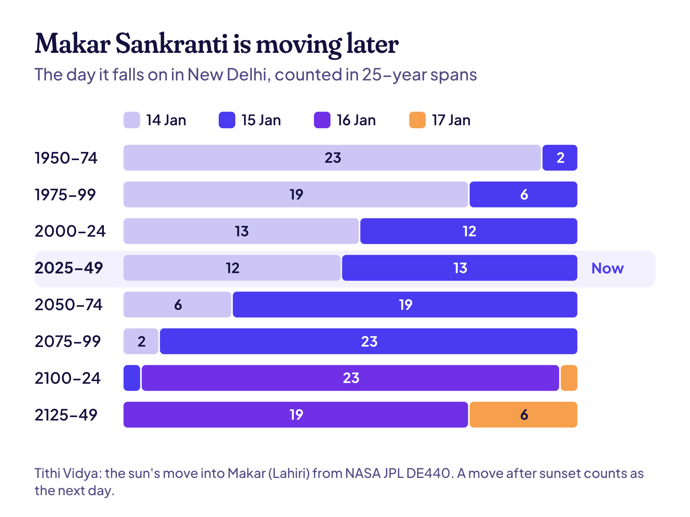

**Makar Sankranti 2027 is on Friday, 15 January, by most panchangs.** The sun moves into Makar (Capricorn) at 9:10 pm IST on Thursday, 14 January. That's after sunset everywhere in India, so the festival's holy hours fall on Friday morning.

But the central government's holiday list says Thursday. And if you live in London or New York, the same rule gives you Thursday too. I'll untangle all of that first. Then there's a bigger surprise: the date itself is slowly moving, and I have 200 years of numbers to show it.

## Makar Sankranti 2027 date and time

| | Date and time (IST) |
| --- | --- |
| The sun enters Makar | Thursday, 14 January, 9:10 pm |
| Makar Sankranti, by the panchang | Friday, 15 January |
| Central government holiday | Thursday, 14 January |
| Thai Pongal | Friday, 15 January |
| Next year | Saturday, 15 January 2028 (the sun moves at 3:24 am) |

Our calculator works out tithis, the moon's days. For Sankranti I ran the same NASA JPL [DE440 data](https://ssd.jpl.nasa.gov/doc/de440_de441.html) through a separate script, with the Lahiri ayanamsa that most Indian calendars use ([how the numbers are made](/how-it-works)).

Dainik Jagran's [Makar Sankranti 2027 page](https://english.dainikjagranmpcg.com/religion/makar-sankranti-2027-date-punya-kaal-timings-and-rituals/article-18215) gives the same Friday, for the same reason. Its time for the sun's move is 9:06 pm, four minutes off ours. Calendars use slightly different settings, and here it changes nothing: both times are long after sunset.

## Why the 15th, when the holiday is on the 14th

Most panchangs follow one simple rule. If the sun changes sign after sunset, the day belongs to the next morning, and so do the holy dip, the charity and the puja. In 2027 the sun arrives at 9:10 pm, so the festival moves to Friday.

The central government's [2027 holiday list](https://utilities.cept.gov.in/dop/pdfbind.ashx?id=15435) keeps Makar Sankranti on Thursday, 14 January, and puts Pongal on Friday, the 15th. State governments set their own holidays too, so check yours.

Here's what the evening looks like across India. In every city the sun had set hours before 9:10 pm.

| City | Sunset, Thu 14 Jan | Sunrise, Fri 15 Jan |
| --- | --- | --- |
| New Delhi | 5:45 pm | 7:15 am |
| Mumbai | 6:20 pm | 7:15 am |
| Kolkata | 5:12 pm | 6:19 am |
| Chennai | 6:01 pm | 6:35 am |
| Bengaluru | 6:12 pm | 6:46 am |
| Hyderabad | 6:01 pm | 6:49 am |
| Ahmedabad | 6:14 pm | 7:23 am |
| Patna | 5:19 pm | 6:37 am |

So the holy hours begin with Friday's sunrise in your city. For Pongal, that's Thai Pongal on Friday, after Bhogi on Thursday.

> **Read next:** [Makar Sankranti's 12 names](/blog/makar-sankranti-different-names): Pongal, Lohri, Bihu, Uttarayan and the rest, state by state.

## Makar Sankranti 2027 in the USA, UK and abroad

The sun moves into Makar at one moment for the whole world: 3:40 pm GMT on Thursday, 14 January. Run the same sunset rule on local clocks, and readers in the west get a different day.

| City | The sun enters Makar (local time) | Day by the same rule |
| --- | --- | --- |
| London | Thu 14 Jan, 3:40 pm (sunset 4:19 pm) | Thursday, 14 January |
| New York | Thu 14 Jan, 10:40 am | Thursday, 14 January |
| Toronto | Thu 14 Jan, 10:40 am | Thursday, 14 January |
| San Francisco | Thu 14 Jan, 7:40 am | Thursday, 14 January |
| Dubai | Thu 14 Jan, 7:40 pm (sunset 5:50 pm) | Friday, 15 January |
| Singapore | Thu 14 Jan, 11:40 pm | Friday, 15 January |
| Sydney | Fri 15 Jan, 2:40 am | Friday, 15 January |

In London the sun arrives 39 minutes before sunset, and in North America in the morning. So by local time, Thursday is the day. If your temple's calendar says Friday, go with your temple.

## Why Makar Sankranti stays in mid-January

Almost every Hindu festival follows the moon, so its date [slides about 11 days a year and jumps back](/blog/why-your-hindu-birthday-moves). Makar Sankranti follows the sun instead. It's the moment the sun, seen against the stars, crosses into the sign of Makar. Our calendar also follows the sun, so the two stay close.

Close, but not exactly in step. The calendar keeps pace with the seasons. Makar Sankranti keeps pace with the stars. Earth's axis wobbles very slowly, so the two drift apart by about [one degree every 72 years](https://en.wikipedia.org/wiki/Uttarayana). The sun covers about one degree a day, so Makar Sankranti slips about one day later every 72 years.

You can see it in the moment the sun enters Makar. It comes about 6 hours later each year, and every leap day pulls it back by a day. The pull-back is never quite enough, and the drift builds up:

Look at the middle rows. From 2000 to 2024, 13 years landed on the 14th and 12 on the 15th. From 2025 to 2049 it flips: 13 on the 15th, 12 on the 14th.

By the 2070s the 14th is almost gone. And after 2100, a year with no leap day, the festival jumps to the 16th. The first such year is 2101, when the sun moves at 8:36 pm on 15 January.

> **Did you know?** You'll often read that it's the 14th in normal years and the 15th in leap years. That was roughly true for your grandparents. It isn't any more: 2027 isn't a leap year, and it's the 15th.

## Isn't it the day the sun turns north?

Not any more. The sun starts moving north (Uttarayan) right after the winter solstice. Wikipedia's Uttarayana article calls the idea that Makar Sankranti starts it "a common misconception". The two fell on the same day about 1,700 years ago, and they've drifted apart since.

In the coming season the solstice is at 2:20 am IST on Tuesday, 22 December 2026. The sun has been heading north for over three weeks by the time it enters Makar. Gujarat still calls the festival Uttarayan.

## How people mark the day

The day starts with a holy dip, in a river if there's one nearby. At Prayagraj it's the first big bath of the [Magh Mela 2027](/blog/magh-mela). Then come charity, sesame and jaggery sweets, khichdi in the north, and kites over Gujarat. Each region has its own way, and its own name for the day.

And if you want to know which tithi you were born on, that's the moon's side of the calendar. [Find my tithi](/find) works it out in a minute.

## Common questions

### Makar Sankranti 2027 mein kab hai?

Friday, 15 January 2027, by most panchangs. The sun enters Makar at 9:10 pm on Thursday, 14 January, after sunset, so the festival moves to the next morning. The central government's holiday list keeps it on Thursday.

### Is Makar Sankranti 2027 a holiday on the 14th or the 15th?

The central government's 2027 list gives Thursday, 14 January for Makar Sankranti and Friday, 15 January for Pongal. States publish their own lists, which can differ.

### Why is Makar Sankranti always on 14 or 15 January?

Because it follows the sun, not the moon. It's the day the sun enters the sign of Makar, and our calendar tracks the sun too. It drifts by about a day every 72 years, which is why it's moving from the 14th to the 15th.

### When will Makar Sankranti fall on 16 January?

The sun first enters Makar on 16 January in 2102. By the after-sunset rule, the festival reaches the 16th a year earlier, in 2101, and stays there for most of that century.

### What time is Makar Sankranti 2027 in the USA?

The sun enters Makar at 10:40 am Eastern time and 7:40 am Pacific time on Thursday, 14 January. By the same sunset rule, that makes Thursday the day in the US.

## Keep reading

- [Makar Sankranti's 12 names](/blog/makar-sankranti-different-names): what each state calls it and how each one celebrates.
- [Magh Mela 2027](/blog/magh-mela): Sankranti opens the mela this year, a week before Paush Purnima.
- [Hindu calendar 2027](/blog/hindu-calendar): every festival of next year, with its rule.
