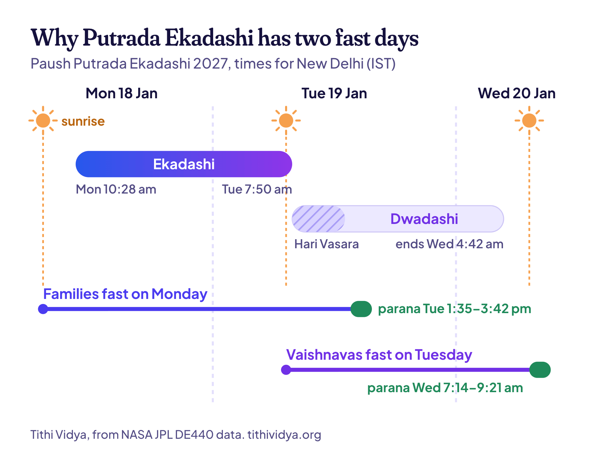

**Paush Putrada Ekadashi 2027 is on Monday, 18 January, for most families, and on Tuesday, 19 January, for Vaishnavas.** The Ekadashi tithi runs from 10:28 am on Monday to 7:50 am on Tuesday (IST). Families break the fast on Tuesday afternoon, between 1:35 pm and 3:42 pm in New Delhi.

That surprises people, since Tuesday has Ekadashi at sunrise. The reason is Dwadashi, the day after, and a picture shows it best.

## Paush Putrada Ekadashi 2027 date and time

| | Date and time (IST) |
| --- | --- |
| Ekadashi begins | Monday, 18 January, 10:28 am |
| Ekadashi ends | Tuesday, 19 January, 7:50 am |
| Families (Smarta) fast | Monday, 18 January |
| Families break the fast, New Delhi | Tuesday, 19 January, 1:35 pm to 3:42 pm |
| Vaishnavas fast | Tuesday, 19 January |
| Vaishnavas break the fast, New Delhi | Wednesday, 20 January, 7:14 am to 9:21 am |

A tithi starts and ends at one moment everywhere, so these tithi times hold across India. They come from Tithi Vidya, which works out the sun and moon from NASA JPL's [DE440 data](https://ssd.jpl.nasa.gov/doc/de440_de441.html) ([here's how](/how-it-works)). The parana windows depend on your city's sunrise, so there's a table for 12 cities below.

## Why there are two fast days

Look at the top bar. Ekadashi is still running at Tuesday's sunrise, for 36 minutes, so by the usual rule Tuesday is the Ekadashi day.

Now the second bar. The fast is broken during Dwadashi, the next tithi, and this Dwadashi ends at 4:42 am on Wednesday, before sunrise. A Tuesday fast would have no Dwadashi morning to end in. So most families fast a day earlier, on Monday, and break it on Tuesday.

Vaishnavas keep Tuesday and break the fast on Wednesday morning. Go by your family's tradition, or your temple's.

> **Read next:** [What is a tithi?](/blog/what-is-tithi) Why a Hindu day can start at 10:28 in the morning.

## Why the fast ends in the afternoon

Families break this fast in the afternoon. The first quarter of Dwadashi, called Hari Vasara, isn't a time to break a fast, and this time it lasts until 1:03 pm.

By then the early morning has gone, and calendars avoid the middle of the day, so the window moves to the afternoon. Our Ekadashi list explains [why some parana times fall after midday](/blog/ekadashi-list#why-some-parana-times-are-after-midday).

| City | Families: Tue 19 Jan | Vaishnavas: Wed 20 Jan |
| --- | --- | --- |
| New Delhi | 1:35 pm to 3:42 pm | 7:14 am to 9:21 am |
| Mumbai | 1:56 pm to 4:10 pm | 7:15 am to 9:29 am |
| Kolkata | 1:03 pm to 3:04 pm | 6:19 am to 8:30 am |
| Chennai | 1:28 pm to 3:46 pm | 6:36 am to 8:53 am |
| Bengaluru | 1:39 pm to 3:57 pm | 6:46 am to 9:04 am |
| Hyderabad | 1:34 pm to 3:49 pm | 6:50 am to 9:05 am |
| Ahmedabad | 1:56 pm to 4:07 pm | 7:23 am to 9:34 am |
| Pune | 1:52 pm to 4:06 pm | 7:10 am to 9:24 am |
| Jaipur | 1:42 pm to 3:50 pm | 7:17 am to 9:25 am |
| Lucknow | 1:21 pm to 3:29 pm | 6:56 am to 9:04 am |
| Patna | 1:05 pm to 3:14 pm | 6:37 am to 8:46 am |
| Varanasi | 1:13 pm to 3:23 pm | 6:45 am to 8:55 am |

If you're pregnant, diabetic or on medicine, talk to your doctor before a fast.

## Outside India: one day for everyone

Abroad it's simpler. In London and North America the tithi covers Monday's sunrise and ends that night, so everyone fasts on Monday.

| City | Fast day | Break the fast |
| --- | --- | --- |
| London | Monday, 18 January | Tue 19 Jan, 7:56 am to 9:38 am |
| New York | Monday, 18 January | Tue 19 Jan, 7:16 am to 9:12 am |
| Toronto | Monday, 18 January | Tue 19 Jan, 7:46 am to 9:39 am |
| San Francisco | Monday, 18 January | Tue 19 Jan, 7:22 am to 9:22 am |
| Sydney | Tuesday, 19 January | Wed 20 Jan, 6:04 am to 8:53 am |

Dubai, Singapore and Kathmandu split like India: families on Monday, Vaishnavas on Tuesday. ISKCON temples follow their own Gaudiya rules, so check your temple's calendar too.

## What Putrada means

Putrada means "the giver of sons". Couples fast on this day and pray to Vishnu for a son, and for their children's well-being. There are two Putrada Ekadashis a year: this one in the bright half of Paush, and another in Shravana, in July or August. [Wikipedia notes](https://en.wikipedia.org/wiki/Pausha_Putrada_Ekadashi) that the Paush one is more popular in North India, while other states give more weight to the one in Shravana.

The story behind it comes from the Bhavishya Purana. King Suketuman and Queen Shaibya were unhappy because they had no child. The king met a group of sages at Lake Manasarovar, who told him to keep this fast, and the couple later had a son. Like every Ekadashi, many people avoid grains and beans on the day.

Your own birthday has a tithi too, and it comes back once a year just like this one. [Find my tithi](/find) shows it in a minute.

## Common questions

### Paush Putrada Ekadashi 2027 kab hai?

On Monday, 18 January 2027, for most families, and Tuesday, 19 January, for Vaishnavas. The Ekadashi tithi runs from 10:28 am on Monday to 7:50 am on Tuesday.

### When to break the Paush Putrada Ekadashi fast?

After a Monday fast, between 1:35 pm and 3:42 pm on Tuesday (New Delhi). After a Tuesday fast, between 7:14 am and 9:21 am on Wednesday.

### When is the next Putrada Ekadashi?

Shravana Putrada Ekadashi is on Thursday, 12 August 2027.

## Keep reading

- [Ekadashi 2027 list](/blog/ekadashi-list): every fast of the year, with parana times.
- [Saphala Ekadashi 2027](/blog/saphala-ekadashi): the first Ekadashi of 2027, and the one place abroad where it falls a day earlier.
- [Hindu calendar 2027](/blog/hindu-calendar): every festival of the year, with its tithi.
