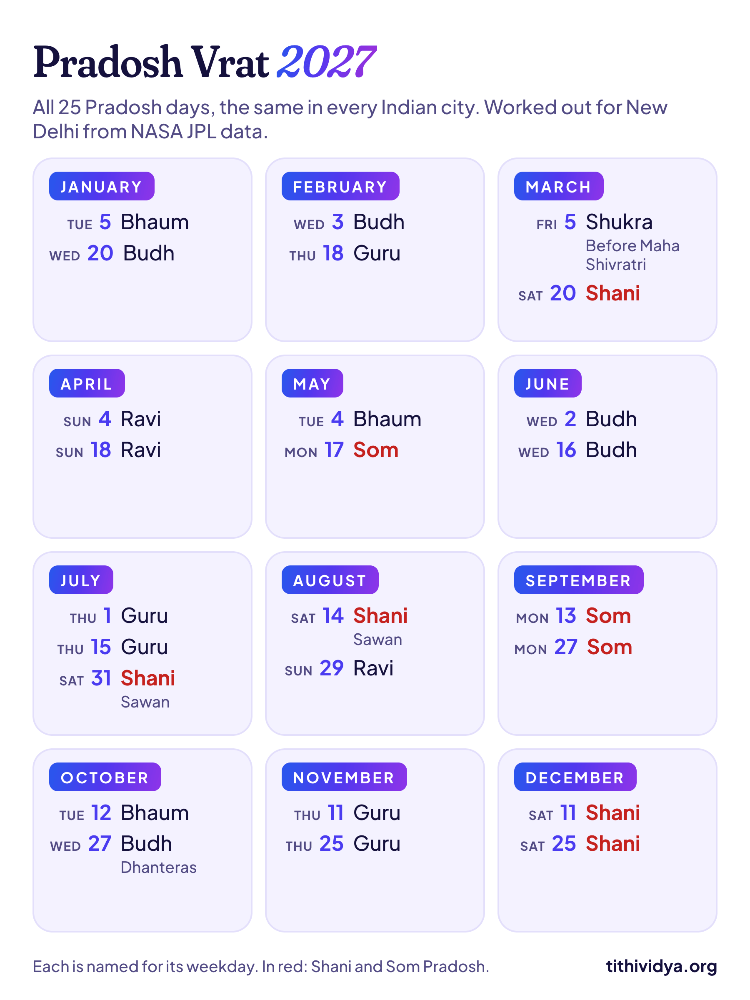

**There are 25 Pradosh Vrat days in 2027. The first is Tuesday, 5 January, a Bhaum Pradosh, and the last is Saturday, 25 December.** If you're reading this in December 2026, the next one is Monday, 21 December, a Som Pradosh.

Five of 2027's Pradosh fall on a Saturday, against two in 2026, and both of Sawan's are among them. But if you live in the US, every one of those Saturdays moves to a Friday. I'll show you why below.

## Pradosh Vrat 2027 dates

| Date | Pradosh | Sunset, Delhi |
| --- | --- | --- |
| Tue, 5 Jan | Bhaum | 5:38 pm |
| Wed, 20 Jan | Budh | 5:50 pm |
| Wed, 3 Feb | Budh | 6:02 pm |
| Thu, 18 Feb | Guru | 6:13 pm |
| Fri, 5 Mar | Shukra | 6:23 pm |
| Sat, 20 Mar | **Shani** | 6:32 pm |
| Sun, 4 Apr | Ravi | 6:41 pm |
| Sun, 18 Apr | Ravi | 6:48 pm |
| Tue, 4 May | Bhaum | 6:58 pm |
| Mon, 17 May | **Som** | 7:06 pm |
| Wed, 2 Jun | Budh | 7:15 pm |
| Wed, 16 Jun | Budh | 7:21 pm |
| Thu, 1 Jul | Guru | 7:23 pm |
| Thu, 15 Jul | Guru | 7:21 pm |
| Sat, 31 Jul | **Shani** | 7:13 pm |
| Sat, 14 Aug | **Shani** | 7:02 pm |
| Sun, 29 Aug | Ravi | 6:47 pm |
| Mon, 13 Sep | **Som** | 6:29 pm |
| Mon, 27 Sep | **Som** | 6:12 pm |
| Tue, 12 Oct | Bhaum | 5:55 pm |
| Wed, 27 Oct | Budh | 5:40 pm |
| Thu, 11 Nov | Guru | 5:30 pm |
| Thu, 25 Nov | Guru | 5:24 pm |
| Sat, 11 Dec | **Shani** | 5:25 pm |
| Sat, 25 Dec | **Shani** | 5:31 pm |

I worked these out with Tithi Vidya, which uses NASA JPL's [DE440 data](https://ssd.jpl.nasa.gov/doc/de440_de441.html) for the sun and the moon ([how it works](/how-it-works)).

I ran the same list for 12 Indian cities, from Kolkata to Ahmedabad and Chennai to Lucknow, and every date came out the same. Only the sunset time changes.

## How the Pradosh day is chosen

Pradosh falls on Trayodashi, the 13th [tithi, or lunar day](/blog/what-is-tithi), of each half of the moon's month. That's why it comes twice a month. The worship happens in pradosh kaal, the twilight around sunset. [Wikipedia's Pradosha page](https://en.wikipedia.org/wiki/Pradosha) puts it at 1.5 hours either side of sunset.

So the day isn't picked at sunrise, like most festivals. It's the evening when Trayodashi is running at sunset.

> **Example:** The first Pradosh of 2027. Trayodashi begins at 6:16 pm on Monday, 4 January, about 40 minutes after Delhi's sunset. It runs until 8:40 pm on Tuesday. Monday's sunset comes before it, Tuesday's falls inside it. So the vrat is on Tuesday, 5 January.

There's one rarer case. Sometimes Trayodashi starts just after one sunset and ends before the next, so no sunset falls in it at all. Then the vrat stays on that first evening, since its twilight still has some Trayodashi in it. That doesn't happen in Delhi in 2027, but it did twice in 2026, on 12 June and 21 December.

To be sure the rule matches what families actually follow, I ran it over 2026. It gave the same 25 days as [Amar Ujala's published list for 2026](https://www.amarujala.com/spirituality/festivals/pradosh-vrat-2026-dates-list-calendar-hindu-vrat-calendar-2026-2025-12-09), including both of those odd ones.

> **Read next:** [Ekadashi 2027 list](/blog/ekadashi-list): the other fast that comes twice a month, with the time to break each one.

## Shani, Som and Bhaum Pradosh in 2027

Each Pradosh takes the name of its weekday: Som for Monday, Bhaum for Tuesday, Shani for Saturday, and so on.

| Pradosh | Weekday | Dates in 2027 |
| --- | --- | --- |
| Shani | Saturday | 20 Mar, 31 Jul, 14 Aug, 11 Dec, 25 Dec |
| Som | Monday | 17 May, 13 Sep, 27 Sep |
| Bhaum | Tuesday | 5 Jan, 4 May, 12 Oct |
| Budh | Wednesday | 20 Jan, 3 Feb, 2 Jun, 16 Jun, 27 Oct |
| Guru | Thursday | 18 Feb, 1 Jul, 15 Jul, 11 Nov, 25 Nov |
| Shukra | Friday | 5 Mar |
| Ravi | Sunday | 4 Apr, 18 Apr, 29 Aug |

Shani and Som Pradosh are the two that Wikipedia names. One of its stories is set at Ujjain's Mahakaleshwar temple. A king there was attacked on a Saturday Trayodashi, a Shani Pradosh, and Shiva appeared to protect the city.

How people keep it varies, but the outline is the same. Many fast through the day and bathe before sunset. Then they worship Shiva, Parvati and Nandi in the twilight with lamps and bael leaves, and the Pradosh story is read after the puja.

> **Tip:** If you're pregnant, diabetic or on medicine, talk to your doctor before a fast.

## The special Pradosh days of 2027

**Friday, 5 March: the eve of Maha Shivratri.** Wikipedia calls the Pradosh that falls just before or on Maha Shivratri the Maha Pradosha. In 2027 Shivratri is on Saturday, 6 March, so this Shukra Pradosh is it. The [Hindu calendar 2027](/blog/hindu-calendar) explains why Shivratri goes by midnight.

**Saturday, 31 July and Saturday, 14 August: both of Sawan's.** In North India, Sawan runs from 19 July to 17 August in 2027. Its two Pradosh, one in each half of the month, are both Shani Pradosh.

**Wednesday, 27 October: Dhanteras.** Dhanteras is kept on Kartika's dark-half Trayodashi, in the evening. So it lands on the very same twilight as this Budh Pradosh, two days before Diwali.

Pradosh follows the moon's calendar, and so does your Hindu birthday. [Find my tithi](/find) shows yours in a minute.

## Outside India

A tithi starts at the same moment all over the world. But New York's clock is 10½ hours behind India's (9½ in summer). So its Trayodashi often begins in the afternoon and is running at sunset a day before India's. Sydney is ahead of India, so it can go the other way.

| City | Pradosh that move | New dates in 2027 |
| --- | --- | --- |
| London | 5, a day earlier | 4 Jan, 19 Mar, 3 May, 30 Jul, 12 Sep |
| New York, Toronto | 12, a day earlier | 4 Jan, 19 Jan, 19 Mar, 3 Apr, 3 May, 15 Jun, 30 Jul, 13 Aug, 12 Sep, 26 Oct, 10 Dec, 24 Dec |
| San Francisco | 15, a day earlier | The 12 above, plus 17 Apr, 1 Jun and 28 Aug |
| Sydney | 5, a day later | 18 May, 2 Jul, 16 Jul, 28 Sep, 13 Oct |
| Dubai | 2, a day earlier | 4 Jan, 3 May |
| Singapore, Kathmandu | None | Same as India |

Look at the Saturdays. All five of India's Shani Pradosh move to Friday in New York, Toronto and San Francisco. New York and Toronto get just one Shani Pradosh all year, on 3 April. Temples abroad often print their own local calendar, so check yours too.

## Common questions

### Pradosh Vrat kab hai?

The next one is on Monday, 21 December 2026, a Som Pradosh. The first of 2027 is on Tuesday, 5 January, a Bhaum Pradosh.

### How many Pradosh Vrat are there in 2027?

25. There are two a month, and July has three: 1, 15 and 31 July.

### When is Shani Pradosh in 2027?

Five times in India: 20 March, 31 July, 14 August, 11 December and 25 December. In the US and Canada, each of these falls on the Friday before.

### What time is the Pradosh puja?

In the evening twilight around sunset. In New Delhi, sunset on 2027's Pradosh days ranges from 5:24 pm on 25 November to 7:23 pm on 1 July. The table above has each date.

## Keep reading

- [Purnima 2027 list](/blog/purnima-list): every full moon of the year, with the fast days and moonrise.
- [Amavasya 2027 list](/blog/amavasya-list): all 13 new moons, and which day suits shraddha.
- [Sakat Chauth 2027](/blog/sakat-chauth): the January fast that ends at moonrise, with times for your city.
