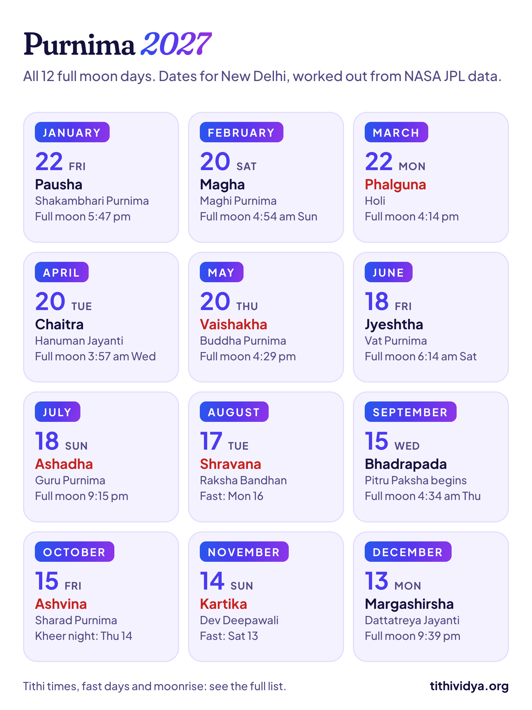
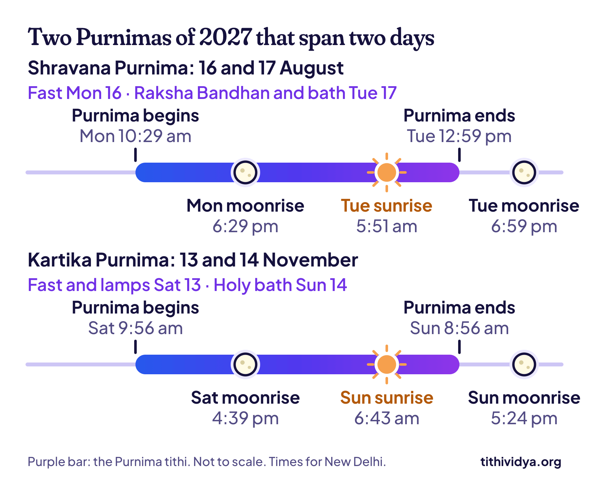

**2027 has 12 Purnimas. The first is Pausha Purnima on Friday, 22 January, and the last is Margashirsha Purnima on Monday, 13 December.** This Purnima 2027 list gives each date and time for New Delhi: when the tithi begins, when it ends, the fast day and the moonrise.

Two of the twelve need care. For Raksha Bandhan's Purnima in August and Kartik Purnima in November, the fast falls a day before the date on most calendars. I'll show why with a picture.

## Purnima 2027 list: all 12 dates

| Date | Purnima | Known for |
| --- | --- | --- |
| Fri, 22 Jan | Pausha Purnima | Shakambhari Purnima; Magh Mela bathing begins |
| Sat, 20 Feb | Magha Purnima | Maghi Purnima, Guru Ravidas Jayanti |
| Mon, 22 Mar | Phalguna Purnima | Holi; Holika Dahan the night before |
| Tue, 20 Apr | Chaitra Purnima | Hanuman Jayanti |
| Thu, 20 May | Vaishakha Purnima | Buddha Purnima |
| Fri, 18 Jun | Jyeshtha Purnima | Vat Purnima |
| Sun, 18 Jul | Ashadha Purnima | Guru Purnima |
| Tue, 17 Aug | Shravana Purnima | Raksha Bandhan, Narali Purnima |
| Wed, 15 Sep | Bhadrapada Purnima | Pitru Paksha begins |
| Fri, 15 Oct | Ashvina Purnima | Sharad Purnima, Kojagari |
| Sun, 14 Nov | Kartika Purnima | Dev Deepawali, Guru Nanak Jayanti |
| Mon, 13 Dec | Margashirsha Purnima | Dattatreya Jayanti |

Each date is the day that has Purnima at sunrise, the rule most calendars print. Purnima is the 15th tithi, the last [lunar day](/blog/what-is-tithi) of the bright half, when the moon stands opposite the sun. In South India it's Pournami, and in Gujarat, Poonam.

See how the date slides, from the 22nd in January to the 13th in December? One full moon follows the last after about 29.5 days, and most calendar months are longer than that. So Purnima comes about a day earlier each month.

## Purnima 2027 date and time

A Purnima isn't a calendar day. It's a tithi, so it starts and ends at odd hours. These are the hours for 2027, in IST. They hold for all of India.

| Purnima | Tithi begins | Tithi ends (exact full moon) |
| --- | --- | --- |
| Pausha | Thu 21 Jan, 9:31 pm | Fri 22 Jan, 5:47 pm |
| Magha | Sat 20 Feb, 8:00 am | Sun 21 Feb, 4:54 am |
| Phalguna | Sun 21 Mar, 6:22 pm | Mon 22 Mar, 4:14 pm |
| Chaitra | Tue 20 Apr, 4:52 am | Wed 21 Apr, 3:57 am |
| Vaishakha | Wed 19 May, 4:03 pm | Thu 20 May, 4:29 pm |
| Jyeshtha | Fri 18 Jun, 4:35 am | Sat 19 Jun, 6:14 am |
| Ashadha | Sat 17 Jul, 6:49 pm | Sun 18 Jul, 9:15 pm |
| Shravana | Mon 16 Aug, 10:29 am | Tue 17 Aug, 12:59 pm |
| Bhadrapada | Wed 15 Sep, 2:49 am | Thu 16 Sep, 4:34 am |
| Ashvina | Thu 14 Oct, 6:50 pm | Fri 15 Oct, 7:17 pm |
| Kartika | Sat 13 Nov, 9:56 am | Sun 14 Nov, 8:56 am |
| Margashirsha | Sun 12 Dec, 11:56 pm | Mon 13 Dec, 9:39 pm |

Here's something most lists leave out. **The moment a Purnima tithi ends is the exact full moon.** The tithi covers the last 12° of the moon's climb to the point opposite the sun, so the moon is fullest right as it ends. On 18 July that's 9:15 pm, a fine evening to look up. On 21 April it's 3:57 am.

The lengths differ too. January's Purnima lasts 20 hours 17 minutes and August's 26 hours 29 minutes, because the moon speeds up and slows down on its path.

## Purnima vrat 2027: fast days and moonrise

Many families keep a fast on Purnima, hold a Satyanarayan Puja in the evening, and break the fast after seeing the moon. So the evening matters more than the sunrise.

| Purnima | Fast (vrat) day | Moonrise, New Delhi | Bath and charity |
| --- | --- | --- | --- |
| Pausha | Fri, 22 Jan | 5:46 pm | Fri, 22 Jan |
| Magha | Sat, 20 Feb | 5:42 pm | Sat, 20 Feb |
| Phalguna | Mon, 22 Mar | 6:38 pm | Mon, 22 Mar |
| Chaitra | Tue, 20 Apr | 6:27 pm | Tue, 20 Apr |
| Vaishakha | Thu, 20 May | 7:19 pm | Thu, 20 May |
| Jyeshtha | Fri, 18 Jun | 7:04 pm | Fri, 18 Jun |
| Ashadha | Sun, 18 Jul | 7:18 pm | Sun, 18 Jul |
| Shravana | Mon, 16 Aug \* | 6:29 pm | Tue, 17 Aug |
| Bhadrapada | Wed, 15 Sep | 5:58 pm | Wed, 15 Sep |
| Ashvina | Fri, 15 Oct | 5:29 pm | Fri, 15 Oct |
| Kartika | Sat, 13 Nov \* | 4:39 pm | Sun, 14 Nov |
| Margashirsha | Mon, 13 Dec | 5:00 pm | Mon, 13 Dec |

\* The fast is a day before the sunrise date.

The rule most panchangs follow goes like this. The fast is kept on the day with Purnima at sunrise. But if Purnima has already begun by early afternoon of the day before, the fast moves to that earlier day, so the evening puja falls inside the tithi. In 2027 that happens twice.

Look at Shravana Purnima. The tithi begins at 10:29 am on Monday, 16 August. Monday's moon rises at 6:29 pm, inside Purnima. By Tuesday's moonrise the tithi is over. So the fast and the evening puja are on Monday, and Raksha Bandhan, which goes by the sunrise date, is on Tuesday.

Kartika Purnima works the same way: fast and lamps on Saturday, 13 November, holy bath at sunrise on Sunday the 14th. If your family simply fasts on the calendar date, that's fine too. Custom comes first.

The moon rises at a different minute in every city. Here's the moonrise on each fast day in three more:

| Fast day | Mumbai | Kolkata | Chennai |
| --- | --- | --- | --- |
| Fri, 22 Jan | 6:23 pm | 5:12 pm | 6:03 pm |
| Sat, 20 Feb | 6:11 pm | 5:03 pm | 5:46 pm |
| Mon, 22 Mar | 6:52 pm | 5:49 pm | 6:19 pm |
| Tue, 20 Apr | 6:33 pm | 5:32 pm | 5:55 pm |
| Thu, 20 May | 7:14 pm | 6:17 pm | 6:30 pm |
| Fri, 18 Jun | 6:57 pm | 6:01 pm | 6:12 pm |
| Sun, 18 Jul | 7:16 pm | 6:19 pm | 6:34 pm |
| Mon, 16 Aug | 6:33 pm | 5:34 pm | 5:55 pm |
| Wed, 15 Sep | 6:14 pm | 5:12 pm | 5:43 pm |
| Fri, 15 Oct | 5:57 pm | 4:50 pm | 5:33 pm |
| Sat, 13 Nov | 5:14 pm | 4:04 pm | 4:54 pm |
| Mon, 13 Dec | 5:43 pm | 4:30 pm | 5:25 pm |

If you're pregnant, diabetic or on medicine, talk to your doctor before a fast.

> **Tip:** Were you born on a full moon? About 1 person in 30 is. [Find my tithi](/find) shows the tithi you were born on, and the date it comes back every year.

## Purnima 2027, month by month

### January: Pausha Purnima, 22 January

The first Purnima of the year opens the Magh Mela bathing season at Prayagraj. It's also Shakambhari Purnima. Its tithi is the shortest of the twelve.

### February: Magha Purnima, 20 February

Maghi Purnima is a big bathing day and Guru Ravidas Jayanti. The tithi starts at 8:00 am on Saturday and ends at 4:54 am on Sunday, so it touches no sunrise at all. Saturday is the day. There's a faint eclipse that night too; more on it below.

### March: Phalguna Purnima, 22 March

This is Holi. Purnima begins at 6:22 pm on Sunday, 21 March, 11 minutes before sunset in Delhi, so the Holika bonfire is lit that evening. Colours fly on Monday. In Bengal and Odisha it's Dol Purnima.

### April: Chaitra Purnima, 20 April

Hanuman Jayanti in North India. Purnima runs from before dawn on Tuesday to before dawn on Wednesday, so the whole day and the whole night belong to it.

### May: Vaishakha Purnima, 20 May

Buddha Purnima, which marks the birth, the enlightenment and the passing of the Buddha.

### June: Jyeshtha Purnima, 18 June

Vat Purnima, when married women in Maharashtra and Gujarat tie threads around a banyan tree. This tithi is long, and it's running at sunrise on both Friday and Saturday. The fast is on Friday. Some families take the holy bath on Saturday morning.

### July: Ashadha Purnima, 18 July

Guru Purnima, the day to thank your teachers. The full moon is exact at 9:15 pm on Sunday.

### August: Shravana Purnima, 17 August

Raksha Bandhan, and Narali Purnima on the Maharashtra coast, where fishing families offer coconuts to the sea. The fast is on Monday, 16 August. It's the longest Purnima tithi of 2027.

### September: Bhadrapada Purnima, 15 September

Pitru Paksha, the fortnight for remembering ancestors, begins with this Purnima and runs to 29 September.

### October: Ashvina Purnima, 15 October

Sharad Purnima, the harvest full moon, when kheer is left out in the moonlight. Purnima begins at 6:50 pm on Thursday, 14 October, and covers that whole night. That's why Kojagari Lakshmi Puja, done at midnight, belongs to Thursday. The fast and the sunrise date are Friday the 15th, and Friday's moon still rises inside Purnima, at 5:29 pm.

So both nights have a claim. I'd leave the kheer out on Thursday night, the one that's Purnima from end to end, but follow your family.

### November: Kartika Purnima, 14 November

Dev Deepawali in Varanasi, Guru Nanak Jayanti, and the last day of the Pushkar fair. Lamps are lit on Saturday evening and the dip is on Sunday morning. [Kartik Purnima 2026](/blog/kartik-purnima) explains all three celebrations.

### December: Margashirsha Purnima, 13 December

Dattatreya Jayanti, kept most widely in Maharashtra and Karnataka.

> **Read next:** [Ekadashi 2027 list: all 25 dates with parana times](/blog/ekadashi-list). The other fast most families plan the year around.

## Lunar eclipses on Purnima in 2027

A lunar eclipse can only happen on a Purnima, when the Earth sits between the sun and the moon. In 2027 three Purnimas have one, and all three are penumbral. That means the moon passes only through the faint outer edge of the Earth's shadow.

| Purnima | Eclipse peak (IST) | What you'd see from India |
| --- | --- | --- |
| Magha, 20 February | 4:43 am, Sunday 21 February | A slight grey shading before dawn |
| Ashadha, 18 July | 9:33 pm, Sunday 18 July | Nothing: too slight to notice |
| Shravana, 17 August | 12:43 pm, Tuesday 17 August | Nothing: it's daytime |

None of them turns the moon red, and none is a partial or total eclipse. Most panchangs don't apply sutak, the eclipse restrictions, to a penumbral eclipse. Our calculator doesn't work out eclipses, so these times come from [NASA's table of 2027 eclipses](https://eclipse.gsfc.nasa.gov/OH/OH2027.html).

## Where these dates come from

I worked out the tithi times with Tithi Vidya, which reads the positions of the sun and moon from NASA JPL's [DE440 data](https://ssd.jpl.nasa.gov/doc/de440_de441.html). I've tested it against 92,839 tithi start times from Swiss Ephemeris, and half of them agree within 1.7 seconds. The method is on [How it works](/how-it-works).

The moonrise times come from the same NASA data. They're for the moon's upper edge on a flat horizon in New Delhi, so buildings, hills and haze will make you wait a few minutes longer. I checked all 12 dates against a published panchang for New Delhi, and they agree.

In Tamil Nadu and Kerala, many temples announce the hours for Pournami worship straight from the tithi's start and end, so use the times in the second table. And for readers outside India: the tithi begins at the same moment worldwide, but your sunrise differs, so a date can shift by a day. [Wikipedia's page on Purnima](https://en.wikipedia.org/wiki/Purnima) lists the festivals tied to each one.

## Common questions

### How many Purnimas are there in 2027?

12, one in every calendar month. A year with a blue moon, or with an extra Hindu month, can have 13.

### Purnima kab hai? When is the next one?

If you're reading this in late 2026, Kartik Purnima is on Tuesday, 24 November, and Margashirsha Purnima is on Wednesday, 23 December. The first Purnima of 2027 is on Friday, 22 January.

### When is Guru Purnima in 2027?

On Sunday, 18 July 2027. The Purnima tithi runs from 6:49 pm on Saturday to 9:15 pm on Sunday (IST).

### When is Sharad Purnima in 2027?

The Purnima tithi runs from 6:50 pm on Thursday, 14 October, to 7:17 pm on Friday, 15 October. Most calendars print Friday. The night that lies fully inside Purnima is Thursday's.

### Is Purnima the same as the full moon?

Almost. The full moon is one instant, when the moon is exactly opposite the sun. Purnima is the tithi of about a day that leads up to that instant.

### Can Satyanarayan Puja be done on Purnima?

Yes, it's the most common day for it. Families usually hold it on the evening of the fast day, the middle column of the table above.

## Keep reading

- [Hindu calendar 2027: all festival dates with tithi](/blog/hindu-calendar): where each Purnima sits among the year's festivals.
- [Kartik Purnima 2026: Dev Deepawali, Gurpurab and snan time](/blog/kartik-purnima): one Purnima, three celebrations.
- [What is a tithi?](/blog/what-is-tithi): why a Purnima can start at 6:50 pm, in one picture.
