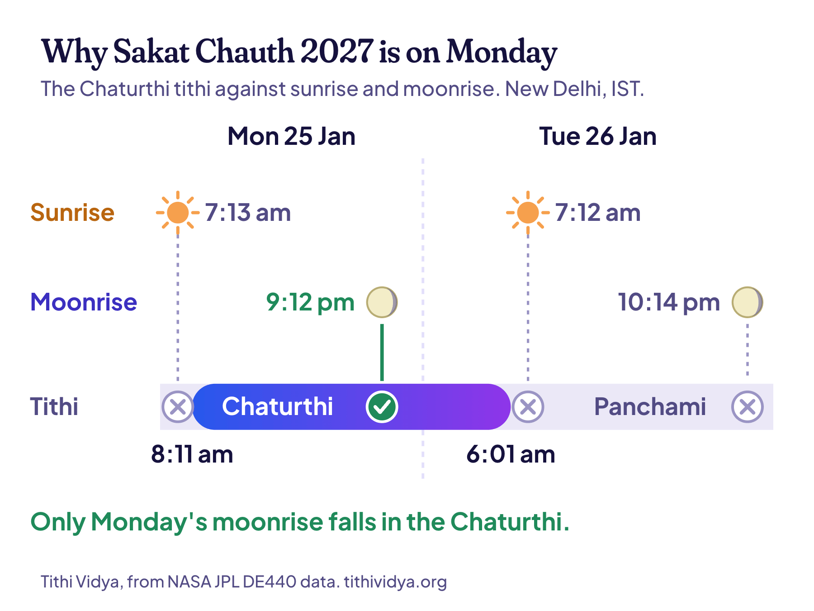

**Sakat Chauth 2027 is on Monday, 25 January.** The Chaturthi tithi runs from 8:11 am on Monday to 6:01 am on Tuesday (IST). Mothers fast through the day and break the fast after the moon rises, at 9:12 pm in New Delhi.

Here's the strange part. This Chaturthi never touches a sunrise, so by the rule most festivals follow, it wouldn't get a day at all. Sakat Chauth goes by the moon instead, and the moon picks Monday.

## Sakat Chauth 2027 date and time

| | Date and time (IST) |
| --- | --- |
| Chaturthi begins | Monday, 25 January, 8:11 am |
| Chaturthi ends | Tuesday, 26 January, 6:01 am |
| Sakat Chauth fast | Monday, 25 January |
| Moonrise, New Delhi | Monday, 25 January, 9:12 pm |

The tithi times are the same everywhere in India. They come from Tithi Vidya, which works out the sun and moon from NASA JPL's [DE440 data](https://ssd.jpl.nasa.gov/doc/de440_de441.html) ([here's how](/how-it-works)).

Our calculator doesn't do moonrise yet, so moonrise comes from a separate script on the same data. I checked it against the [moon table for New Delhi on timeanddate.com](https://www.timeanddate.com/moon/india/new-delhi?month=1&year=2027), which also says 9:12 pm.

## Why the moon picks the day

Most festivals take the tithi that's running at sunrise. Look at the two suns. Monday's sun rises at 7:13 am, an hour before the Chaturthi begins. By Tuesday's sunrise it has already ended. That makes it [a skipped tithi, or kshaya](/blog/what-is-tithi#how-a-day-gets-its-tithi), with no sunrise of its own.

But like every Sankashti Chaturthi, Sakat Chauth is kept on the day the moon comes up during the Chaturthi. Monday's moon rises at 9:12 pm, right in the middle of it. Tuesday's rises at 10:14 pm, in Panchami. So Monday it is.

> **Did you know?** It happened last year too. Sakat Chauth 2026, on 6 January, also missed both sunrises. This year's comes 19 days later because 2026 had an extra month, and moon dates [jump later after an extra month](/blog/why-your-hindu-birthday-moves).

## Sakat Chauth moonrise time in your city

The moon comes up first in the east. Kolkata sees it more than an hour before Ahmedabad. In every city here, the Chaturthi is still running when it rises.

| City | Moonrise, Mon 25 Jan |
| --- | --- |
| Kolkata | 8:27 pm |
| Patna | 8:40 pm |
| Varanasi | 8:49 pm |
| Prayagraj | 8:54 pm |
| Lucknow | 8:57 pm |
| Kanpur | 9:00 pm |
| Chennai | 9:03 pm |
| Hyderabad | 9:09 pm |
| New Delhi | 9:12 pm |
| Bhopal | 9:13 pm |
| Bengaluru | 9:14 pm |
| Jaipur | 9:19 pm |
| Indore | 9:19 pm |
| Pune | 9:28 pm |
| Mumbai | 9:32 pm |
| Ahmedabad | 9:33 pm |

These times are for the moon's top edge clearing a flat horizon. Buildings and winter haze can hide it a little longer.

## How Sakat Chauth is kept

Sakat Chauth is the Chaturthi of the dark half of Magha. [Wikipedia's Sankashti Chaturthi page](https://en.wikipedia.org/wiki/Sankashti_Chaturthi) lists it as the Magha one, kept mostly in North and Central India. Calendars that start each month at the new moon (amanta) call it Pausha instead, so you'll see both names.

Mothers keep the fast for their children's long life and health. They offer Ganesha til (sesame) laddoos, jaggery, modaks and durva grass. And they eat only after offering water (arghya) to the moon, as [Republic's report on Sakat Chauth 2026](https://www.republicworld.com/lifestyle/festivals/sakat-chauth-2026-first-chaturthi-of-the-year-today-know-moonrise-time-muhurat-significance) describes. The sesame gives it its other names, Til Chauth and Tilkut Chauth.

> **Tip:** If you're pregnant, diabetic or on medicine, talk to your doctor before a fast.

### The Sakat Chauth katha

In the story [Patrika tells](https://www.patrika.com/religion-news/sakat-chauth-ki-katha-sakat-chauth-2023-vrat-7971000/), a potter's pots won't bake in his kiln. A priest says a child must be given to the kiln, and a widow's only son is chosen.

She gives him a supari and durva grass, tells him to pray to Ganesha, and trusts Sakat Mata to keep him safe. The kiln fires in a single night, and the boy comes out unharmed. That's why mothers keep this fast for their children.

The fast follows the moon's calendar, and so does your Hindu birthday. [Find my tithi](/find) shows yours in a minute.

## Outside India

Abroad, one city moves Sakat Chauth to Sunday.

| City | Sakat Chauth | Moonrise |
| --- | --- | --- |
| London | Monday, 25 January | 9:03 pm |
| New York | Monday, 25 January | 9:15 pm |
| Toronto | Monday, 25 January | 9:38 pm |
| San Francisco | Sunday, 24 January | 8:27 pm |
| Dubai | Monday, 25 January | 9:15 pm |
| Singapore | Monday, 25 January | 9:57 pm |
| Sydney | Monday, 25 January | 9:51 pm |

In San Francisco the Chaturthi runs from 6:41 pm on Sunday to 4:31 pm on Monday, local time. Only Sunday's moonrise falls inside it.

New York and Toronto are odd. Their Chaturthi runs from 9:41 pm on Sunday to 7:31 pm on Monday, so neither moonrise falls in it. Calendars then take the day with the Chaturthi at sunrise: Monday. Check your temple's calendar too.

> **Read next:** [Magh Mela 2027](/blog/magh-mela). Sakat Chauth falls in the mela's month, between the Paush Purnima and Mauni Amavasya baths.

## Common questions

### Sakat Chauth 2027 kab hai?

On Monday, 25 January 2027. The Chaturthi runs from 8:11 am on Monday to 6:01 am on Tuesday (IST), and the fast ends after moonrise.

### What time is the moonrise on Sakat Chauth 2027?

9:12 pm in New Delhi, 9:32 pm in Mumbai and 8:27 pm in Kolkata. The city table above has 13 more.

### When is Til Chauth or Tilkut Chauth in 2027?

They're other names for Sakat Chauth: Monday, 25 January 2027.

### Is Sakat Chauth the same as Sankashti Chaturthi?

Yes. There's a Sankashti Chaturthi every month, on the fourth day after the full moon. Sakat Chauth is the one in Magha.

## Keep reading

- [Paush Purnima 2027](/blog/paush-purnima): the full moon three days earlier, the year's closest, when kalpvas begins.
- [Hindu calendar 2027](/blog/hindu-calendar): every festival of next year, with the tithi behind each date.
