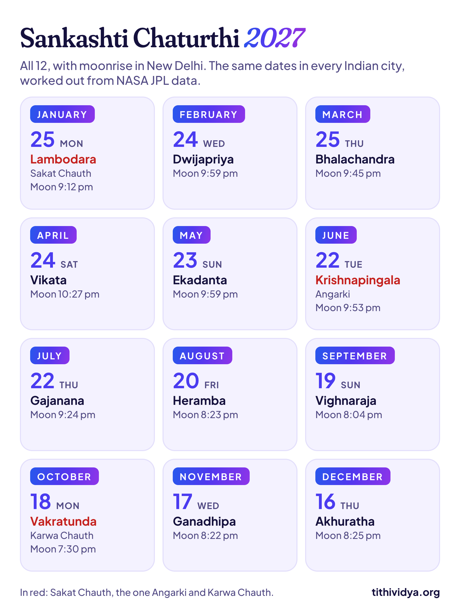

**There are 12 Sankashti Chaturthis in 2027. The first is Monday, 25 January (Sakat Chauth), and the only Angarki, on a Tuesday, is 22 June.** If you're reading this in December 2026, the next one is Saturday, 26 December, with moonrise at 8:14 pm in New Delhi.

Each one ends at moonrise, so the moon's time matters as much as the date. Below are both for every month, plus the Ganesha form each Sankashti is named after. One more thing: abroad, the dates shift, and New York gets three Angarkis instead of one.

## Sankashti Chaturthi 2027 dates and moonrise

| Date | Sankashti | Moonrise, Delhi |
| --- | --- | --- |
| Mon, 25 Jan | Lambodara | 9:12 pm |
| Wed, 24 Feb | Dwijapriya | 9:59 pm |
| Thu, 25 Mar | Bhalachandra | 9:45 pm |
| Sat, 24 Apr | Vikata | 10:27 pm |
| Sun, 23 May | Ekadanta | 9:59 pm |
| **Tue, 22 Jun** | **Krishnapingala** | 9:53 pm |
| Thu, 22 Jul | Gajanana | 9:24 pm |
| Fri, 20 Aug | Heramba | 8:23 pm |
| Sun, 19 Sep | Vighnaraja | 8:04 pm |
| Mon, 18 Oct | Vakratunda | 7:30 pm |
| Wed, 17 Nov | Ganadhipa | 8:22 pm |
| Thu, 16 Dec | Akhuratha | 8:25 pm |

The times are moonrise, when the fast ends. Three dates have more to them: 25 January is Sakat Chauth, 22 June is the year's Angarki, and 18 October is Karwa Chauth.

The dates come from Tithi Vidya, which works out the sun and moon from NASA JPL's [DE440 data](https://ssd.jpl.nasa.gov/doc/de440_de441.html) ([here's how](/how-it-works)). Our calculator doesn't do moonrise yet, so the moonrise times come from a separate script on the same data. They're for the top edge of the moon clearing a flat horizon, so buildings can hide it for a few minutes more.

I ran the list for 14 Indian cities, from Kolkata to Ahmedabad, and every date came out the same. Only the moonrise changes. The names follow the table of monthly Ganesha forms on [Wikipedia's Sankashti Chaturthi page](https://en.wikipedia.org/wiki/Sankashti_Chaturthi).

## Moonrise in more cities

The moon comes up first in the east. Kolkata always sees it at least half an hour before Delhi. Chennai sees it before Delhi from February to July, and after it from September. Bengaluru is 10 or 11 minutes after Chennai every time.

| Date | Mumbai | Kolkata | Chennai |
| --- | --- | --- | --- |
| 25 Jan | 9:32 pm | 8:27 pm | 9:03 pm |
| 24 Feb | 10:05 pm | 9:05 pm | 9:28 pm |
| 25 Mar | 9:44 pm | 8:46 pm | 9:02 pm |
| 24 Apr | 10:20 pm | 9:24 pm | 9:35 pm |
| 23 May | 9:53 pm | 8:57 pm | 9:09 pm |
| 22 Jun | 9:55 pm | 8:57 pm | 9:17 pm |
| 22 Jul | 9:38 pm | 8:36 pm | 9:06 pm |
| 20 Aug | 8:45 pm | 7:40 pm | 8:18 pm |
| 19 Sep | 8:38 pm | 7:28 pm | 8:17 pm |
| 18 Oct | 8:11 pm | 6:59 pm | 7:53 pm |
| 17 Nov | 9:03 pm | 7:50 pm | 8:45 pm |
| 16 Dec | 9:00 pm | 7:49 pm | 8:39 pm |

## How the Sankashti day is chosen

Sankashti is the Chaturthi, the fourth lunar day, after the full moon. Most festivals take the tithi running at sunrise, but Sankashti goes by the moon: the fast is kept on the day the moon rises while Chaturthi is running. That's the same rule as [Sakat Chauth](/blog/sakat-chauth), which is simply January's Sankashti.

Most months, only one evening fits. Two months in 2027 are the odd ones:

- **February: neither evening fits.** Chaturthi runs from 9:49 pm on Tuesday, 23 February, to 8:41 pm on Wednesday. Tuesday's moon rises at 8:57 pm, before it starts. Wednesday's rises at 9:59 pm, after it ends. Calendars then take the day that has Chaturthi at sunrise: Wednesday.
- **May: both evenings fit.** Chaturthi runs from 8:42 pm on Sunday, 23 May, to 10:59 pm on Monday. The moon rises inside it on both nights, at 9:59 pm and 10:42 pm. Calendars take the first: Sunday.

Every date in the list also matches the 2027 lists already published elsewhere.

> **Read next:** [Pradosh Vrat 2027 list](/blog/pradosh-vrat-list): the other monthly fast that goes by the evening sky, with all 25 dates.

## Angarki Chaturthi 2027: only one

When Sankashti falls on a Tuesday, it's called Angarki (or Angaraki) Sankashti Chaturthi. Tuesday is Mangalvar, the day of Mars, whose other name is Angaraka. Wikipedia tells how Ganesha blessed Angaraka on a Chaturthi that fell on a Tuesday.

In India, 2027 has just one: **Tuesday, 22 June**, the Krishnapingala Sankashti. The next comes on Tuesday, 8 August 2028.

## Sakat Chauth, Karwa Chauth and Ganesh Chaturthi

Two of 2027's Sankashtis go by better-known names. January's is Sakat Chauth, when mothers fast for their children. October's falls on Karwa Chauth, Monday, 18 October, when the moon rises at 7:30 pm in Delhi. The [Hindu calendar 2027](/blog/hindu-calendar) explains why some calendars print the 19th for it.

Ganesh Chaturthi is a different Chaturthi: the one after the new moon, in Bhadrapada. In 2027 it's on Saturday, 4 September, and the Vighnaraja Sankashti follows 15 days later.

## How Sankashti is kept

Devotees fast through the day for Ganesha, the remover of obstacles (*sankat* means trouble). As Wikipedia's page puts it, they break the fast at night, after prayers to Ganesha and a sight of the moon. Modaks and durva grass are the usual offerings, and many families also offer water to the moon.

> **Tip:** If you're pregnant, diabetic or on medicine, talk to your doctor before a fast.

Sankashti returns on its tithi every month, and your Hindu birthday returns on its tithi every year. [Find my tithi](/find) shows yours in a minute.

## Outside India

A tithi starts at the same moment everywhere, but the moon rises at local time. So abroad, the evening that catches the Chaturthi can be a different one.

| City | Dates that move | Angarki days in 2027 |
| --- | --- | --- |
| London | 23 Feb and 23 Apr, a day earlier | 23 Feb, 22 Jun |
| New York, Toronto | 23 Feb, 23 Apr, 21 Jul and 16 Nov, a day earlier | 23 Feb, 22 Jun, 16 Nov |
| San Francisco | 24 Jan, 23 Feb, 23 Apr, 21 Jul, 18 Sep and 16 Nov, a day earlier | 23 Feb, 22 Jun, 16 Nov |
| Sydney | 24 May, 21 Aug and 19 Oct, a day later | 22 Jun, 19 Oct |
| Singapore | 24 May and 21 Aug, a day later | 22 Jun |
| Dubai | 23 Feb, a day earlier | 23 Feb, 22 Jun |

In London, for example, Chaturthi starts at 4:19 pm on Tuesday, 23 February, and the moon rises inside it at 9:18 pm the same night. So Sankashti is on Tuesday there, an Angarki, while India keeps Wednesday. Kathmandu matches India all year. Temples abroad often print their own calendar, so check yours too.

## Common questions

### Sankashti Chaturthi kab hai?

The next one is Saturday, 26 December 2026, with moonrise at 8:14 pm in New Delhi. The first of 2027 is Monday, 25 January, which is Sakat Chauth.

### How many Sankashti Chaturthis are there in 2027?

12, one a month. 2026 had 13, because it had an extra month.

### When is Angarki Chaturthi in 2027?

Tuesday, 22 June 2027, in India. Moonrise is at 9:53 pm in New Delhi and 9:55 pm in Mumbai.

### What is the difference between Sankashti and Vinayaka Chaturthi?

Sankashti is the Chaturthi after the full moon, in the waning half. Vinayaka Chaturthi is the one after the new moon, in the waxing half, and in Bhadrapada that one is Ganesh Chaturthi.

## Keep reading

- [Ekadashi 2027 list](/blog/ekadashi-list): every Ekadashi fast of the year, with the time to break each one.
- [Purnima 2027 list](/blog/purnima-list): all 12 full moons, with the fast days and moonrise.
