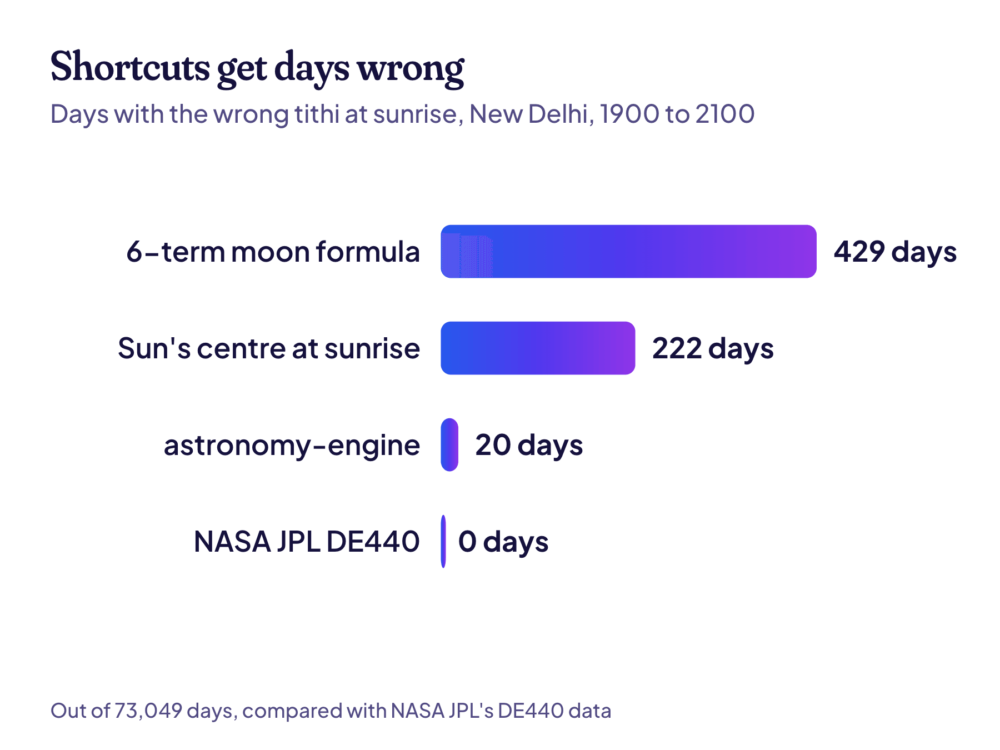

**A tithi birthday calculator takes your birth date, time and place, finds the tithi you were born on, and then finds the day it comes back each year.** That sounds simple. But five small choices inside it decide whether your date is right, a day off, or a whole month off.

I built [Tithi Vidya's calculator](/find) and tested it against tens of thousands of known results. Here's what I learned about what a good one has to get right, and how you can test any calculator in two minutes.

## How a tithi birthday calculator works

Every tithi birthday calculator does the same four steps, whether it tells you or not:

1. **It finds where the sun and moon were** at your birth moment.
2. **It works out your tithi** from the angle between them. Every 12° is one tithi, so there are 30 in a month.
3. **It finds your lunar month,** like Shravana or Kartika.
4. **It searches each year** for the day that tithi comes back in that month, and names the day by a rule, usually the tithi at sunrise.

If you want the basics first, start with [what a tithi birthday is](/blog/tithi-birthday).

### One birth, all four steps

Here's what happens inside, with real numbers. Take a birth at 8:30 am on 15 August 1998, in New Delhi.

1. **Sun and moon.** At that moment, the moon was 274° ahead of the sun.
2. **Tithi.** 274° divided by 12 is 22 full steps and a bit more, so this is the 23rd tithi: Krishna Ashtami, the 8th day of the dark half. It began at 2:24 pm the day before and ended at 12:16 pm that day.
3. **Month.** The moon was in the month of Shravana.
4. **The 2027 birthday.** In 2027, Krishna Ashtami of Shravana begins at 8:25 pm on 24 August and ends at 7:20 pm on 25 August. At sunrise on the 24th (5:55 am), the tithi is still Krishna Saptami. At sunrise on the 25th (5:55 am), it's Krishna Ashtami. So the tithi birthday is **Wednesday, 25 August 2027**.

Every choice in those four steps can go wrong. Here are the five that matter most.

## 1. Exact positions for the sun and moon

The moon doesn't move at a steady speed. It speeds up and slows down along its path, so a tithi can last anywhere from about 20 to 27 hours. A calculator needs the moon's real position to the minute, or it puts the tithi change at the wrong time. Near sunrise, a few minutes is enough to name the wrong day.

When I built Tithi Vidya, I tried the shortcuts first. Here's how many days each one got wrong, out of 73,049 days from 1900 to 2100, compared with exact NASA data:

A short moon formula gets about 2 days a year wrong. Even a good free library slips about once a decade. So Tithi Vidya reads NASA JPL's [DE440 data](https://ssd.jpl.nasa.gov/doc/de440_de441.html) directly. It's the same kind of data used to fly spacecraft.

> **Did you know?** The middle bar is a sneaky one. Sunrise counts from the moment the top edge of the sun clears the horizon, not its centre. Getting that detail wrong costs 222 days in 200 years.

## 2. Your birth time

A tithi can change at any hour, day or night. On many days, a morning birth and an evening birth fall on different tithis.

So a calculator that only asks for your birth date is guessing. It has to ask for the time. Don't know yours? A good calculator still helps. It shows when your tithi started and ended, so you can see if your guess sits safely inside it.

Our example shows why. Krishna Ashtami ended at 12:16 pm on 15 August 1998. A baby born that afternoon has Krishna Navami, and every one of their tithi birthdays lands a day later.

> **Tip:** If your birth time sits within an hour or two of a tithi change, ask your family whether you were born in the morning or the evening. That one detail can move your tithi birthday by a day every year.

## 3. Your place, and its sunrise

The tithi changes at the same instant everywhere on Earth. But the clock time and the sunrise are different in every city, and those decide which calendar day carries the tithi.

This matters more than most people think. I counted every tithi in 2027 with our engine: **139 of the 370 dated tithis fall on a different day in New York than in New Delhi.** That's more than one in three.

| 2027, Shukla Pratipada of... | New Delhi | New York |
| --- | --- | --- |
| Phalguna | 9 March | 8 March |
| Vaishakha | 7 May | 6 May |
| Shravana | 3 August | 2 August |
| Margashirsha | 29 November | 28 November |

So a calculator has to ask where you were born. It needs that place's time zone to read your birth time. And it needs real sunrise times there for every date it gives back.

Sunrise itself moves through the year, and it's later in winter than in summer. A calculator that assumes 6:00 am every day will name the wrong day whenever a tithi changes between 6:00 am and the real sunrise.

## 4. The rule that names the day

A tithi almost never lines up with a day. It starts in the middle of one day and ends in the middle of the next. So which day is your birthday? Calculators answer this differently.

Most panchangs use the **sunrise rule**: the tithi running at sunrise names the day. Some simpler tools use the day the tithi **starts** instead. Here's what that does to one real tithi birthday, Krishna Ashtami of Shravana at New Delhi:

| Year | Day it starts | Day by the sunrise rule |
| --- | --- | --- |
| 2026 | 4 Sep | 4 Sep |
| 2027 | 24 Aug | 25 Aug |
| 2029 | 31 Aug | 1 Sep |
| 2030 | 20 Aug | 21 Aug |

Three of those four years give a different answer. Neither tool is broken. They just follow different rules, and a good calculator tells you which rule it uses. Tithi Vidya uses the sunrise rule.

There are two odd cases too. A short tithi can miss every sunrise (a skipped tithi, or kshaya), and a long one can cover two (a doubled tithi, or vriddhi). The same birthday is skipped in 2043, so a calculator needs a rule for that as well. Ours picks the day the tithi falls in, and the first day of a doubled tithi.

> **Read next:** [Why your Hindu birthday moves every year](/blog/why-your-hindu-birthday-moves), with the year-by-year dates for one tithi.

## 5. The extra month

About every 32 or 33 months, the Hindu calendar adds an extra month, called [adhik maas](https://en.wikipedia.org/wiki/Adhika-masa), to stay in step with the seasons. Sometimes that extra month is a copy of your birth month. Then your tithi comes around twice in one year, a month apart.

Here's the same birthday again in 2042, when Shravana comes twice:

| 2042 | Krishna Ashtami | Day |
| --- | --- | --- |
| Extra Shravana (adhik) | 8 August | Friday |
| Regular Shravana (nija) | 7 September | Sunday |

A calculator that takes the first match gives 8 August. Most families keep the regular month, which gives 7 September. That's a 30-day gap from one quiet choice in the code. Tithi Vidya always uses the regular month.

## How to test any tithi birthday calculator

You don't have to trust anyone, including us. Run this two-minute test on any calculator:

1. Enter a birth of **15 August 1998 at 8:30 am in New Delhi.**
2. It should say the tithi is **Krishna Ashtami**, in Shravana (or Bhadrapada, if it uses full-moon months).
3. It should show the tithi ending at about **12:16 pm** on 15 August 1998. If it shows no times at all, that's a warning sign.
4. The tithi birthdays should be **4 September 2026** and **25 August 2027**.
5. For 2042, it should give **7 September**, not 8 August.

If a calculator passes all five, it's handling time, place, the day rule and the extra month properly. If it fails step 4 by a day, it probably uses a different day rule. If it fails step 5 by a month, it isn't handling the extra month.

### Red flags in a tithi calculator

Even before you test it, a few things should make you careful:

- **No birth time field.** It can't know your tithi on a day when the tithi changes.
- **No place, or only a country.** Sunrise in Arunachal Pradesh comes almost two hours before sunrise in Gujarat, though both use the same clock.
- **No times on the result.** You can't check a tithi without seeing when it starts and ends.
- **No word on the method.** A good tool says where its sun and moon positions come from and which day rule it uses.
- **It asks for your name, phone number or email first.** Working out a tithi needs none of that.
- **The dates only go a year or two ahead.** If it can't show your tithi birthday ten years out, it may be reading from a fixed printed table rather than calculating it.

### What a calculator can't decide for you

Some choices belong to your family, not the software. Some families keep a birthday by nakshatra, the star the moon was in, rather than by tithi. Some follow a priest's own panchang, which may name a day differently in a skipped or doubled tithi. And some keep the purnimanta month names, so the same day carries a different month's name.

A good calculator shows you enough, like the tithi's start and end times and its month, that you can match it to your family's way.

## How we test Tithi Vidya

Saying "accurate" is easy, so here are the numbers. The engine was checked against [Swiss Ephemeris](https://www.astro.com/swisseph/), a separate, widely used astronomy system:

| What was checked | Result |
| --- | --- |
| All 92,839 tithi changes from 1899 to 2150 | Half within 1.7 seconds; the worst up to 2026 is 6.5 seconds |
| The tithi at sunrise in New Delhi for 91,311 days | 8 days differ, all within 18 seconds of a tithi change |
| All 3,095 lunar month names | No differences |
| 5,856 sunrises in 8 cities | Worst gap 2.7 seconds |

The code, the data and every test are open. You can read them, and run them yourself, from [How it works](/how-it-works).

## Common questions

### Is a Hindu birthday calculator the same as a tithi birthday calculator?

Usually, yes. Most "Hindu birthday calculators" find your tithi birthday. A few use your birth nakshatra instead, which is common in Kerala and Tamil Nadu, so check which one you're getting.

### Why do two calculators give me different dates?

Almost always for one of the five reasons above. It could be a rough moon position, a missing birth time, the wrong place, a different day rule or the extra month. Run the test above on both and you'll usually spot which one.

### Can I use it for a death anniversary?

Yes. The maths is the same: enter the date, time and place of passing instead of a birth. The tithi that comes back each year in that month is the date many families use for the yearly shraddha.

### Which calendar system does Tithi Vidya use?

Amanta months, which run from new moon to new moon, with the Lahiri ayanamsa and the sunrise rule. Lahiri is the ayanamsa used by the Indian government's own national panchang. If your family uses full-moon (purnimanta) months, the tithi and the date are the same; only the month's name can differ in the dark half.

### Does Tithi Vidya store my birth details?

No. Everything is worked out in your browser, so your birth details never leave your device. It's free and open source.

## Keep reading

- [What a tithi birthday is, and how to find yours](/blog/tithi-birthday): the basics, with a real example.
- [Why your Hindu birthday moves every year](/blog/why-your-hindu-birthday-moves): the 11-day slide and the extra month.
- [Find my tithi](/find): your own tithi birthday for the next 100 years.
