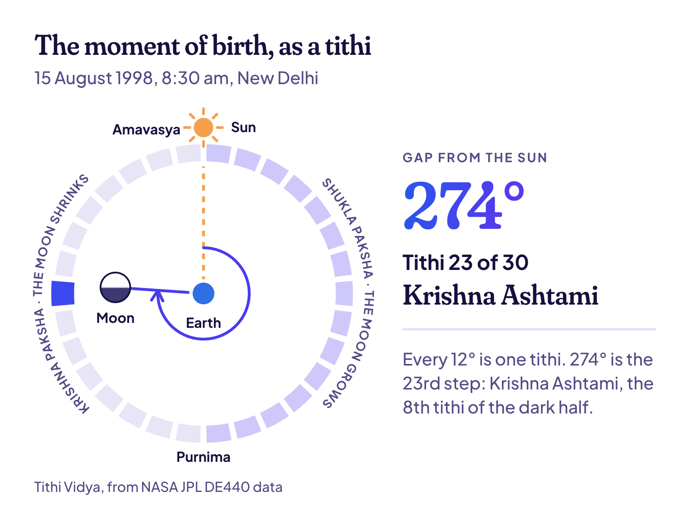
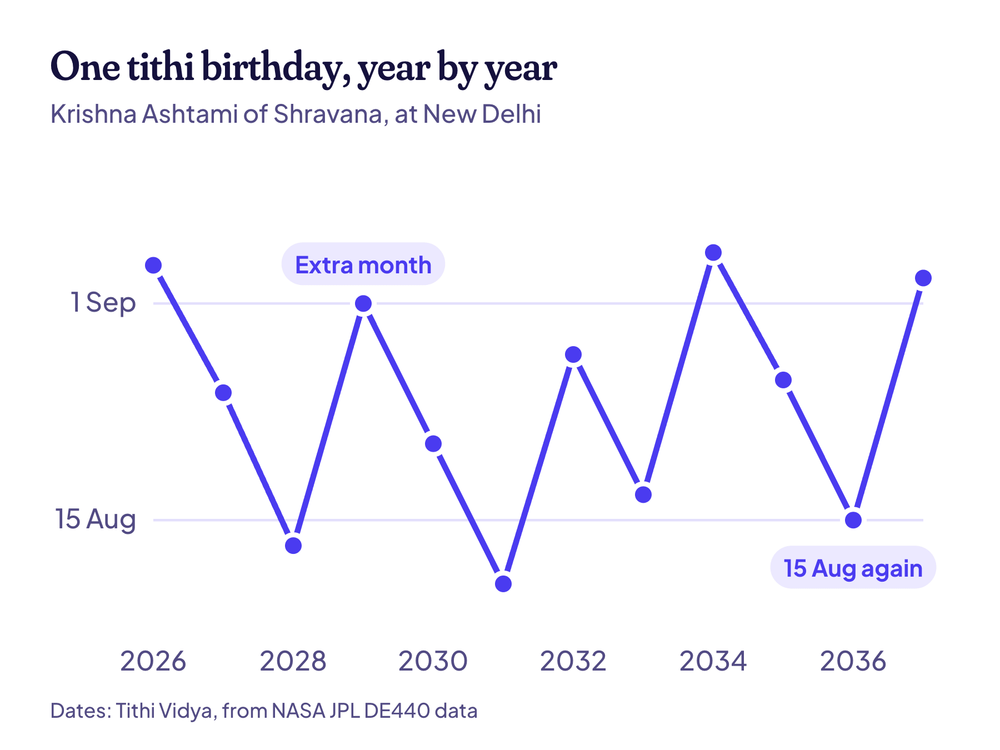

**Your tithi birthday is your birthday by the moon.** It's the day each year when the moon comes back to the same tithi, in the same Hindu month, as when you were born. It almost never lands on the same calendar date twice. You can find yours on [Find my tithi](/find) in about a minute.

Here's a real example. Someone born at 8:30 in the morning on 15 August 1998, in New Delhi, was born on **Krishna Ashtami** in the month of **Shravana**. That's the tithi of Janmashtami, Krishna's birthday. So this person shares a tithi with Krishna, and their tithi birthday comes around at Janmashtami time every year. In 2026 it's on Friday, 4 September. In 2027 it's on Wednesday, 25 August.

So why does it move, how do you find yours, and what happens in the odd years? One step at a time.

## What a tithi is, in one picture

Picture the sun, the Earth and the moon. As the moon goes around us, the angle between the moon and the sun keeps growing. It's 0° at the new moon, 180° at the full moon, and back to 360° at the next new moon.

Every 12° of that angle is one **tithi**. And 360 divided by 12 gives 30 tithis in a lunar month.

In the wheel, the moon is 274° from the sun. That's the 23rd step, Krishna Ashtami, the moment our example was born.

The 30 tithis come in two halves, called pakshas:

- **Shukla Paksha** is the bright half: tithis 1 to 15, while the moon grows. It ends with Purnima, the full moon.
- **Krishna Paksha** is the dark half: tithis 16 to 30, while the moon shrinks. It ends with Amavasya, the new moon.

The names repeat in each half: Pratipada for the 1st, Dwitiya for the 2nd, and so on up to Chaturdashi for the 14th. So Krishna Ashtami just means "the 8th tithi of the dark half". Wikipedia has a good [overview of tithis](https://en.wikipedia.org/wiki/Tithi) if you want the history.

> **Did you know?** A tithi isn't a fixed length, because the moon speeds up and slows down on its path. The shortest tithi of 2027 is the Amavasya of 1 and 2 August, at 20 hours 15 minutes. That's the new moon of the total solar eclipse on 2 August. The longest is Shukla Shashthi on 3 and 4 December, at 26 hours 43 minutes.

## The three parts of your tithi birthday

Three things from the moment you were born set your tithi birthday:

| Part | What it is | Our example |
| --- | --- | --- |
| Tithi | Which of the 30 steps the moon was on | Ashtami, the 8th |
| Paksha | Which half of the month | Krishna, the dark half |
| Lunar month | Which of the 12 Hindu months | Shravana |

Each year, your tithi birthday is the day when all three line up again.

One thing trips up a lot of people: the month's name depends on where your family is from. Much of North India counts each month from full moon to full moon. This is called purnimanta. Much of the south and west counts from new moon to new moon, called amanta.

In the dark half of the month, the two names are one month apart. So our example's tithi is Krishna Ashtami of **Shravana** the amanta way, and Krishna Ashtami of **Bhadrapada** the purnimanta way. It's the same moment and the same day each year, with two names. Tithi Vidya uses amanta month names.

## Why the date moves every year

Your calendar birthday follows the sun. After 365 days, it comes back. Your tithi birthday follows the moon, and twelve moon months add up to about 354 days. That's roughly 11 days short of a calendar year. So most years, your tithi birthday comes about 11 days earlier than the year before.

That can't go on forever, or festivals would slowly drift through the seasons. So about every two or three years, the Hindu calendar adds an extra month, called adhik maas. When that happens, your tithi birthday jumps about 19 days later, and the slide starts again.

Here's our example's tithi birthday from 2026 to 2037:

See how it never leaves a window of about four weeks, from 10 August to 5 September? The extra months keep it in its season. Here are the same dates in a table:

| Year | Tithi birthday | Day |
| --- | --- | --- |
| 2026 | 4 September | Friday |
| 2027 | 25 August | Wednesday |
| 2028 | 13 August | Sunday |
| 2029 | 1 September | Saturday |
| 2030 | 21 August | Wednesday |
| 2031 | 10 August | Sunday |
| 2032 | 28 August | Saturday |
| 2033 | 17 August | Wednesday |
| 2034 | 5 September | Tuesday |
| 2035 | 26 August | Sunday |
| 2036 | 15 August | Friday |
| 2037 | 3 September | Thursday |

There's a neat pattern hiding in there too. Nineteen calendar years are almost exactly 235 moon months, so the dates nearly repeat every 19 years. Our example's tithi birthday fell on 15 August in 2017, 19 years after the birth. And it lands on 15 August again in 2036. Astronomers call this the Metonic cycle.

> **Read next:** [Why your Hindu birthday moves every year](/blog/why-your-hindu-birthday-moves), with another example and the extra months marked.

## Why your birth time matters

A tithi doesn't start at midnight. It starts whenever the moon reaches its next 12° mark, at any hour of the day or night. So two babies born on the same date can have different tithis.

Our example shows it well. On 15 August 1998 in New Delhi, Krishna Ashtami ended at 12:16 pm. A baby born that morning has Krishna Ashtami. A baby born that afternoon has Krishna Navami, and a different tithi birthday every year:

| Born on 15 Aug 1998 at | Tithi | 2026 | 2027 |
| --- | --- | --- | --- |
| 8:30 am | Krishna Ashtami | 4 Sep | 25 Aug |
| 3:00 pm | Krishna Navami | 5 Sep | 26 Aug |

That's why Tithi Vidya asks for your birth time. It asks for your birth place for the same reason: the place sets your time zone, and the sunrise that starts each day in the Hindu calendar.

That sunrise matters in one more way. A panchang day runs from one sunrise to the next, not from midnight. Take a baby born at 4 am on 16 August 1998. Their tithi is Krishna Navami. But in the panchang, their birth still belongs to 15 August, because the sun hadn't come up yet.

> **Tip:** Don't know your exact birth time? Put in your best guess, then look at when your tithi ran. If your guess is hours away from a change, you're fine. If it's close, ask your family whether you were born in the morning or the evening.

## How to find your tithi birthday in a minute

1. Open [Find my tithi](/find).
2. Enter your **birth date**.
3. Enter your **birth time**. A best guess works (see the tip above).
4. Pick your **birth place**. If your city isn't in the list, choose "Somewhere else" and enter its coordinates and time zone.
5. Under **Show me**, pick **My moon birthday**. That gives you one date a year, in your moon month.
6. Read the result. You'll see your tithi, when it ran, and your tithi birthday for the next 100 years.

For our example, the answer is Krishna Ashtami, which ran from 2:24 pm on 14 August to 12:16 pm on 15 August 1998. The next tithi birthdays are 4 September 2026 and 25 August 2027.

Everything is worked out in your browser, so your birth details never leave your phone. And it's free.

## Skipped and doubled tithis

Most days have one tithi at sunrise, and that tithi gives the day its name. This is called the udaya tithi. But tithis aren't exactly a day long, so two odd things happen:

- **A skipped tithi (kshaya).** A short tithi can start after one sunrise and end before the next. No day gets its name.
- **A doubled tithi (vriddhi).** A long tithi can cover two sunrises, so two days carry its name.

Neither is rare. Across 2027, New Delhi sees 17 skipped tithis and 12 doubled ones.

Our example hits a skipped one in 2034. That year, Krishna Ashtami starts at 6:18 am on 5 September, just after sunrise. It ends at 4:07 am on 6 September, just before the next sunrise.

So which day is the birthday? Tithi Vidya puts it on 5 September, the day the tithi falls in. For a doubled tithi, it uses the first of the two days. Some families and priests follow other rules, and if yours does, go with your family.

## When your birth month comes twice

Sometimes the extra month (adhik maas) is a copy of your birth month, so that month comes twice in one year. Tithi Vidya then uses the regular month, called nija, and never the extra one. You still get exactly one tithi birthday that year.

That's the most common way to count it, but traditions differ, so ask your family priest if you're not sure. Extra months come roughly every 32 or 33 months, and Wikipedia [explains how adhik maas works](https://en.wikipedia.org/wiki/Adhika-masa).

## How families celebrate a tithi birthday

There's no single right way. Many families keep it simple:

- An early bath, then an aarti or a small puja at home.
- A visit to the temple.
- Blessings from elders, often with a tilak on the forehead.
- Feeding someone, or giving to people who need it (daan).
- Something sweet, of course.

In much of Tamil Nadu and Kerala, families often go by the birth nakshatra, the star group the moon was in, rather than the tithi. Both come from the same idea: a birthday kept by the moon.

Lots of people keep both birthdays. The calendar one is for cake and friends, and the tithi one is for prayers and family. You don't have to pick.

## Where these dates come from

Every date in this post comes from Tithi Vidya. It works out where the sun and the moon are using NASA JPL's [DE440 data](https://ssd.jpl.nasa.gov/doc/de440_de441.html), the same kind of data used to fly spacecraft. It uses the Lahiri ayanamsa and amanta months, and the times here are for New Delhi (IST).

When I built it, I checked it against 92,839 tithi start times worked out separately with Swiss Ephemeris. Half of them agreed within 1.7 seconds. Every test, and the code itself, is on [How it works](/how-it-works).

## Common questions

### What does tithi birthday mean in English?

It means your birthday by the Hindu lunar calendar. It's the day each year when the moon comes back to the tithi you were born on, in your birth month. People also call it a lunar birthday or a moon birthday.

### What is janma tithi?

Janma tithi is the tithi at the moment you were born, one of the 30 steps of the moon, like Krishna Ashtami or Shukla Dashami. Your tithi birthday is the day it comes back each year.

### Can I find my tithi without my birth time?

Often, yes. A tithi lasts about a day, so most birth dates have only one or two possible tithis. Enter a best guess and check when your tithi ran. If your guess sits close to a change, ask your family about morning or evening.

### Why is my tithi birthday on a different date every year?

Twelve moon months are about 11 days shorter than a calendar year, so the date slides earlier. Every two or three years an extra month is added, and the date jumps back.

### Is my tithi birthday the same everywhere in the world?

Usually, but not always. The dates are worked out for one place, using its sunrise and time zone. If you now live far from where you were born, your local date can come out a day different.

### How accurate is Tithi Vidya?

Very. Its tithi times match Swiss Ephemeris to within seconds, and its lunar months matched on all 3,095 months tested. It's free and open source, so anyone can check the maths.

## Keep reading

- [Why your Hindu birthday moves every year](/blog/why-your-hindu-birthday-moves): the 11-day slide, with real dates from 2026 to 2037.
- [How Tithi Vidya works](/how-it-works): the NASA data, the code and every accuracy test.
- [Find my tithi](/find): your own tithi birthday for the next 100 years.
