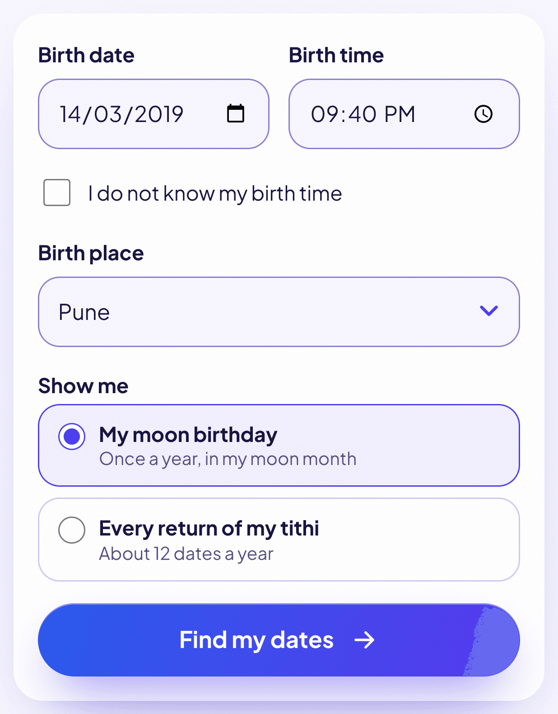
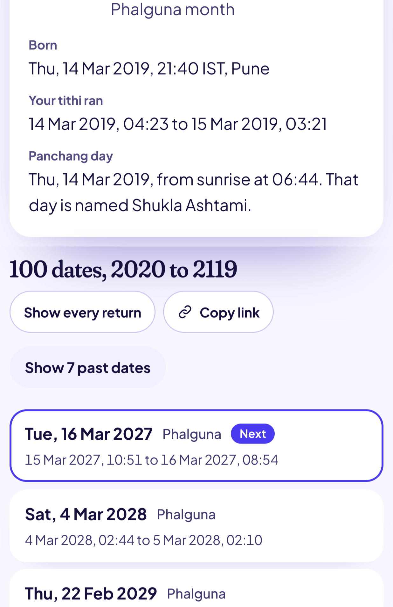

**To find the tithi of a death anniversary, enter the date, time and place of passing in [Find my tithi](/find).** It shows the tithi of that moment, the Hindu month, and the day that tithi comes back every year. It takes about a minute, and it's free.

There's one catch a calculator won't tell you on its own. Shraddha is done around midday and in the afternoon, but calendars name each day by its sunrise. Most years that's the same day. Some years it isn't, and the shraddha belongs to the day before. I'll show you how to spot that in ten seconds, with a real example.

If you're here because you've recently lost someone, I'm sorry. I've tried to keep this simple.

## Why a death anniversary follows the tithi

The yearly shraddha falls on the death anniversary by the Hindu calendar, not by the calendar on the wall ([Wikipedia explains the rite](https://en.wikipedia.org/wiki/%C5%9Ar%C4%81ddha)). That means the same tithi, in the same Hindu month, as the day the person passed.

A tithi is a lunar day: the time the moon takes to move 12° further from the sun. It lasts about a day, but it doesn't start at midnight, and it can begin or end at any hour. ([Here's what a tithi is, with a picture](/blog/what-is-tithi).)

Families call this day different things: shraddh tithi, barsi, punyatithi, varshik shraddh, or just "tithi". In English it's sometimes called a lunar death anniversary.

Because the moon's year is about 11 days shorter than the sun's, the date moves. It slides earlier every year, then jumps back when an extra Hindu month is added. It's the same drift that [moves your Hindu birthday around the calendar](/blog/why-your-hindu-birthday-moves).

| | Calendar date | Tithi date |
| --- | --- | --- |
| Follows | The sun | The moon |
| Same date every year? | Yes | No, it moves within about a month |
| Used for | Most everyday memorials | Shraddha, barsi, Pitru Paksha |

## What you need

- **The date of passing.**
- **The time, as close as you know it.** The tithi can change at any hour, so the time can matter. There's a section below for when you don't know it.
- **The place.** Choose the city, or the nearest big city in the list. The place sets the time zone and the sunrise.

Your details stay on your device. Tithi Vidya runs the calculation inside your browser and doesn't send them anywhere.

## How to find the death anniversary tithi, step by step

1. **Open Find my tithi** (the link in the first line of this page).
2. **Enter the date of passing in "Birth date".** The labels say "birth" because I first built the site for tithi birthdays. The calculation is exactly the same: it finds the tithi of any moment you give it.
3. **Enter the time in "Birth time".** Don't know it? Read the section on that first.
4. **Choose the place.**
5. **Under "Show me", keep "My moon birthday".** That gives one date a year, in the right Hindu month.
6. **Press "Find my dates".**

## A worked example, from start to finish

Say someone passed away in Pune at 9:40 pm on Thursday, 14 March 2019. Here's what the calculator gives:

- **Tithi: Shukla Ashtami.** The 8th tithi of Shukla Paksha, the bright half of the month.
- **Month: Phalguna.**
- **The tithi ran** from 4:23 am on 14 March to 3:21 am on 15 March (IST).

So the yearly shraddha falls on Phalguna Shukla Ashtami. The result card shows it, with the next dates under it.

Here are the next four years, with the times the tithi runs. The times are the same anywhere in India, because a tithi starts and ends at one moment for everyone.

| Year | Date shown | Tithi runs (IST) |
| --- | --- | --- |
| 2027 | Tue, 16 March | 15 Mar, 10:51 am, to 16 Mar, 8:54 am |
| 2028 | Sat, 4 March | 4 Mar, 2:44 am, to 5 Mar, 2:10 am |
| 2029 | Thu, 22 February | 21 Feb, 7:50 am, to 22 Feb, 9:19 am |
| 2030 | Tue, 12 March | 12 Mar, 1:05 am, to 13 Mar, 3:23 am |

Now look at 2027 and 2029. In both, the tithi ends in the morning of the date shown. Hold that thought.

## The calculator's date vs the shraddha day

The calculator follows the most common rule in Hindu calendars. A day takes the name of the tithi running at sunrise. It's called udaya tithi, and it's one of the [five rules a tithi calculator has to get right](/blog/tithi-birthday-calculator). Birthdays and most festivals use it.

Shraddha doesn't. The texts set it later in the day:

- **The afternoon.** The Manusmriti says that for shraddha, ["the afternoon is preferable to the forenoon"](https://www.wisdomlib.org/hinduism/book/manusmriti-with-the-commentary-of-medhatithi/d/doc200080.html) (verse 3.278). This afternoon is called aparahna. When daylight is split into five equal parts, it's [the fourth part](https://www.wisdomlib.org/definition/aparahna).
- **Kutapa, around midday.** Some texts name [kutapa, the 8th of 15 equal parts of daylight](https://www.wisdomlib.org/definition/kutapa), as the best time. In Pune in March, that's about 12:20 pm to 1:10 pm.

Either way, what counts is the tithi running at that time of day, not at sunrise. So the shraddha day is the day whose afternoon (or midday) falls inside the tithi.

| Year | Calculator says | Tithi at midday | Shraddha day |
| --- | --- | --- | --- |
| 2027 | Tue, 16 Mar | Mon, 15 Mar | **Mon, 15 Mar** |
| 2028 | Sat, 4 Mar | Sat, 4 Mar | Sat, 4 Mar |
| 2029 | Thu, 22 Feb | Wed, 21 Feb | **Wed, 21 Feb** |
| 2030 | Tue, 12 Mar | Tue, 12 Mar | Tue, 12 Mar |

Take 2027. Ashtami starts at 10:51 am on Monday, 15 March, and ends at 8:54 am on Tuesday. Tuesday's sunrise, at 6:42 am in Pune, falls inside it, so the calendar names Tuesday "Ashtami". But by Tuesday's midday, Ashtami is long over. Monday's midday (12:20 to 1:10 pm) and afternoon (1:55 to 4:20 pm) are both inside it. So the shraddha is on Monday.

In these four years, the afternoon rule and the midday rule pick the same day. That's usual, but not guaranteed.

> **Quick check:** Look at the times under each date in your result. If the tithi ends in the morning of the date shown, the shraddha is usually the day before.

When a tithi only grazes an afternoon, or covers part of two, families follow finer rules. In those years, check with your family priest or the panchang your family uses. Honestly, I'd like Tithi Vidya to mark the shraddha day by itself one day. Until it does, the quick check above takes ten seconds.

> **Read next:** [Amavasya 2027 list](/blog/amavasya-list): the same afternoon rule moves Sarva Pitru Amavasya, the biggest shraddha day of the year, to the day before its sunrise date.

## If you don't know the exact time

Whether the time matters depends on one thing: did the tithi change that day? The result tells you, on the line "Your tithi ran".

In our example, Ashtami ran from 4:23 am on 14 March to 3:21 am on 15 March. So any time on 14 March after 4:23 am gives the same answer. Only a passing between midnight and 4:23 am would give Saptami, the 7th tithi.

So:

1. **Enter the date with your best guess of the time.** Or tick "I do not know my birth time", and the site uses 12 noon. It then reminds you the answer may be one tithi off.
2. **Read "Your tithi ran".** If it covers the whole part of the day when the passing could have happened, the time doesn't matter. You're done.
3. **If the tithi changed in that window,** run it once for each side, and ask family elders which part of the day it was. Often "before sunrise" or "late at night" is all you need.

> **Tip:** A hospital record or the death certificate may show the time. Older relatives often remember it too.

## If they passed away abroad

The tithi changes at the same moment everywhere on Earth. Only the local clock time is different. That leaves two cases:

- **To see the tithi,** enter the place where they passed, if it's in our list, with the local time.
- **To get the yearly dates for the city where you'll hold the shraddha,** convert the time of passing into that city's time, and enter it with that city. Then the dates follow that city's sunrise.

> **Example:** 11:30 pm on 10 January in London is 5:00 am on 11 January in India. So enter 11 January, 5:00 am, with your city in India.

| City | Behind India, November to March | Behind India, April to October |
| --- | --- | --- |
| London | 5 hours 30 minutes | 4 hours 30 minutes |
| New York, Toronto | 10 hours 30 minutes | 9 hours 30 minutes |
| San Francisco | 13 hours 30 minutes | 12 hours 30 minutes |
| Dubai | 1 hour 30 minutes | 1 hour 30 minutes |

Clocks in these cities change on set Sundays in March and in October or November, so for a date near those weeks, use a time-zone converter.

Living abroad and holding the shraddha there? Enter the time of passing in your own city's time, with your own city. The quick check works the same way, with your local midday.

## Every month in the first year

If your family holds a small rite every month in the first year, it falls on the same tithi each month. Choose **"Every return of my tithi"** under "Show me", and the result lists about 12 dates a year instead of one. It's the same tithi every time, in each Hindu month.

The first yearly one, often called the barsi, is the first date in the yearly list. Customs for the first year vary between families, so if anyone says it's held a little earlier, go with your family's priest.

## Pitru Paksha: the same tithi, once more

Every year, in Pitru Paksha (the fortnight for ancestors), families offer shraddha again. It's held on [the lunar day on which the ancestor died](https://en.wikipedia.org/wiki/Pitru_Paksha), so it's the tithi number that counts: Ashtami for Ashtami.

For our example, that's the Ashtami of Pitru Paksha. In 2027 it runs from 4:37 am on Thursday, 23 September, to 2:57 am on Friday. Thursday's afternoon falls inside it, so it's **Thursday, 23 September 2027**.

The last day, Sarva Pitru Amavasya (also called Mahalaya), is for all ancestors, whatever tithi they died on. So it's also the day families use when they don't know the tithi. In 2027, its shraddha is on Wednesday, 29 September.

> **Did you know?** Pitru Paksha 2027 runs from 15 to 29 September. The [Hindu calendar 2027](/blog/hindu-calendar) has it, with every other festival of the year.

## The month name: amanta and purnimanta

Tithi Vidya names months the amanta way, with each month ending on the new moon. Much of North India uses the purnimanta way, where months end on the full moon.

For a tithi in Shukla Paksha, like our Ashtami, both systems give the same month name. For a tithi in Krishna Paksha, the dark half, the North Indian name is one month later. A Krishna Ashtami in Phalguna by our calendar is a Krishna Ashtami in Chaitra in many North Indian panchangs. The day itself is the same. Only the name changes.

Some families, in parts of South India for example, follow other calendars for this rite. If yours does, those dates can differ from ours. Tithi Vidya follows the lunar tithi and month.

## Where these dates come from

Tithi Vidya works out where the sun and moon are from NASA JPL's [DE440 data](https://ssd.jpl.nasa.gov/doc/de440_de441.html), the data NASA uses for its own spacecraft. Before launch, I checked the calculator against 92,839 tithi start times worked out separately with Swiss Ephemeris. The typical gap was 1.7 seconds. ([Here's how it works](/how-it-works).)

The sunrise and afternoon times above are for Pune, from the same data. Your own city's times will be a few minutes different, and the tithi times won't change at all.

## Common questions

### What is the death anniversary tithi called in English?

It's the lunar death anniversary: the tithi (lunar day) of the Hindu month in which the person passed. In Hindi it's often called the barsi or shraddh tithi, and in Marathi the punyatithi.

### Is the tithi taken at the time of death or at sunrise?

Most families take the tithi running at the moment of passing. Some go by the panchang day, the tithi at that day's sunrise. The two only differ if the tithi changed between sunrise and the time of passing. Tithi Vidya's result shows both: "Your tithi", and the "Panchang day" with its own tithi.

### Barsi ki tithi kaise nikale? (How do I find the barsi tithi?)

The same way: enter the date, time and place of passing in Find my tithi. The first yearly date in the result is the barsi. Then use the quick check above to see whether the shraddha falls a day earlier.

### What if the tithi is skipped that year?

Sometimes a tithi starts after one sunrise and ends before the next, so no day is named after it. It's called a kshaya tithi, and the [Dev Uthani Ekadashi post](/blog/dev-uthani-ekadashi) shows a real one. For shraddha, look for the day whose afternoon or midday it covers. If it covers neither, ask your priest.

### Can I just use the English date?

You can, and some families abroad do, because it's easier to plan. The tradition is the tithi, though. With the tithi dates listed for the next 100 years, it's easy to put them all in your phone's calendar once.

### Why is the shraddha date different every year?

The moon's year is about 11 days shorter than the sun's. So the tithi comes about 11 days earlier each year, until an extra Hindu month (adhik maas) is added and it jumps back.

## Keep reading

- [Tithi birthday: what it is and how to find yours](/blog/tithi-birthday): the same calculation, for the living.
- [Amavasya 2027 list](/blog/amavasya-list): every new moon of 2027, and which day is for shraddha and tarpan.
- [Why your Hindu birthday moves every year](/blog/why-your-hindu-birthday-moves): the 11-day drift, with real dates.
