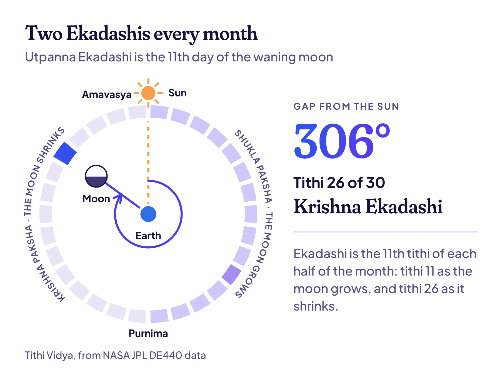

**Utpanna Ekadashi 2026 is on Friday, 4 December.** The Ekadashi tithi runs from 11:04 pm on Thursday, 3 December, to 11:45 pm on Friday (IST). Break the fast on Saturday, 5 December, between 6:59 am and 9:04 am in New Delhi.

This year there's no confusion: families and Vaishnavas, ISKCON included, all fast on the same Friday. And if you've been meaning to start keeping Ekadashi fasts, this is the traditional one to begin with. Here's why, and how to do it.

## Utpanna Ekadashi 2026 date and time

| | Date and time (IST) |
| --- | --- |
| Ekadashi begins | Thursday, 3 December, 11:04 pm |
| Ekadashi ends | Friday, 4 December, 11:45 pm |
| Fast | Friday, 4 December |
| Parana (breaking the fast), New Delhi | Saturday, 5 December, 6:59 am to 9:04 am |

It's the Ekadashi of the waning moon in the month of Margashirsha, by North India's calendar, or Kartika by the amanta calendar used in the south and west. It's the same day either way.

Why no split this time? Ekadashi begins before midnight on Thursday, so it's already running at dawn on Friday everywhere in India. The two traditions only part ways when Ekadashi starts just after a sunrise, as it did on [Dev Uthani Ekadashi](/blog/dev-uthani-ekadashi) two weeks earlier.

## Utpanna Ekadashi parana time

Parana is done on Saturday, during Dwadashi, the next tithi. Hari Vasara, the first quarter of Dwadashi that's skipped for parana, is over by 6:02 am, before sunrise. So you can break the fast from sunrise until the end of the early morning:

| City | Break the fast, Saturday, 5 December |
| --- | --- |
| New Delhi | 6:59 am to 9:04 am |
| Mumbai | 6:58 am to 9:10 am |
| Kolkata | 6:02 am to 8:12 am |
| Chennai | 6:18 am to 8:34 am |
| Bengaluru | 6:28 am to 8:45 am |
| Hyderabad | 6:32 am to 8:46 am |
| Ahmedabad | 7:06 am to 9:16 am |
| Pune | 6:53 am to 9:06 am |
| Jaipur | 7:01 am to 9:08 am |
| Lucknow | 6:41 am to 8:47 am |
| Patna | 6:21 am to 8:29 am |
| Varanasi | 6:29 am to 8:37 am |

The times are worked out from each city's sunrise and sunset, using NASA JPL's [DE440 data](https://ssd.jpl.nasa.gov/doc/de440_de441.html), the same data behind [every date on Tithi Vidya](/how-it-works). In the UK, the US and Canada the fast is also on Friday, 4 December. Break it after sunrise on Saturday: 7:49 am to 9:26 am in London, 7:05 am to 8:57 am in New York.

## The story of Utpanna Ekadashi

"Utpanna" means born, and this is the day Ekadashi herself was born. The story goes that a demon named Mura came for Vishnu while he slept in a cave, after a long war. A radiant young woman rose out of Vishnu's own body and killed Mura before he could strike.

When Vishnu woke, he named her Ekadashi, after the 11th day on which she appeared. He promised that anyone who fasts on her day would be freed from their sins. [Wikipedia's page on Ekadashi](https://en.wikipedia.org/wiki/Ekadashi) tells the legend and lists all the Ekadashis of the year.

## Why it's the best Ekadashi to start fasting

Since every Ekadashi fast traces back to this day, many families start the habit here. Then they keep it on both Ekadashis of every month, the 11th day of the waxing moon and the 11th day of the waning moon.

If you're starting, these steps keep it simple:

1. **Pick your level.** A nirjala fast skips even water. Most beginners keep a phalahar fast: fruit, milk, nuts, sabudana and other fasting foods, but no grains or dal.
2. **Eat light the evening before,** on Dashami, and skip rice.
3. **Pick tulsi leaves on Thursday.** Tradition says they aren't picked on Ekadashi itself.
4. **On Friday,** bathe, offer tulsi and a lamp to Vishnu, and read or listen to the vrat katha.
5. **Break the fast on Saturday** within your city's parana window, with something light.

> **Tip:** Start gently. A fruit-and-milk fast is still an Ekadashi fast, and you can make it stricter later. If you're pregnant, diabetic or on medicine, talk to your doctor before a fast.

The next Ekadashi is Mokshada Ekadashi on Sunday, 20 December, which is also Gita Jayanti.

> **Read next:** [Kaal Bhairav Jayanti 2026](/blog/kaal-bhairav-jayanti), three days earlier, on 1 December, and why its puja is kept at night.

## Common questions

### Utpanna Ekadashi kab hai in 2026?

On Friday, 4 December 2026. The Ekadashi tithi runs from 11:04 pm on 3 December to 11:45 pm on 4 December (IST).

### Can I drink water on Utpanna Ekadashi?

Yes, unless you're keeping a nirjala fast, which skips even water. Most people who keep a fruit-and-milk fast drink water through the day.

### When is Utpanna Ekadashi in 2027?

On Wednesday, 24 November 2027. Ekadashi is running at sunrise and before dawn that day, so families and Vaishnavas fast together again.

> **Tip:** Ekadashi follows the moon, and so does your birthday in the Hindu calendar. [Find my tithi](/find) shows the tithi you were born on.

## Keep reading

- [Dev Uthani Ekadashi 2026: 20 or 21 November?](/blog/dev-uthani-ekadashi): the Ekadashi before this one, and why its two traditions split.
- [Kaal Bhairav Jayanti 2026](/blog/kaal-bhairav-jayanti): Bhairav's night, and the monthly Kalashtami dates.
- [Tithi birthday: what it is and how to find yours](/blog/tithi-birthday): what a tithi is, with a picture.
