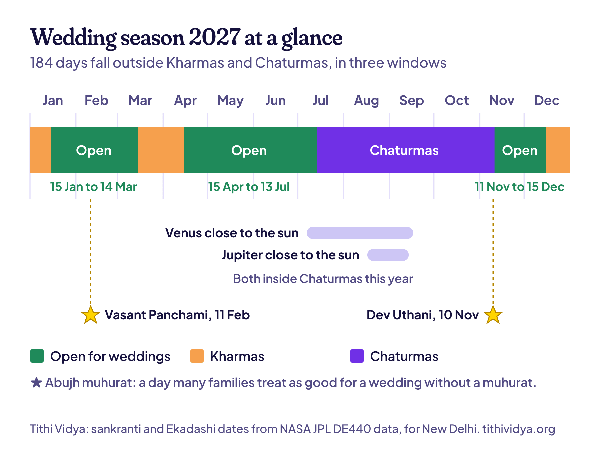

**In 2027, vivah muhurats fall in three windows: 15 January to 14 March, 15 April to 13 July, and 11 November to 15 December.** That's 184 days. Most of the rest of the year is closed to weddings by two old customs, Kharmas and Chaturmas.

A muhurat is a precise time on one of those open days, and it's picked for each couple, so no website can give you yours. But the windows themselves come straight from the sun and the moon, and I can show you exactly where they fall in 2027 and why.

## Vivah muhurat 2027: the open and closed months

| Dates in 2027 | Weddings? | Why |
| --- | --- | --- |
| 1 to 14 January | Closed | Kharmas: the sun is in Dhanu (Sagittarius) |
| 15 January to 14 March | **Open** | |
| 15 March to 14 April | Closed | Kharmas: the sun is in Meena (Pisces) |
| 15 April to 13 July | **Open** | |
| 14 July to 10 November | Closed | Chaturmas: Vishnu's four months of sleep |
| 11 November to 15 December | **Open** | |
| 16 to 31 December | Closed | Kharmas again: the sun is back in Dhanu |

The edges come from Tithi Vidya's numbers, worked out from NASA JPL's [DE440 data](https://ssd.jpl.nasa.gov/doc/de440_de441.html) ([how we do it](/how-it-works)).

The sun leaves Dhanu at 9:10 pm on 14 January. It enters Meena at 7:00 am on 15 March and leaves it at 3:28 pm on 14 April. Chaturmas runs from Devshayani Ekadashi, Wednesday, 14 July, to Dev Uthani Ekadashi, Wednesday, 10 November. Then the sun enters Dhanu again at 4:39 pm on 16 December.

These are the rules most of North India follows. Other regions keep their own customs, and every family has its own pandit, so treat the windows as the outline and let your pandit fill in the days.

## Why these months have no weddings

**Kharmas.** For a month in December and January, and again in March and April, the sun sits in Dhanu or Meena, the two signs [ruled by Jupiter](https://www.thehitavada.com/Encyc/2026/3/9/kharmaas-from-15th-auspicious-ceremonies-to-pause-for-a-month.html). Many North Indian families hold no weddings in that time. I went through the dates and the reasons in the [Kharmas post](/blog/kharmas), and the first Kharmas of the year ends with [Makar Sankranti](/blog/makar-sankranti).

**Chaturmas.** Tradition says Vishnu sleeps for four months, from Devshayani Ekadashi to Dev Uthani Ekadashi, and weddings wait until he wakes. Patrika, the Hindi daily, lists Chaturmas among the months with no weddings in its [2026 wedding season report](https://www.patrika.com/religion-and-spirituality/vivah-muhurat-dates-in-2026-tithi-shukra-uday-in-february-2026-wedding-dates-in-2026-20295679). The season reopens when he wakes. On [Dev Uthani Ekadashi](/blog/dev-uthani-ekadashi), and with [Tulsi Vivah](/blog/tulsi-vivah) the next evening, the shehnai comes back out.

**Venus and Jupiter.** There's one more rule, and it's about planets. The same Patrika report explains that Venus (Shukra) and Jupiter (Guru) must be "risen" for a wedding. When one of them is too close to the sun to be seen, it's called ast, set, and the weddings wait. That's why the 2026 season only opened on 5 February: Venus rose on 1 February.

## Venus and Jupiter in 2027: good timing

So when are they close to the sun in 2027? I checked the angle between each planet and the sun for every day of the year, with the same NASA data.

| Planet | Close to the sun in 2027 | Closest |
| --- | --- | --- |
| Venus (Shukra) | 7 July to 17 September (within 10°) | 12 August |
| Jupiter (Guru) | 17 August to 14 September (within 11°) | 31 August |

Look at the dates. Both fall almost entirely inside Chaturmas, when weddings are paused anyway. The only overlap with an open window is a few days of early July, before Devshayani Ekadashi.

Panchangs mark the exact start and end of Shukra ast by their own rules, so they can differ from these by several days. But the big picture is clear: in 2027 the planets take their break at the same time as everyone else.

Two things that cost a lot of dates in 2026 are missing in 2027, too. There's no extra month (Adhik Maas) this year, and no Venus break in the middle of the winter season.

> **Example:** Start with 365 days. Take away Kharmas (14 days in January, 31 in March and April, 16 in December) and Chaturmas (120 days). That leaves 184. A pandit's checks then cut those down to a few dozen days. For 2026, Patrika counted 59 muhurats in the whole year.

## How a pandit picks the exact muhurat

A muhurta is, strictly, a unit of time: [1/30 of a day, or 48 minutes](https://en.wikipedia.org/wiki/Muhurta). In everyday use, a muhurat is a good moment picked for an event, and a wedding is the one most families take most seriously.

Within the open windows, a pandit looks at each day's panchang. That's the [five parts of the Hindu day](https://en.wikipedia.org/wiki/Panchangam): the tithi, the weekday, the nakshatra, the yoga and the karana. The tithi is the moon's day, and the nakshatra is the group of stars the moon is in. Each of them can rule a day in or out.

Then comes the hour: the pandit picks a time window on the chosen day. If your family matches horoscopes, it also has to suit both of the couple's charts. That's why two weddings on the same day can have different muhurats, and why a list on a website can only tell you which days are in play.

> **Read next:** [What is a tithi?](/blog/what-is-tithi) The moon's day, the first thing on every muhurat list.

## Abujh muhurat: days that need no checking

Some days are considered so good that families hold weddings without fixing a muhurat at all. These are called abujh (unasked) muhurats. Two of them fall in 2027's open windows:

- **Vasant Panchami, Thursday, 11 February.** Patrika's report names it as an abujh muhurat.
- **Dev Uthani Ekadashi, Wednesday, 10 November.** Many families, especially in Rajasthan, treat the day the season reopens as abujh. In 2023 so many weddings fell on it that Rajasthan's assembly election was moved.

## Why we don't publish a muhurat list

Our calculator works out tithis: the moon's days, to the minute, from NASA data. A real muhurat also needs the nakshatra, the hour for your city and, for many families, two horoscopes. A list that ignores all that would look precise and still be wrong for you. So I'd rather show you the windows, which are the same for everyone, and leave the hour to your pandit.

What you can do is find the tithi of any date or birth. [Find my tithi](/find) works it out in a minute.

## Common questions

### Vivah muhurat 2027 kab se shuru hai?

From Friday, 15 January 2027, the day after the winter Kharmas ends. The sun leaves Dhanu at 9:10 pm on 14 January.

### Are there wedding dates in August 2027?

No. August falls inside Chaturmas, which runs from 14 July to 10 November 2027. Venus is also close to the sun all month, and Jupiter from 17 August.

### When is Kharmas in 2027?

Twice. From 15 March to 14 April, while the sun is in Meena, and from 16 December, when the sun enters Dhanu again. The winter Kharmas that began on 16 December 2026 ends on 14 January 2027.

### Is there Adhik Maas in 2027?

No. 2026 had one, an extra Jyeshtha month in May and June. 2027 has none, which leaves more of the summer open for weddings.

## Keep reading

- [Kharmas 2026](/blog/kharmas): why weddings pause for a month, and the dates through 2027.
- [Dev Uthani Ekadashi](/blog/dev-uthani-ekadashi): the day the wedding season reopens, and why it once moved an election.
- [Hindu calendar 2027](/blog/hindu-calendar): every festival of next year, with its tithi.
