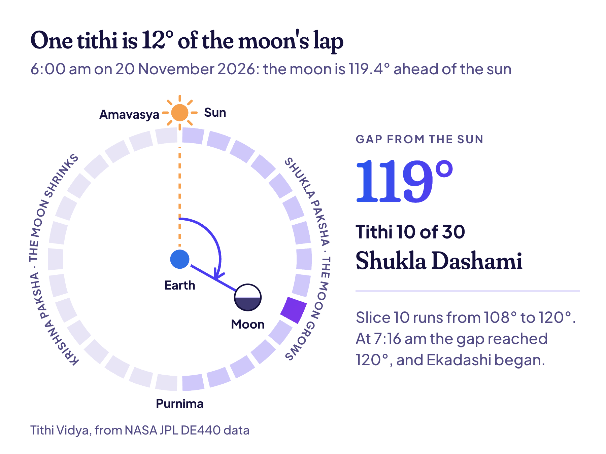
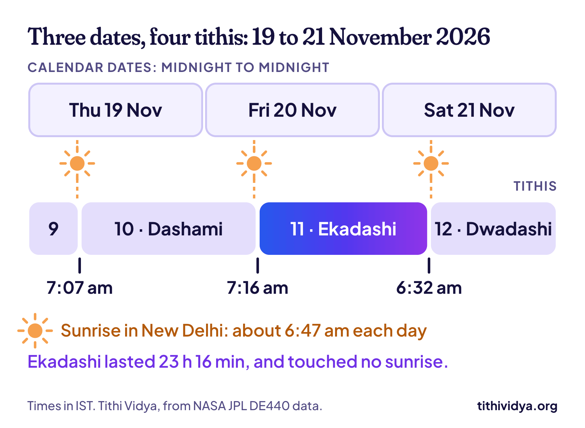

**A tithi is a lunar day: the time the moon takes to move 12° further ahead of the sun.** A lunar month has 30 tithis, 15 while the moon grows and 15 while it shrinks. The Hindu calendar counts its days in tithis, not in dates.

That one idea explains a lot. It's why [Hindu dates move every year](/blog/why-your-hindu-birthday-moves). It's why a Hindu "day" can begin at 7:16 in the morning. And it's why you have a second birthday you may not know about.

## What is a tithi, in one picture

Think of the sun and the moon as two runners on the same track, watched from the Earth. The moon is the fast one. Every day it pulls about 12° further ahead of the sun. [NASA's guide to moon phases](https://science.nasa.gov/moon/moon-phases/) shows the same lap from space.

Now cut that lap into 30 equal slices of 12°. Each slice is one tithi.

- **Gap of 0°:** the moon is level with the sun. That's Amavasya, the new moon.
- **Gap of 180°:** the moon is opposite the sun and fully lit. That's Purnima, the full moon.
- **Gap of 360°:** it's level with the sun again, and the next month begins.

The picture shows a real moment: 6:00 am on 20 November 2026, the day this post went out. The moon was 119.4° ahead of the sun. That falls in slice number 10, which runs from 108° to 120°, so the tithi was Dashami, the tenth.

At 7:16 am the gap reached 120°, and Ekadashi, the eleventh, began. No clock struck and no sun rose to mark it. Only the angle changed.

## Tithi meaning in English

The closest English for tithi is **lunar day**. Tithi (तिथि) is a Sanskrit word, and in South India you'll often see it spelt thithi. People also use it loosely for "date": "aaj kaun si tithi hai?" just asks for today's date in the Hindu calendar.

But a lunar day isn't a day in the usual sense. It doesn't start at midnight, and it isn't 24 hours long. I'll come to that below. [Wikipedia's page on tithi](https://en.wikipedia.org/wiki/Tithi) has the longer, technical definition.

## The 30 tithis and their names

A lunar month has two halves, called pakshas:

- **Shukla Paksha,** the bright half: 15 tithis from new moon to full moon, while the moon grows.
- **Krishna Paksha,** the dark half: 15 tithis from full moon back to new moon.

Both halves use the same 14 names, and they're simply the Sanskrit words for first to fourteenth. Only the 15th differs.

| No. | Tithi | Means |
| --- | --- | --- |
| 1 | Pratipada | First |
| 2 | Dwitiya | Second |
| 3 | Tritiya | Third |
| 4 | Chaturthi | Fourth |
| 5 | Panchami | Fifth |
| 6 | Shashthi | Sixth |
| 7 | Saptami | Seventh |
| 8 | Ashtami | Eighth |
| 9 | Navami | Ninth |
| 10 | Dashami | Tenth |
| 11 | Ekadashi | Eleventh |
| 12 | Dwadashi | Twelfth |
| 13 | Trayodashi | Thirteenth |
| 14 | Chaturdashi | Fourteenth |
| 15 | Purnima or Amavasya | Full moon (bright half) or new moon (dark half) |

So a full name has two parts: the half and the number. Shukla Ekadashi is the 11th tithi of the bright half. Krishna Ashtami is the 8th of the dark half, the tithi of Janmashtami.

Festivals are pinned to these names. [All 25 Ekadashi fasts of 2027](/blog/ekadashi-list), for example, fall on the 11th tithi of one half or the other.

## Tithi vs date: the difference

| | Calendar date | Tithi |
| --- | --- | --- |
| Set by | The clock | The moon's angle from the sun |
| Starts | At midnight | At any time of day or night |
| Lasts | 24 hours | About 20 to 27 hours |
| In a month | 28 to 31 | Always 30 |
| Changes | At each time zone's own midnight | At one moment for the whole Earth |

Here are three real days in November 2026, counted both ways.

Look at Ekadashi. It began at 7:16 am on Friday and ended at 6:32 am on Saturday. It lasted 23 hours 16 minutes, and it never lined up with a calendar date.

## Why a tithi isn't 24 hours

The moon doesn't run at a steady speed. Its path around the Earth is an oval, so it moves faster when it's close to us and slower when it's far away. The sun's speed across the sky changes a little through the year too.

So the time needed to gain 12° keeps changing. These are the extremes for 2027, from our own table of every tithi:

| | Tithi | Length |
| --- | --- | --- |
| Shortest | Amavasya, 1 to 2 August | 20 hours 15 minutes |
| Average | Any tithi | About 23 hours 37 minutes |
| Longest | Shukla Shashthi, 3 to 4 December | 26 hours 43 minutes |

The average comes from the [lunar month](https://en.wikipedia.org/wiki/Lunar_month), which is 29.53 days long. Split that into 30 and each tithi gets a little less than a day.

## How a day gets its tithi

A tithi can start at 3 pm. So which tithi does a calendar day belong to?

The most common rule: **a day takes the tithi that's running at sunrise.** That tithi is called the udaya tithi, and it has two odd effects. Both are normal.

- **A skipped tithi (kshaya).** A short tithi can start after one sunrise and end before the next, so no day gets its name. It happened to the Ekadashi above. In Delhi the sun rose at 6:47 am on Friday, still in Dashami, and at 6:48 am on Saturday, already in Dwadashi.
- **A repeated tithi (vriddhi).** A long tithi can be running at two sunrises in a row, so two days carry its name.

In 2027, New Delhi's calendar has 17 skipped tithis and 12 repeated ones.

That skipped Ekadashi is the reason [Dev Uthani Ekadashi 2026 has two dates](/blog/dev-uthani-ekadashi). And not every festival goes by sunrise. Some use midnight, the evening or moonrise, and [the 2027 festival list](/blog/hindu-calendar) marks the rule for each one.

> **Read next:** [Tithi birthday: what it is and how to find yours](/blog/tithi-birthday). You were born on one of the 30 tithis, and it comes back once a year.

## How to find today's tithi, or yours

You don't need a printed panchang. [Find my tithi](/find) works it out for any moment from 1900 to 2149:

1. **Enter a date and a time.** For today's tithi, use today's date and the time right now. For your birth tithi, use the date and time you were born. (The form says "birth date", but any date works.)
2. **Pick the city.**
3. **Press "Find my dates".**

The name at the top is the tithi running at that moment. Under it you'll see when that tithi began and ended, and the tithi at that day's sunrise.

> **Example:** [Open the calculator at the moment in the picture](/find#date=2026-11-20&time=06:00&place=New+Delhi): 6:00 am on 20 November 2026 in New Delhi. It shows Shukla Dashami, ending at 7:16 am.

It runs in your browser, so the date you type never leaves your phone.

## How we measure a tithi

A few minutes can decide which tithi is running at sunrise, and so which date a festival gets. That's why the angle has to be exact.

Tithi Vidya reads the positions of the sun and moon from NASA JPL's [DE440 data](https://ssd.jpl.nasa.gov/doc/de440_de441.html), the same data used to fly spacecraft. I tested its tithi start times against 92,839 worked out separately with Swiss Ephemeris, and half of them agreed within 1.7 seconds. The method, the code and the tests are on [How it works](/how-it-works).

## Common questions

### How many tithis are there in a month?

30 in every lunar month: 15 in Shukla Paksha and 15 in Krishna Paksha. A lunar month is only about 29.5 days long, so now and then a tithi gets skipped.

### Is a tithi the same as a nakshatra?

No. A tithi measures the moon's angle from the sun. A nakshatra is the group of stars the moon is passing, and there are 27 of them. A panchang lists both for every day.

### What is a tithi in astrology?

The same thing: the lunar day at a given moment. In Hindu astrology, the tithi at your birth is your janma tithi. It's one of the five parts of a panchang, along with the weekday, the nakshatra, the yoga and the karana.

### Does the tithi depend on where I live?

The moment a tithi changes is the same everywhere on Earth. But sunrise isn't, so the tithi that names a day can differ between two cities, and more often between two countries.

### What is my tithi?

It's the tithi that was running when you were born. Put your birth date, time and place into the calculator above. It names your tithi and lists your tithi birthday for the next 100 years.

## Keep reading

- [Tithi birthday: what it is and how to find yours](/blog/tithi-birthday): your own tithi, and the date it returns each year.
- [Ekadashi 2027 list: all 25 dates](/blog/ekadashi-list): the 11th tithi, 25 times in one year.
- [Tithi birthday calculator: 5 things it must get right](/blog/tithi-birthday-calculator): sunrise, skipped tithis and extra months, with real cases.
