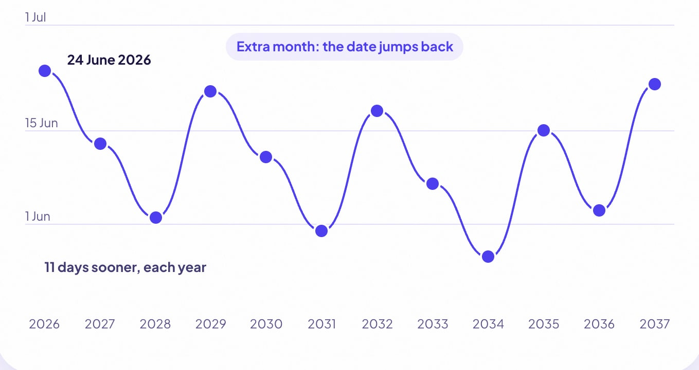

Ask an elder in your family about your birthday, and they may not give you a date. They may give you a **tithi**, like "Shukla Dashami in Jyeshtha". That is your birthday by the moon. It comes back every year, but almost never on the same calendar date.

Here is why, in plain words.

## Two calendars, one birthday

The calendar on your wall follows the **sun**. One trip around the sun is 365 days, so your calendar birthday comes back after 365 days.

The Hindu calendar also follows the **moon**. A moon month runs from one new moon to the next, about 29.5 days. Inside that month there are 30 tithis. A tithi is one step of the moon moving away from the sun: each time the gap between them grows by 12°, a new tithi starts.

Your tithi birthday is the day your tithi comes back, in the same moon month you were born in. Our guide explains [what a tithi birthday is and how to find yours](/blog/tithi-birthday), step by step.

## Twelve moon months are short

Twelve moon months add up to about **354 days**. That is about **11 days shorter** than a calendar year.

So if nothing else happened, your tithi birthday would come about 11 days sooner every year. After a few years it would be in a different season.

## The extra month

The Hindu calendar does not let that happen. About every two or three years, it adds an **extra moon month**, called an adhika masa. That happens about 7 times every 19 years.

When an extra month comes, your tithi birthday jumps back by about 19 days. Then it starts creeping earlier again.

## A real example

Here is one tithi, Shukla Dashami in the month of Jyeshtha, at New Delhi. These dates come straight from Tithi Vidya.

| Year | Date | What happened |
| --- | --- | --- |
| 2026 | 24 June | |
| 2027 | 13 June | 11 days sooner |
| 2028 | 2 June | 11 days sooner |
| 2029 | 21 June | Jumped back: an extra month (Adhika Chaitra) came first |
| 2030 | 11 June | 10 days sooner |
| 2031 | 31 May | 11 days sooner |
| 2032 | 18 June | Jumped back: an extra month (Adhika Bhadrapada) came first |
| 2033 | 7 June | 11 days sooner |
| 2034 | 27 May | 11 days sooner |
| 2035 | 15 June | Jumped back: an extra month (Adhika Ashadha) came first |
| 2036 | 3 June | 12 days sooner |
| 2037 | 22 June | Jumped back: an extra month (Adhika Jyeshtha) came first |

Over twelve years, this birthday never leaves a window of about four weeks, from 27 May to 24 June. The extra months keep it in its season.

## One more thing: sunrise

A panchang day starts at **sunrise**, not at midnight. The tithi that is running at sunrise gives the day its name. Sunrise comes at different times in different cities, so now and then the same tithi lands on different dates in two places. That is why Tithi Vidya asks where you were born.

## So which birthday is right?

Both. Your calendar birthday counts your years. Your tithi birthday follows the moon. Many families use the tithi birthday for prayers and blessings.

You can find yours in a minute: enter your birth date, time and place on [Find my tithi](/find). If you want to see exactly how it works, and how it was tested, read [How it works](/how-it-works).
